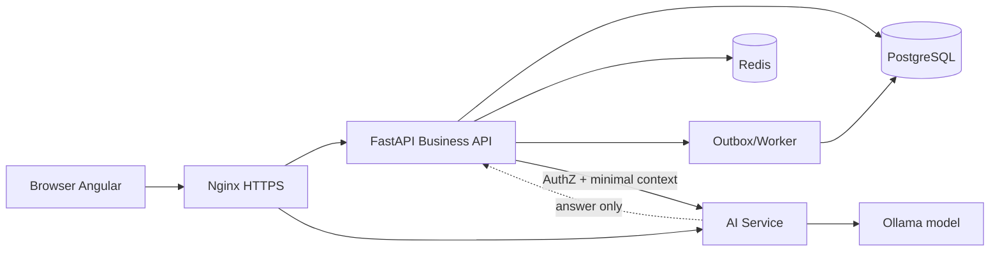
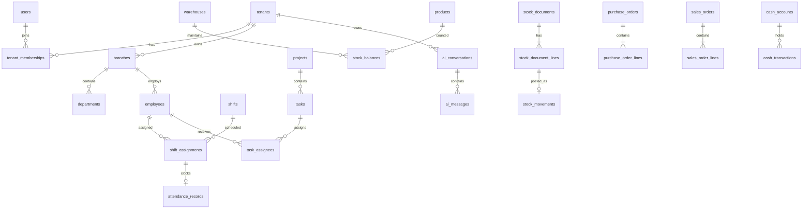

# OMNICORE AI — BUSINESS DESIGN (MVP)

> **Tên đề tài:** Thiết kế và phát triển nền tảng quản trị doanh nghiệp hợp nhất tích hợp trợ lý trí tuệ nhân tạo  
> **Document ID:** OCA-BD-MVP-003 | **Version:** 3.1 (DD-Ready Baseline) | **Ngày:** 15/11/2026  
> **Trạng thái:** REVIEW CANDIDATE — bản chuẩn hóa đầu vào cho DD API / DD Screen, chưa phải mã nguồn đã triển khai hoặc đặc tả kỹ thuật cuối cùng.  
> **Loại tài liệu:** Business Requirements + Functional Specifications + Software Requirements + Architecture + UI/API/Data Specification (gộp một file).  
> **Đối tượng:** Product Owner, BA, Tech Lead, Frontend/Backend Engineer, QA, DevOps, doanh nghiệp pilot.  
> **Quy ước:** Mọi chức năng/API/bảng là **đề xuất cho sản phẩm mới**; các quyết định chuẩn hóa v3.1 ở §15–§21 có hiệu lực cao hơn mô tả tổng quan trước đó nếu có khác biệt. Các hợp đồng OpenAPI và DD Screen chi tiết vẫn cần được tạo và phê duyệt từ baseline này.

---

## 1. Mục tiêu và giới hạn MVP

### 1.1 Vấn đề cần giải quyết

Doanh nghiệp nhỏ thường quản lý nhân viên bằng bảng tính, chấm công thủ công, giao việc qua tin nhắn, ghi chép kho và thu/chi rời rạc. Hệ quả: trùng dữ liệu, không truy vết được sai lệch, báo cáo chậm và chủ doanh nghiệp thiếu góc nhìn tổng thể.

**Giải pháp:** một web app responsive, mỗi doanh nghiệp có vùng dữ liệu riêng; nhân viên thao tác theo quyền; các phân hệ liên kết bằng chứng từ và khóa ngoại; dashboard đọc dữ liệu hệ thống; AI hỗ trợ hỏi đáp **chỉ đọc**.

### 1.2 Nhóm người dùng

| Role code | Phạm vi chính | Chú ý |
|---|---|---|
| `OWNER` | Toàn tenant, quản lý chủ sở hữu, dashboard | Không xóa chủ sở hữu cuối |
| `ADMIN` | Cấu hình, user, chi nhánh, dữ liệu được ủy quyền | Không tự nâng lên OWNER |
| `MANAGER` | Nhân viên, bảng công, task trong chi nhánh | Theo scope chi nhánh |
| `HR` | Nhân viên, ca, công, duyệt công | Không mặc định quyền tiền |
| `WAREHOUSE` | Sản phẩm, kho, chứng từ kho | Chỉ kho được cấp |
| `PURCHASER` | Nhà cung cấp, đơn mua | Không tự ghi sổ quỹ |
| `SALES` | Khách hàng, đơn bán | Không tự ghi sổ quỹ |
| `ACCOUNTANT` | Thu chi, công nợ đơn giản, đối chiếu | Không mặc định chỉnh nhân sự |
| `EMPLOYEE` | Check-in/out, nhiệm vụ được giao, yêu cầu chỉnh công | Chỉ dữ liệu bản thân |

Một tài khoản có thể có nhiều role; quyền hiệu lực = phép hợp nhất quyền **trong phạm vi chi nhánh được cấp**; deny/tenant boundary luôn ưu tiên. Phê duyệt phải qua BE, không dựa vào ẩn nút trên FE.

### 1.3 Trong phạm vi (P0)

- Doanh nghiệp, chi nhánh, phòng ban, nhân viên, tài khoản và phân quyền.
- Ca làm việc, chấm công, chỉnh công có phê duyệt.
- Công việc, dự án đơn giản, Kanban, bình luận và thông báo.
- Sản phẩm, kho, tồn, phiếu nhập/xuất, kiểm soát tồn âm.
- Đơn mua/đơn bán và liên kết nhập/xuất kho.
- Sổ thu/chi và liên kết thanh toán đơn (không thay thế kế toán tổng hợp).
- Dashboard, báo cáo CSV, trợ lý AI hỏi dữ liệu **read-only**.

### 1.4 Ngoài MVP (P1/P2)

Tính lương, bảo hiểm, thuế, hóa đơn điện tử pháp lý, kế toán bút toán kép, báo cáo tài chính chuẩn, POS, thanh toán ngân hàng trực tiếp, CRM nâng cao, hợp đồng, tuyển dụng, tài sản, vận chuyển, quản trị chuỗi cung ứng nâng cao, đa tiền tệ giao dịch, phê duyệt nhiều cấp tùy biến, AI tự động ghi/sửa dữ liệu, tích hợp phần cứng chấm công, app native, dự báo chuyên sâu. **Không gọi sổ thu chi MVP là hệ thống kế toán đạt chuẩn.**

### 1.5 Nguyên tắc nền tảng

1. Mọi tài nguyên nghiệp vụ thuộc một `tenant_id`; lọc quyền tại server; chi nhánh là scope phụ.
2. `employee` là hồ sơ nhân sự, `user` là tài khoản đăng nhập; chỉ user có membership ACTIVE và employee ACTIVE được liên kết mới dùng chấm công/tác vụ self-service. Một nhân viên không mặc nhiên có tài khoản.
3. Chứng từ kho/thu chi sau khi `POSTED` là bất biến. Sai sót phải qua phiếu điều chỉnh (kho) hoặc phiếu đảo (tiền) có lý do, tham chiếu gốc và audit; không sửa ngầm.
4. API command thay đổi tồn/số dư cần idempotency key, transaction và row lock.
5. Số tiền lưu `numeric(18,2)`, số lượng `numeric(18,3)`, giá vốn `numeric(18,4)`; không dùng float. Làm tròn `ROUND_HALF_UP` ở monetary line total, giá vốn giữ 4 chữ số nội bộ; tính bằng `Decimal` phía server.
6. Tất cả thời điểm được lưu UTC; giao diện hiển thị theo timezone tenant. Dữ liệu ngày ca có `work_date` riêng.
7. Không đồng nhất **doanh số** (đơn đã giao) với **tiền thu** (phiếu thu đã ghi sổ).
8. AI không trực tiếp được quyền đọc DB hoặc quyết định thay con người; API cấp dữ liệu đã được lọc theo quyền.

## 2. Kiến trúc triển khai và công nghệ

### 2.1 Công nghệ sử dụng

| Lớp | Công nghệ | Nhiệm vụ |
|---|---|---|
| Frontend | Angular 22, TypeScript, RxJS, Angular Router/Forms, CSS tokens | Web responsive; feature-based modules |
| Backend | Python 3.12+, FastAPI, Pydantic v2, SQLAlchemy, Alembic | REST APIs, business rules, transaction |
| Database | PostgreSQL | Nguồn dữ liệu chuẩn, FK, transaction, index |
| Cache/async | Redis, worker Python | Cache dashboard ngắn hạn, rate limit, hàng đợi notification (tùy nhu cầu) |
| AI | FastAPI service + HTTPX + Ollama | Tóm tắt/phân tích dữ liệu đã được authorize |
| Infra | Nginx, Docker Compose, HTTPS, Linux | Reverse proxy, deploy, health checks |
| Tests | pytest, Vitest, Ruff, mypy | Unit, integration, contract, FE test |

**Lựa chọn kiến trúc:** *modular monolith* cho nghiệp vụ ERP (để đảm bảo ACID với đơn hàng/tồn/thu chi); AI service tách riêng. Không chia microservices chỉ vì số lượng mô-đun.

### 2.2 Sơ đồ thành phần



- Không để browser gọi PostgreSQL/Ollama trực tiếp.
- AI service chỉ nhận dữ liệu đã lọc do Business API gửi; mọi tool gọi lại qua proxy đã xác thực và authorize.
- Công việc ghi sổ thực hiện **đồng bộ trong PostgreSQL transaction**, không đợi hàng đợi.
- Worker chỉ xử lý thông báo, cache invalidation, export; retry không ghi thêm giao dịch trùng.

### 2.3 Cấu trúc thư mục đề xuất

```text
omnicore-ai/
├── apps/
│   ├── web/                   # Angular
│   │   └── src/app/
│   │       ├── core/          # auth, http, guards, config, interceptors
│   │       ├── shared/        # UI kit, pipes, utilities
│   │       └── features/      # core, hr, attendance, tasks, inventory,
│   │                          # purchases, sales, finance, dashboard, ai
│   ├── api/                   # FastAPI
│   │   ├── app/core/          # DB, auth, settings, policies, audit
│   │   ├── app/modules/       # các bounded context nghiệp vụ
│   │   │   └── inventory/     # router, schemas, service, repository, models
│   │   ├── migrations/        # Alembic
│   │   └── tests/
│   └── ai-api/                # FastAPI/Ollama adapter
├── contracts/                 # OpenAPI, JSON schemas, event contracts
├── infra/                     # Docker, Nginx, env samples
└── docs/                      # BD, ADR, test plans
```

**Luật code:** Router chỉ parse HTTP; Service giữ state machine/transaction; Repository truy vấn dữ liệu theo tenant; Pydantic xác thực schema; FE component chỉ xử lý trình bày; data-access gọi API client. Đường kết nối module qua domain service công khai, không truy cập tùy tiện repository module khác.

### 2.4 Data-flow và bảo mật

1. Browser gửi Bearer JWT → Nginx → FastAPI; JWT phải có chữ ký, expiry, audience.
2. Dependency xác thực user → resolve `tenant_id` từ path → membership ACTIVE → permission và branch scope.
3. Query lọc bắt buộc theo tenant; kiểm tra FK xuyên tenant ngay cả khi ID UUID hợp lệ; có thể bổ sung PostgreSQL RLS làm defense-in-depth.
4. Service mở transaction, thay đổi aggregate, ghi `audit_logs` và `outbox_events`, commit một lần.
5. Worker phát notification, không làm thay đổi kết quả nghiệp vụ đã commit.

## 3. Quy ước đặc tả chung

### 3.1 Traceability

`Business Goal -> Module -> UC -> Screen -> API -> DB -> Acceptance Test`. ID là duy nhất trong file. Module ID: `CORE`, `HR`, `ATT`, `TASK`, `INV`, `PUR`, `SAL`, `FIN`, `DASH`, `AI`.

### 3.2 API chuẩn

- Root: `/api/v1`; ký hiệu `T` trong catalog thay cho `/tenants/{tenantId}`.
- Header: `Authorization: Bearer <JWT>`; command ghi dữ liệu quan trọng dùng `Idempotency-Key: <UUID>`; PATCH dùng `version` optimistic lock.
- Listing: `page >= 1`, `size` mặc định 20 tối đa 100; trả `meta.total`, `meta.page`, `meta.size`.
- Time ISO-8601 UTC; date ISO `YYYY-MM-DD`; UUID v4; giá trị tiền theo tiền tệ tenant; không tự đổi tiền tệ MVP.
- Không truyền `tenantId` trong body, không tin userId/role do FE gửi.

**Envelope thành công:**

```json
{"success":true,"businessCode":"OK","message":"Success","data":{"id":"uuid"},"meta":{"page":1,"size":20,"total":1},"traceId":"req-123"}
```

**Envelope lỗi:**

```json
{"success":false,"businessCode":"STOCK_INSUFFICIENT","message":"Không đủ tồn kho","data":null,"meta":{"fields":[],"details":{"available":"4.000","requested":"7.000"}},"traceId":"req-124"}
```

| HTTP | businessCode điển hình | Quy tắc |
|---|---|---|
| 400 | `BAD_REQUEST` | Request sai cấu trúc |
| 401 | `UNAUTHENTICATED` | Thiếu/hết phiên |
| 403 | `FORBIDDEN` | Không có quyền |
| 404 | `NOT_FOUND` | Resource không tồn tại hoặc bị che bởi tenant boundary |
| 409 | `CONFLICT`, `STATE_CONFLICT`, `VERSION_CONFLICT`, `STOCK_INSUFFICIENT` | Xung đột trạng thái/tồn |
| 422 | `VALIDATION_ERROR`, `INVALID_REFERENCE` | Sai field hoặc liên kết |
| 429 | `RATE_LIMITED` | Quá ngưỡng API/AI |
| 503 | `AI_UNAVAILABLE` | AI service lỗi/timeout |

### 3.3 Trạng thái UI bắt buộc

`loading`, `empty`, `ready`, `validation-error`, `forbidden`, `server-error`, `conflict`, `submitting`, `success`. Mọi thao tác POST/PATCH phải disable nút khi gửi, có xác nhận khi ghi sổ hoặc hủy, reload dữ liệu nếu 409, thông báo lỗi và `traceId` khi liên hệ hỗ trợ.

### 3.4 Phân quyền theo scope

- `tenant`: OWNER/ADMIN trong tenant.
- `branch`: manager/HR/warehouse/sales theo chi nhánh hoặc kho được cấp.
- `self`: employee chỉ xem hồ sơ, chấm công, task của mình.
- `assigned`: task chỉ người được giao, creator hoặc manager cùng scope được xem/chỉnh.
- `financial`: chỉ ACCOUNTANT/OWNER/ADMIN có permission tương ứng.
- `ai`: không mở rộng quyền đọc của người hỏi; AI được quyền thấy ít hơn hoặc bằng người hỏi.

### 3.5 Trạng thái chứng từ

| Aggregate | States & allowed transitions |
|---|---|
| Purchase Order | `DRAFT → CONFIRMED → PARTIALLY_RECEIVED → RECEIVED`; `DRAFT → CANCELLED` |
| Sales Order | `DRAFT → CONFIRMED → PARTIALLY_FULFILLED → FULFILLED`; `DRAFT → CANCELLED` |
| Stock Document | `DRAFT → POSTED`; `DRAFT → CANCELLED`; không sửa POSTED |
| Cash Transaction | `DRAFT → POSTED`; `DRAFT → CANCELLED`; không sửa POSTED |
| Attendance Adjustment | `PENDING → APPROVED/REJECTED` |
| Task | `TODO → IN_PROGRESS → IN_REVIEW → DONE`; `IN_REVIEW → IN_PROGRESS`; có thể `IN_PROGRESS → TODO` nếu manager thực hiện và có lý do |

`POSTED` là hành động server-side phân biệt với HTTP POST. Mọi transition có quyền riêng và audit log. Sửa sai sau ghi sổ: kho dùng phiếu điều chỉnh có tham chiếu chứng từ gốc; tiền dùng API-082 tạo phiếu đảo bất biến. Hai thao tác đều cần quyền và lý do; tuyệt đối không sửa trực tiếp stock_movements/cash_transactions đã POSTED.

---
## 4. Danh mục module và khả năng

| Module | Nhóm | Phạm vi |
|---|---|---|
| `CORE` | Nền tảng & phân quyền | Quản lý tài khoản, doanh nghiệp, chi nhánh, vai trò và cấu hình. |
| `HR` | Nhân sự | Hồ sơ nhân viên, phòng ban và trạng thái làm việc. |
| `ATT` | Chấm công & ca làm | Xếp ca, check-in/out, đối soát công và yêu cầu chỉnh công. |
| `TASK` | Công việc & dự án | Giao nhiệm vụ, theo dõi tiến độ, kiểm tra kết quả. |
| `INV` | Sản phẩm & kho | Danh mục sản phẩm, tồn kho, nhập/xuất/điều chỉnh có chứng từ. |
| `PUR` | Mua hàng | Đơn mua hàng, nhận hàng, theo dõi thanh toán. |
| `SAL` | Bán hàng | Đơn bán, xuất giao hàng, theo dõi thu tiền. |
| `FIN` | Sổ thu chi | Quản lý tài khoản quỹ, phiếu thu/chi và số dư. |
| `DASH` | Báo cáo & thông báo | Dashboard điều hành, báo cáo và cảnh báo. |
| `AI` | Trợ lý AI cơ bản | Hỏi đáp và tóm tắt dữ liệu có phân quyền, chỉ đọc. |

## 5. Đặc tả chức năng & use cases

### 5.1 `CORE` — Nền tảng & phân quyền

**Yêu cầu chức năng** `FR-CORE-00`: đăng ký, tạo tenant, nhận lời mời; `FR-CORE-01`: đăng nhập và chọn doanh nghiệp; `FR-CORE-02`: quản lý chi nhánh; `FR-CORE-03`: mời tài khoản và phân vai trò; `FR-CORE-04`: audit.

**Business rules:** Email duy nhất trên hệ thống; mật khẩu băm Argon2id; người tạo tenant đầu tiên mặc định là OWNER; lời mời có TTL 72h, token hash lưu server, accept một lần và chỉ với cùng email; tenant slug duy nhất; không cấp quyền OWNER qua API thường; membership ACTIVE mới được truy cập; audit lưu thay đổi vai trò và chi nhánh. Mời user mới không đồng nghĩa tự tạo employee — liên kết khi HR tạo hồ sơ.

**Tiêu chí nghiệm thu:** Account thuộc doanh nghiệp A không truy cập được dữ liệu doanh nghiệp B; nhân viên chỉ thấy quyền đã cấp; thu hồi membership khiến token hiện hành mất hiệu lực tenant-scoped ngay khi request tiếp theo.

**Luồng nghiệp vụ:**

#### UC-01 — Đăng nhập & chọn doanh nghiệp

- **Tiền điều kiện:** Người dùng đã được mời và kích hoạt.
- **Main flow:** 0. Nếu chưa có user: SCR-40/API-075 đăng ký. Chủ doanh nghiệp mới dùng SCR-41/API-076 tạo tenant+OWNER membership. Người được mời nhận token qua SCR-42/API-077 (phải đăng nhập và email trùng lời mời). 1. Nhập email/mật khẩu ở SCR-01 → API-001. 2. Server kiểm mật khẩu hash và trạng thái tài khoản, cấp access/refresh token. 3. SCR-02 gọi API-004/005, hiển thị danh sách tenant thuộc membership ACTIVE. 4. Chọn tenant, mọi API tenant-scope xác minh membership + quyền. 5. Đăng xuất API-003 thu hồi refresh token.
- **Alternate/exception:** Sai mật khẩu → 401; bị khóa → 403; tenant không thuộc người dùng → 404/403; refresh token dùng lại → chặn phiên liên quan; lời mời hết hạn/khác email → 409/403.
- **Dữ liệu liên quan:** `users`, `tenant_memberships`, `refresh_sessions`, `tenants`.

#### UC-02 — Thêm chi nhánh và gán vai trò

- **Tiền điều kiện:** OWNER/ADMIN đang hoạt động.
- **Main flow:** 1. SCR-04 tạo chi nhánh API-009. 2. SCR-05 mời người qua API-012, tạo tenant_invitations token hash và gửi URL một lần. 3. Người nhận đăng nhập (đăng ký nếu chưa có), API-077 xác thực email user khớp email được mời, hạn token và tenant trước khi tạo membership + role/branch từ lời mời; token được đánh dấu ACCEPTED trong transaction. 4. API-013 cập nhật quyền theo chi nhánh; ghi audit.
- **Alternate/exception:** Mã chi nhánh trùng → 409; không được cấp vai trò OWNER → 403; không cho xóa/chặn OWNER cuối cùng.
- **Dữ liệu liên quan:** `branches`, `tenant_memberships`, `membership_roles`, `roles`, `audit_logs`.

**Trace:** Screens SCR-01, SCR-40, SCR-41, SCR-42, SCR-02, SCR-03, SCR-04, SCR-05, SCR-06; APIs API-001, API-002, API-003, API-004, API-005, API-006, API-007, API-008, API-009, API-010, API-011, API-012, API-013, API-014, API-075, API-076, API-077.

### 5.2 `HR` — Nhân sự

**Yêu cầu chức năng** `FR-HR-01`: lập hồ sơ; `FR-HR-02`: phân phòng ban; `FR-HR-03`: đổi trạng thái nhân viên.

**Business rules:** Mã nhân viên duy nhất theo tenant; employee có thể không có account; mỗi nhân viên thuộc đúng một chi nhánh và có thể một phòng ban; phòng ban phải cùng chi nhánh; không xóa vật lý nhân viên đã có attendance/tasks/orders.

**Tiêu chí nghiệm thu:** Tạo nhân viên trùng mã trả 409; chuyển phòng ban phải kiểm quan hệ branch; MANAGER chỉ thấy người cùng scope, EMPLOYEE chỉ xem hồ sơ bản thân.

**Luồng nghiệp vụ:**

#### UC-03 — Thêm và điều chuyển nhân viên

- **Tiền điều kiện:** HR có employee.write.
- **Main flow:** 1. SCR-08 nhận mã nhân viên, họ tên, chi nhánh/phòng ban. 2. API-016 xác thực dữ liệu, tạo employee độc lập với user. 3. Có thể liên kết account nếu người đó đăng nhập. 4. SCR-09 chỉnh phòng ban/status qua API-018 và lưu audit. 5. Danh sách SCR-07 phản ánh thay đổi.
- **Alternate/exception:** Mã nhân viên trùng trong tenant → 409; phòng ban không thuộc tenant/branch → 422; nhân viên có ca đang chạy không thể vô hiệu hóa ngay nếu chưa đóng công.
- **Dữ liệu liên quan:** `employees`, `departments`, `branches`, `users`, `audit_logs`.

**Trace:** Screens SCR-07, SCR-08, SCR-09, SCR-10; APIs API-015, API-016, API-017, API-018, API-019, API-020.

### 5.3 `ATT` — Chấm công & ca làm

**Yêu cầu chức năng** `FR-ATT-01`: cấu hình ca; `FR-ATT-02`: xếp lịch; `FR-ATT-03`: check-in/out; `FR-ATT-04`: duyệt chỉnh công; `FR-ATT-05`: báo cáo bảng công.

**Business rules:** Một assignment tối đa một bản ghi công; check-in/out ghi thời gian server (clientTimestamp chỉ dùng tham khảo); không cho check-out trước check-in; phút làm việc = chênh lệch hai mốc, không tự trừ nghỉ giữa ca nếu chưa có cấu hình; đi muộn tính theo planned_start_at+grace; ca qua đêm lưu start/end UTC chuẩn. Người phê duyệt khác người gửi; chỉnh công lưu lịch sử.

**Tiêu chí nghiệm thu:** Check-in cùng lúc ở hai thiết bị không tạo hai record; ca qua đêm có thời lượng đúng; bản ghi công sau phê duyệt có audit before/after.

**Luồng nghiệp vụ:**

#### UC-04 — Xếp ca và chấm công

- **Tiền điều kiện:** Có employee ACTIVE, shift assignment hợp lệ.
- **Main flow:** 1. HR tạo mẫu ca ở SCR-13 (API-026) và phân ca qua API-027. 2. Nhân viên SCR-11 gọi API-021 xem ca. 3. Nhấn check-in API-022; backend dùng thời gian server và tính đi muộn. 4. Check-out API-023, tính phút làm việc. 5. SCR-12 tổng hợp bảng công API-024.
- **Alternate/exception:** Check-in 2 lần cùng assignment → 409/idempotent replay; check-out khi chưa check-in → 409; quá thời điểm có thể tạo yêu cầu chỉnh; ca qua đêm xử lý bằng start_at/end_at UTC.
- **Dữ liệu liên quan:** `shifts`, `shift_assignments`, `attendance_records`.

#### UC-05 — Yêu cầu chỉnh công

- **Tiền điều kiện:** Nhân viên có lịch hoặc chứng cứ hợp lệ.
- **Main flow:** 1. SCR-14 gửi API-028 kèm thời gian đề nghị, lý do. 2. HR/quản lý truy vấn API-029. 3. Người phê duyệt khác người đề nghị gọi API-030. 4. APPROVED cập nhật bản ghi công trong transaction và giữ lịch sử before/after. 5. Tự động thông báo kết quả.
- **Alternate/exception:** Tự phê duyệt → 403; yêu cầu đã xử lý → 409; điều chỉnh khiến out < in → 422; kỳ đã khóa (nếu có) → 409.
- **Dữ liệu liên quan:** `attendance_adjustments`, `attendance_records`, `notifications`, `audit_logs`.

**Trace:** Screens SCR-11, SCR-12, SCR-13, SCR-14; APIs API-021, API-022, API-023, API-024, API-025, API-026, API-027, API-028, API-029, API-030.

### 5.4 `TASK` — Công việc & dự án

**Yêu cầu chức năng** `FR-TASK-01`: tạo/giao việc; `FR-TASK-02`: board; `FR-TASK-03`: đổi trạng thái; `FR-TASK-04`: bình luận; `FR-TASK-05`: dự án đơn giản.

**Business rules:** `priority ∈ {LOW,MEDIUM,HIGH,URGENT}`; creator/manager có thể đổi nội dung, assignee chỉ đổi trạng thái task được giao; task DONE phải có ít nhất một assignee; tỷ lệ tiến độ dự án = số task DONE / tổng task (0 task => 0%, không chia 0); không cho assign nhân viên INACTIVE.

**Tiêu chí nghiệm thu:** Task hiện trên board đúng cột; employee không thể cập nhật task không được giao; comment chỉ hiện với người có task.read.

**Luồng nghiệp vụ:**

#### UC-06 — Giao việc và theo dõi tiến độ

- **Tiền điều kiện:** Người giao có task.create và thấy người nhận.
- **Main flow:** 1. Tạo task ở SCR-16 API-033; lưu task + assignees. 2. Người nhận thấy task ở SCR-15 API-031/032. 3. SCR-17 thay trạng thái TODO→IN_PROGRESS→IN_REVIEW→DONE API-035, bình luận API-036. 4. Mỗi thay đổi phát thông báo. 5. Dự án (nếu gắn) tự tổng hợp tỷ lệ DONE.
- **Alternate/exception:** Người nhận ngoài tenant → 422; deadline < created_at → 422; version xung đột → 409; nhân viên chỉ được sửa trạng thái task được giao, không tự đổi assignee.
- **Dữ liệu liên quan:** `projects`, `tasks`, `task_assignees`, `task_comments`, `notifications`.

**Trace:** Screens SCR-15, SCR-16, SCR-17, SCR-18; APIs API-031, API-032, API-033, API-034, API-035, API-036, API-037, API-038.

### 5.5 `INV` — Sản phẩm & kho

**Yêu cầu chức năng** `FR-INV-01`: SKU/kho; `FR-INV-02`: tồn thực tế; `FR-INV-03`: phiếu nhập/xuất; `FR-INV-04`: điều chỉnh; `FR-INV-05`: audit movement.

**Hủy phiếu:** DRAFT có thể hủy bằng API-078 (bắt buộc lý do), POSTED không hủy; nếu sai sau ghi sổ, tạo phiếu ADJUST_IN/ADJUST_OUT có `source_type=CORRECTION`, `source_id` trỏ phiếu gốc và audit, chỉ người có stock.post được ghi sổ.

**Business rules:** Tồn khả dụng MVP = `stock_balances.quantity`; không có reservation. Phiếu kho dùng `IN`, `OUT`, `ADJUST_IN`, `ADJUST_OUT`; loại IN có `unit_cost` để tính giá vốn bình quân, OUT snapshot giá vốn tại thời điểm post. Công thức bình quân khi nhập: `(old_qty*old_avg + in_qty*in_cost)/(old_qty+in_qty)`; khi xuất giữ `avg_unit_cost` cũ. Đơn hàng muốn giao phải đủ tồn tại thời điểm post, không được giả định đủ tồn khi xác nhận đơn.

**Tiêu chí nghiệm thu:** Hai lệnh xuất đồng thời cùng SKU không làm tồn âm; một dòng movement tương ứng duy nhất với một document_line; không thể sửa phiếu POSTED; kiểm kê điều chỉnh chỉ qua chứng từ.

**Luồng nghiệp vụ:**

#### UC-07 — Nhập/xuất/điều chỉnh kho thủ công

- **Tiền điều kiện:** Có kho, SKU hoạt động, quyền stock.write và stock.post.
- **Main flow:** 1. Kho tạo DRAFT phiếu tại SCR-22 API-045, gồm type=IN/OUT/ADJUST_IN/ADJUST_OUT và lines. 2. SCR-23 API-046 hiển thị kiểm tra. 3. Người có stock.post gọi API-047. 4. Trong một DB transaction: khóa stock_balances theo tenant+warehouse+product; validate không tồn âm; ghi stock_movements bất biến; cập nhật balance; đánh dấu phiếu POSTED; outbox event. 5. SCR-21 thể hiện tồn mới.
- **Alternate/exception:** Số lượng <= 0 → 422; xuất vượt tồn → 409 STOCK_INSUFFICIENT; ghi sổ 2 lần → trả kết quả cũ theo idempotency; sai version → 409; phiếu POSTED không được sửa.
- **Dữ liệu liên quan:** `stock_documents`, `stock_document_lines`, `stock_balances`, `stock_movements`, `outbox_events`.

**Trace:** Screens SCR-19, SCR-20, SCR-21, SCR-22, SCR-23; APIs API-039, API-040, API-041, API-042, API-043, API-044, API-045, API-046, API-047, API-078.

### 5.6 `PUR` — Mua hàng

**Yêu cầu chức năng** `FR-PUR-01`: danh bạ nhà cung cấp; `FR-PUR-02`: lập PO; `FR-PUR-03`: xác nhận; `FR-PUR-04`: nhận hàng từng phần; `FR-PUR-05`: theo dõi đã trả/còn trả.

**Hủy đơn:** Chỉ PO DRAFT chưa nhận hàng được hủy bằng API-080; không hủy đơn xác nhận khi đã có phiếu nhận đang chờ hoặc đã ghi sổ.

**Business rules:** Supplier có type SUPPLIER/BOTH. PO total = Σ(qty*unit_price) dùng Decimal; sau CONFIRMED khóa giá và SKU; mỗi yêu cầu receive tạo một stock_document IN DRAFT; chỉ **khi post kho thành công** mới tăng `qty_received`; phép receive đồng thời phải lock order lines để không nhận vượt. Số phải trả hiển thị theo giá trị hàng đã nhận, tiền đã trả theo cash_transaction POSTED; không thay thế AP ledger.

**Tiêu chí nghiệm thu:** Receive 3/10 rồi 7/10 đạt RECEIVED; lần nhận thêm 1 phải 409; khi phiếu kho chưa POSTED số đã nhận vẫn bằng 0; ghi phiếu chi không làm tăng tồn.

**Luồng nghiệp vụ:**

#### UC-08 — Mua hàng → nhận kho → theo dõi công nợ

- **Tiền điều kiện:** Có supplier ACTIVE và warehouse.
- **Main flow:** 1. SCR-25 tạo PO DRAFT API-049. 2. API-051 xác nhận; khóa đơn giá và số lượng đã xác nhận. 3. API-052 nhận hàng từng phần, tạo stock_document DRAFT type IN tham chiếu PO. 4. Thủ kho kiểm tra và post API-047. 5. Transaction ghi tồn và tăng qty_received. 6. Kế toán lập phiếu chi liên kết PO qua API-063, post API-065; số tiền còn phải trả = giá trị PO nhận hợp lệ trừ phiếu chi POSTED.
- **Alternate/exception:** Nhận vượt số lượng chưa nhận → 409; SKU sai với PO → 422; PO chưa confirm → 409; phiếu kho thất bại thì qty_received không tăng; không tự động coi nhập kho là đã thanh toán.
- **Dữ liệu liên quan:** `counterparties`, `purchase_orders`, `purchase_order_lines`, `stock_documents`, `stock_movements`, `cash_transactions`.

**Trace:** Screens SCR-24, SCR-25, SCR-26, SCR-27; APIs API-048, API-049, API-050, API-051, API-052, API-053, API-054, API-080.

### 5.7 `SAL` — Bán hàng

**Yêu cầu chức năng** `FR-SAL-01`: tạo SO; `FR-SAL-02`: xác nhận; `FR-SAL-03`: xuất giao từng phần; `FR-SAL-04`: theo dõi đã thu/còn thu.

**Hủy đơn:** Chỉ SO DRAFT chưa giao hàng được hủy bằng API-081; không hủy đơn xác nhận khi đã tạo phiếu xuất đang chờ hoặc đã ghi sổ.

**Business rules:** Khách lẻ được phép để customer NULL; tổng = Σ(qty*price); khi xác nhận khóa giá; API dispatch chỉ tạo chứng từ OUT DRAFT; khi kho POSTED mới tăng `qty_dispatched` và giảm tồn; doanh số kỳ = giá trị dòng hàng thực giao trong kỳ (dựa trên posted movement và giá SO), không tính DRAFT/CONFIRMED chưa giao. Đơn bán có thể chưa thu tiền; số phải thu = giá trị đã giao - phiếu thu POSTED.

**Tiêu chí nghiệm thu:** Xuất 2/5 rồi 3/5 đạt FULFILLED; xuất vượt tồn 409 và không thay đổi qty_dispatched; số đã thu không vượt quá giá trị được thu theo chính sách pilot (nếu thu trước thì ghi rõ là tiền ứng trước, ngoài MVP).

**Luồng nghiệp vụ:**

#### UC-09 — Bán hàng → xuất kho → ghi nhận tiền

- **Tiền điều kiện:** Có hàng và quyền bán hàng.
- **Main flow:** 1. SCR-29 API-056 lập SO DRAFT; API-058 xác nhận. 2. API-059 tạo phiếu OUT DRAFT cho số lượng giao. 3. Kho post API-047 → giảm tồn, tăng qty_dispatched; SO chuyển PARTIALLY_FULFILLED/FULFILLED. 4. Kế toán tạo phiếu thu API-063 tham chiếu SO, post API-065. 5. Dashboard thể hiện doanh số đơn đã giao và tiền thực thu ở hai KPI riêng.
- **Alternate/exception:** Xuất vượt tồn → 409; giao vượt số lượng còn lại → 409; thay giá sau confirm không cho phép; đơn chưa giao không được tính doanh số đã giao; hoàn trả đưa sang P1.
- **Dữ liệu liên quan:** `counterparties`, `sales_orders`, `sales_order_lines`, `stock_documents`, `stock_movements`, `cash_transactions`.

**Trace:** Screens SCR-28, SCR-29, SCR-30; APIs API-055, API-056, API-057, API-058, API-059, API-081.

### 5.8 `FIN` — Sổ thu chi

**Yêu cầu chức năng** `FR-FIN-01`: tài khoản quỹ; `FR-FIN-02`: phiếu thu chi; `FR-FIN-03`: ghi sổ; `FR-FIN-04`: báo cáo số dư; `FR-FIN-05`: đối chiếu đơn nguồn.

**Business rules:** Phiếu `IN` tăng balance, `OUT` giảm balance; `opening_balance + SUM(POSTED IN) - SUM(POSTED OUT) = current_balance`. Mọi post khóa `cash_accounts` theo transaction; nguồn `SALES` chỉ cho IN gắn sales_order_id, `PURCHASE` chỉ cho OUT gắn purchase_order_id, `MANUAL` không gắn đơn; không chấp nhận tổng thanh toán lớn hơn giá trị đủ điều kiện, trừ khi có quy tắc ứng trước được bổ sung. Đây là **cashbook**, không phải GL.

**Cơ chế sửa sai:** DRAFT được hủy API-079; POSTED được đảo bằng API-082 tạo một giao dịch POSTED mới với `kind` ngược và `reversal_of_id` trỏ chứng từ gốc, lý do bắt buộc, idempotent và kiểm tra đủ số dư tại thời điểm đảo. Chỉ được đảo một lần; chứng từ gốc vẫn giữ nguyên. Giao dịch REVERSAL không tính là tiền khách trả/nhà cung cấp nhận mới trong báo cáo đơn hàng.

**Tiêu chí nghiệm thu:** Post hai lần không tăng tiền hai lần; không cho quỹ âm khi allow_negative=false; phiếu đã POSTED không sửa số tiền; đối chiếu số dư chạy đúng với báo cáo.

**Luồng nghiệp vụ:**

#### UC-10 — Lập và ghi sổ phiếu thu chi

- **Tiền điều kiện:** Có cash_account ACTIVE, ACCOUNTANT được phân quyền.
- **Main flow:** 1. SCR-33 API-063 tạo DRAFT IN/OUT có số tiền > 0; source MANUAL/SALES/PURCHASE. 2. SCR-34 kiểm tra thông tin. 3. API-065 post trong transaction với khóa tài khoản quỹ; cập nhật balance và đóng trạng thái; ghi audit/outbox. 4. SCR-32 API-062 hiển thị sổ và đối chiếu đơn nguồn. 5. Báo cáo kỳ tính SUM(IN)-SUM(OUT) trên phiếu POSTED.
- **Alternate/exception:** Số dư âm nếu cấm thấu chi → 409; một yêu cầu post lặp lại → replay-safe; nguồn đơn không cùng tenant → 422; POSTED không chỉnh trực tiếp; dùng API-082 đảo phiếu có kiểm soát ngay trong MVP.
- **Dữ liệu liên quan:** `cash_accounts`, `cash_transactions`, `audit_logs`, `outbox_events`.

**Trace:** Screens SCR-31, SCR-32, SCR-33, SCR-34; APIs API-060, API-061, API-062, API-063, API-064, API-065, API-079, API-082.

### 5.9 `DASH` — Báo cáo & thông báo

**Yêu cầu chức năng** `FR-DASH-01`: KPI tổng; `FR-DASH-02`: báo cáo theo module; `FR-DASH-03`: xuất CSV; `FR-DASH-04`: thông báo.

**Business rules:** Dashboard hiển thị: số nhân viên ACTIVE, nhân viên có công hôm nay, task quá hạn, SKU dưới ngưỡng, doanh số hàng đã giao, tổng tiền thu, tổng tiền chi. KPI phải ghi rõ kỳ và branch scope; cache ≤ 60 giây; không cộng doanh số với tiền thu. Report code MVP = `attendance`, `tasks`, `stock`, `sales`, `cashbook`.

**Tiêu chí nghiệm thu:** Lọc chi nhánh không lộ dữ liệu khác; report CSV cùng số liệu với API JSON ở cùng filter; thông báo chỉ người nhận đọc được.

**Luồng nghiệp vụ:**

#### UC-11 — Theo dõi dashboard và báo cáo

- **Tiền điều kiện:** Dữ liệu nghiệp vụ có quyền đọc.
- **Main flow:** 1. SCR-35 API-066 nhận kỳ, chi nhánh. 2. BE tổng hợp công việc quá hạn, công ngày, tồn dưới ngưỡng, đơn đã giao, tiền thu/chi. 3. Mỗi KPI ghi rõ thời điểm tính và công thức. 4. SCR-36 gọi API-067 và xuất API-068. 5. Dùng API-069/070 để xử lý thông báo cá nhân.
- **Alternate/exception:** Không có dữ liệu → zero/empty thay vì lỗi; chưa có quyền phân hệ → ẩn KPI hoặc denied; export quá lớn → 202 và link tải tạm thời.
- **Dữ liệu liên quan:** `tasks`, `attendance_records`, `stock_balances`, `sales_orders`, `cash_transactions`, `notifications`.

**Trace:** Screens SCR-35, SCR-36, SCR-37; APIs API-066, API-067, API-068, API-069, API-070.

### 5.10 `AI` — Trợ lý AI cơ bản

**Yêu cầu chức năng** `FR-AI-01`: tạo hội thoại; `FR-AI-02`: hỏi dữ liệu; `FR-AI-03`: lưu lịch sử; `FR-AI-04`: giải thích nguồn.

**Business rules:** Chỉ câu hỏi tổng hợp có thể trả lời từ API đọc (`dashboard`, `tasks`, `attendance`, `stock`, `sales`, `cashbook`) trong scope người dùng; không chạy SQL do model sinh trực tiếp; prompt không thể cấp thêm quyền; không gửi dữ liệu nhạy cảm ngoài phạm vi user; có hạn mức theo tenant/user; response phải nêu kỳ dữ liệu và từ chối khi thiếu bằng chứng. AI không được gọi API ghi dữ liệu.

**Tiêu chí nghiệm thu:** Employee hỏi số dư công ty không có quyền → từ chối; OWNER hỏi tổng tồn kho trả số liệu và nguồn; AI timeout không ảnh hưởng chức năng nghiệp vụ; lưu chat theo owner.

**Luồng nghiệp vụ:**

#### UC-12 — Hỏi đáp trợ lý dữ liệu doanh nghiệp (chỉ đọc)

- **Tiền điều kiện:** Có quyền ai.use, AI service khả dụng.
- **Main flow:** 1. SCR-38 tạo hội thoại API-071. 2. API-072 nhận câu hỏi và xác thực membership. 3. BE lập allowlist query dữ liệu đã lọc tenant, chi nhánh, role; không gửi DB credential cho LLM. 4. AI service tạo câu trả lời kèm metric/source links/độ mới dữ liệu. 5. Lưu conversation/message và hiển thị. 6. Người dùng truy cập lịch sử của mình API-073.
- **Alternate/exception:** Model timeout → 503 AI_UNAVAILABLE; không có nguồn → thông báo không đủ dữ liệu; yêu cầu đổi lương/xóa/sửa kho → từ chối và hướng dẫn thao tác thủ công; prompt injection không vượt quyền.
- **Dữ liệu liên quan:** `ai_conversations`, `ai_messages`, `audit_logs`.

**Trace:** Screens SCR-38, SCR-39; APIs API-071, API-072, API-073, API-074.

---

---

### 5.11. Đặc tả chi tiết từng chức năng (Function-by-Function Specification)

> **Mục đích của phần này:** Phần 5.1–5.10 mô tả các use case liên kết ở cấp mô-đun; mục 5.11 phân rã xuống **52 chức năng cụ thể**. Đây là phần bắt buộc để BA, UI/UX, FE, BE và QA thống nhất *người dùng dùng để làm gì; làm như thế nào; khi nào thành công, thất bại; dữ liệu đi đâu*. Mỗi chức năng đều map với `SCR-*`, `API-*` và bảng dữ liệu. Các API chưa tồn tại trong catalog gốc được bổ sung rõ ở §7.2A và §7.10A, không ngầm coi là có sẵn.

**Cách đọc:** “Luồng chính” là thứ tự người dùng thao tác và backend xử lý. “Trường hợp lỗi” chỉ rõ trạng thái cấm và cách phản hồi. “Dữ liệu liên quan” nêu các bảng/cột trọng yếu; từ điển kiểu dữ liệu, khóa, index được nêu ở §8. Hai lớp đặc tả bổ sung cho nhau.

**Quy ước chung cho toàn bộ 52 chức năng:** Mọi hành động ghi dữ liệu cần permission tại backend, tenant scope, audit với thay đổi nhạy cảm, validation schema và xử lý concurrent theo nghiệp vụ. Frontend chỉ hiển thị nút khi có quyền; backend mới là nơi quyết định. Mọi trường ID do backend xác minh tenant/branch; thời gian hệ thống UTC; mọi giá trị tiền/qty dùng Decimal; màn hình phải có loading/empty/error/success.

| Nhóm | Mã chức năng | Số lượng | Mục tiêu vận hành |
|---|---|---:|---|
| Core | `FN-CORE-01..08` | 8 | Danh tính, doanh nghiệp, quyền, nhật ký |
| Nhân sự | `FN-HR-01..04` | 4 | Phòng ban, nhân viên, tài khoản liên kết |
| Chấm công | `FN-ATT-01..05` | 5 | Ca, lịch, vào/ra, bảng công, chỉnh công |
| Công việc | `FN-TASK-01..05` | 5 | Dự án, task, phân công, Kanban, bình luận |
| Kho | `FN-INV-01..07` | 7 | SKU, kho, tồn, chứng từ và điều chỉnh |
| Mua hàng | `FN-PUR-01..05` | 5 | Nhà cung cấp, PO, nhận hàng, chi tiền |
| Bán hàng | `FN-SAL-01..05` | 5 | Khách hàng, SO, giao hàng, thu tiền |
| Thu chi | `FN-FIN-01..05` | 5 | Quỹ, phiếu, post, đảo, sổ theo kỳ |
| Dashboard | `FN-DASH-01..04` | 4 | Tổng quan, báo cáo, export, thông báo |
| AI | `FN-AI-01..04` | 4 | Chat, hỏi dữ liệu, nguồn, lịch sử |
| **Tổng** | | **52** | **10 mô-đun MVP** |

#### Nhóm CORE — Tài khoản, doanh nghiệp và phân quyền

##### FN-CORE-01 — Đăng ký tài khoản cá nhân

**Chức năng dùng để làm gì:** Cho người dùng tạo danh tính đăng nhập; tài khoản cá nhân chưa tự động có quyền truy cập dữ liệu doanh nghiệp.

**Người sử dụng:** Người chưa có tài khoản. **Điều kiện trước khi thao tác:** Email chưa đăng ký và người dùng đồng ý điều khoản áp dụng.

**Luồng thực hiện (main flow):**

1. Mở trang đăng ký và nhập họ tên, email, mật khẩu.
2. Frontend kiểm tra định dạng email, độ dài mật khẩu, xác nhận mật khẩu rồi gửi yêu cầu.
3. Backend chuẩn hóa email, kiểm tra trùng, băm mật khẩu bằng Argon2id và tạo user ACTIVE trong MVP (email verification là hạng mục hardening trước public go-live).
4. Trả kết quả và chuyển sang đăng nhập; chưa tạo nhân viên hay quyền doanh nghiệp.

**Luồng ngoại lệ / kiểm tra nghiệp vụ:**

- Email trùng: 409 EMAIL_EXISTS.
- Dữ liệu thiếu/sai: 422 theo từng trường.
- MVP chưa hỗ trợ xác minh email; trước khi mở đăng ký công khai phải triển khai xác minh email và chống lạm dụng.

**Kết quả và dữ liệu sau thao tác:** Có tài khoản độc lập để đăng nhập; không tạo membership ngầm.

**Liên kết kỹ thuật:** Màn hình `SCR-40` · API `API-075` · Bảng/cột `identity.users(id,email,password_hash,status,created_at)`.

##### FN-CORE-02 — Đăng nhập, làm mới phiên và đăng xuất

**Chức năng dùng để làm gì:** Xác thực danh tính, duy trì phiên ngắn hạn an toàn và chấm dứt quyền sử dụng phiên khi đăng xuất.

**Người sử dụng:** Người có tài khoản. **Điều kiện trước khi thao tác:** User ACTIVE và có thông tin đăng nhập hợp lệ.

**Luồng thực hiện (main flow):**

1. Nhập email/mật khẩu ở trang đăng nhập.
2. Backend so khớp Argon2id, kiểm tra khóa tài khoản/rate limit và cấp access token ngắn hạn kèm refresh token được xoay vòng.
3. Frontend truy vấn thông tin user và các membership để xác định nơi truy cập.
4. Khi access token hết hạn, refresh token còn hợp lệ được đổi sang cặp mới và thu hồi phiên cũ.
5. Đăng xuất thu hồi refresh session và dọn trạng thái xác thực phía client.

**Luồng ngoại lệ / kiểm tra nghiệp vụ:**

- Sai thông tin: 401.
- Tài khoản vô hiệu: 403.
- Refresh đã thu hồi/bị dùng lại: 401, khóa nhánh phiên liên quan.
- Không được lưu mật khẩu hoặc refresh token trong log.

**Kết quả và dữ liệu sau thao tác:** Chỉ user xác thực mới truy cập các màn hình yêu cầu đăng nhập.

**Liên kết kỹ thuật:** Màn hình `SCR-01, SCR-02` · API `API-001, API-002, API-003, API-004` · Bảng/cột `identity.users; identity.refresh_sessions(id,user_id,token_hash,expires_at,revoked_at)`.

##### FN-CORE-03 — Tạo doanh nghiệp và chọn không gian làm việc

**Chức năng dùng để làm gì:** Cho chủ sở hữu tự mở doanh nghiệp, đồng thời cho một tài khoản tham gia nhiều doanh nghiệp nhưng dữ liệu không trộn lẫn.

**Người sử dụng:** Người đã đăng nhập. **Điều kiện trước khi thao tác:** User ACTIVE; tên, slug, timezone, currency được cung cấp.

**Luồng thực hiện (main flow):**

1. Từ trang chọn doanh nghiệp, nhấn Tạo doanh nghiệp.
2. Nhập tên, địa chỉ định danh slug, múi giờ, đơn vị tiền tệ.
3. Backend kiểm slug duy nhất; trong một transaction tạo tenant, seed role, tạo membership ACTIVE gán OWNER.
4. Trả tenantId; hiển thị tenant trong danh sách của người dùng.
5. Khi chọn tenant, frontend giữ tenant context và backend vẫn xác thực membership trên từng request.

**Luồng ngoại lệ / kiểm tra nghiệp vụ:**

- Slug trùng: 409.
- Không có membership ACTIVE: từ chối vào tenant.
- Không chuyển dữ liệu hoặc quyền giữa hai tenant dù một user thuộc cả hai.

**Kết quả và dữ liệu sau thao tác:** Doanh nghiệp mới có chủ sở hữu hợp lệ; các API sau được giới hạn tenant.

**Liên kết kỹ thuật:** Màn hình `SCR-02, SCR-41` · API `API-004, API-005, API-076` · Bảng/cột `identity.tenants; identity.tenant_memberships; identity.roles; identity.membership_roles`.

##### FN-CORE-04 — Cập nhật thông tin doanh nghiệp

**Chức năng dùng để làm gì:** Quản trị tên hiển thị, múi giờ và thông tin cấu hình dùng chung cho các báo cáo và ngày chấm công.

**Người sử dụng:** OWNER/ADMIN có tenant.update. **Điều kiện trước khi thao tác:** Tenant ACTIVE, người thao tác thuộc tenant.

**Luồng thực hiện (main flow):**

1. Vào Cài đặt doanh nghiệp và tải cấu hình hiện tại.
2. Chỉnh tên hoặc các trường được cấp quyền.
3. Kiểm tra dữ liệu và gửi PATCH với version mới nhất.
4. Backend áp dụng optimistic locking, lưu giá trị mới và ghi audit.
5. Tải lại cấu hình ở thanh tiêu đề, biểu mẫu, báo cáo.

**Luồng ngoại lệ / kiểm tra nghiệp vụ:**

- Version cũ: 409.
- Thay timezone chỉ ảnh hưởng cách hiển thị về sau, không sửa timestamp UTC quá khứ.
- Đổi currency sau khi có chứng từ: khóa trong MVP hoặc yêu cầu migration nghiệp vụ riêng.

**Kết quả và dữ liệu sau thao tác:** Thông tin doanh nghiệp nhất quán, có lịch sử thay đổi.

**Liên kết kỹ thuật:** Màn hình `SCR-03` · API `API-006, API-007` · Bảng/cột `identity.tenants(id,name,timezone,currency,status,version); identity.audit_logs`.

##### FN-CORE-05 — Quản lý chi nhánh

**Chức năng dùng để làm gì:** Tổ chức phạm vi nhân sự, kho, báo cáo và phân quyền theo địa điểm hoặc đơn vị vận hành.

**Người sử dụng:** OWNER/ADMIN. **Điều kiện trước khi thao tác:** Tenant có quyền branch.write.

**Luồng thực hiện (main flow):**

1. Mở danh sách chi nhánh và lọc theo trạng thái.
2. Tạo mã, tên, địa chỉ; hệ thống bảo đảm mã duy nhất trong tenant.
3. Cập nhật tên/trạng thái bằng phiên bản ghi.
4. Khi chi nhánh ngừng hoạt động, không cho lập nghiệp vụ mới nhưng giữ dữ liệu lịch sử.
5. Các màn hình nhân sự, kho, dashboard chỉ hiển thị chi nhánh thuộc phạm vi được cấp.

**Luồng ngoại lệ / kiểm tra nghiệp vụ:**

- Mã trùng: 409.
- Chi nhánh bị tham chiếu không được xóa vật lý.
- Không cho nhân viên thuộc chi nhánh A gán phòng ban của B.

**Kết quả và dữ liệu sau thao tác:** Phạm vi chi nhánh được sử dụng nhất quán trong các phân hệ.

**Liên kết kỹ thuật:** Màn hình `SCR-04` · API `API-008, API-009, API-010` · Bảng/cột `identity.branches(id,tenant_id,code,name,address,status,version); identity.membership_branches`.

##### FN-CORE-06 — Mời thành viên và tiếp nhận lời mời

**Chức năng dùng để làm gì:** Mời tài khoản tham gia doanh nghiệp với bộ vai trò/chi nhánh đã được chỉ định, không chia sẻ mật khẩu.

**Người sử dụng:** OWNER/ADMIN mời, người nhận chấp nhận. **Điều kiện trước khi thao tác:** Email nhận lời mời đã biết; người mời có member.write.

**Luồng thực hiện (main flow):**

1. Chủ doanh nghiệp nhập email, role và branch được cấp.
2. Backend tạo lời mời chứa token ngẫu nhiên, chỉ lưu token_hash, đặt hạn 72 giờ.
3. Hệ thống gửi đường dẫn mời qua kênh thông báo được cấu hình; người nhận đăng ký/đăng nhập nếu cần.
4. Người nhận mở trang lời mời, xem thông tin đã được giới hạn rồi xác nhận bằng chính tài khoản có email khớp.
5. Backend khóa invitation, kiểm hạn/đã sử dụng, tạo membership/role/branch trong một transaction và đánh dấu ACCEPTED.

**Luồng ngoại lệ / kiểm tra nghiệp vụ:**

- Email không khớp lời mời: 403.
- Mời hết hạn/đã dùng: 409.
- Không cho role OWNER được tự cấp qua lời mời mặc định.
- Không tạo employee tự động khi accept.

**Kết quả và dữ liệu sau thao tác:** User được kích hoạt quyền tại đúng tenant và chi nhánh.

**Liên kết kỹ thuật:** Màn hình `SCR-05, SCR-42` · API `API-012, API-077`, API-085 · Bảng/cột `identity.tenant_invitations; identity.tenant_memberships; identity.membership_roles; identity.membership_branches`.

##### FN-CORE-07 — Đổi vai trò, giới hạn truy cập và thu hồi thành viên

**Chức năng dùng để làm gì:** Bảo đảm mỗi người chỉ được xem và thao tác những phân hệ/chi nhánh phù hợp trách nhiệm.

**Người sử dụng:** OWNER/ADMIN có member.write. **Điều kiện trước khi thao tác:** Membership đang tồn tại và không phải chủ sở hữu cuối cùng.

**Luồng thực hiện (main flow):**

1. Tại danh sách thành viên, chọn user và xem role/branch hiện tại.
2. Thay bộ role, chi nhánh được cấp hoặc chuyển trạng thái ACTIVE/SUSPENDED.
3. Backend so sánh quyền người thực hiện, kiểm không tự nâng cấp vượt phạm vi và không xóa OWNER cuối.
4. Ghi lại membership, role, branch và audit trong transaction.
5. Request tiếp theo của user bị thu hồi sẽ thất bại ngay cả khi access token chưa hết hạn.

**Luồng ngoại lệ / kiểm tra nghiệp vụ:**

- Tự nâng lên OWNER: 403.
- Khóa OWNER cuối: 409.
- Chi nhánh khác tenant: 422.
- Ẩn nút ở UI không thay kiểm tra phân quyền trên backend.

**Kết quả và dữ liệu sau thao tác:** Phân quyền có hiệu lực trên tất cả API và các báo cáo/AI.

**Liên kết kỹ thuật:** Màn hình `SCR-05` · API `API-011, API-013` · Bảng/cột `identity.tenant_memberships; identity.membership_roles; identity.membership_branches; identity.roles; identity.audit_logs`.

##### FN-CORE-08 — Tra cứu nhật ký hoạt động

**Chức năng dùng để làm gì:** Truy vết ai đã thay đổi hồ sơ, phê duyệt công, giao việc hoặc ghi sổ chứng từ.

**Người sử dụng:** OWNER/ADMIN được audit.read. **Điều kiện trước khi thao tác:** Các lệnh quan trọng đã ghi audit; retention được cấu hình.

**Luồng thực hiện (main flow):**

1. Mở trang nhật ký, chọn khoảng thời gian, người thực hiện hoặc loại đối tượng.
2. Backend lọc theo tenant/chi nhánh và phân trang.
3. Danh sách hiển thị thời điểm, actor, action, tài nguyên, traceId.
4. Mở chi tiết để đối chiếu thông tin trước/sau đã được làm sạch dữ liệu nhạy cảm.
5. Xuất bằng chức năng báo cáo khi được cấp quyền tương ứng.

**Luồng ngoại lệ / kiểm tra nghiệp vụ:**

- Không được sửa/xóa nhật ký từ UI.
- Không log mật khẩu, token, bí mật API.
- Không hiển thị log thuộc tenant khác.

**Kết quả và dữ liệu sau thao tác:** Có bằng chứng kiểm toán tối thiểu cho các hành động nhạy cảm.

**Liên kết kỹ thuật:** Màn hình `SCR-06` · API `API-014` · Bảng/cột `identity.audit_logs(id,tenant_id,actor_user_id,entity_type,entity_id,action,before_data,after_data,request_id,created_at)`.

#### Nhóm HR — Nhân sự và cơ cấu phòng ban

##### FN-HR-01 — Tạo và xem phòng ban

**Chức năng dùng để làm gì:** Phân chia nhân viên theo bộ phận để giao việc, xếp ca và thống kê.

**Người sử dụng:** OWNER/ADMIN/HR. **Điều kiện trước khi thao tác:** Chi nhánh hợp lệ và quyền department.write/read.

**Luồng thực hiện (main flow):**

1. Mở danh sách phòng ban của một chi nhánh.
2. Chọn Thêm phòng ban, nhập mã, tên, người quản lý nếu có.
3. Backend kiểm mã duy nhất theo chi nhánh và manager thuộc tenant/chi nhánh phù hợp.
4. Tạo bản ghi phòng ban, hiển thị trong bộ lọc nhân viên và biểu mẫu nhân sự.
5. Sử dụng departmentId khi tạo nhân viên mới.

**Luồng ngoại lệ / kiểm tra nghiệp vụ:**

- Trùng mã trong cùng chi nhánh: 409.
- Gán manager khác tenant: 422.
- MVP chỉ có API tạo/xem; sửa/xóa phòng ban cần API bổ sung và chưa được coi là chức năng có sẵn.

**Kết quả và dữ liệu sau thao tác:** Có danh mục phòng ban dùng chung, liên kết được nhân viên.

**Liên kết kỹ thuật:** Màn hình `SCR-10` · API `API-019, API-020`, API-086 · Bảng/cột `hr.departments(id,tenant_id,branch_id,code,name,manager_employee_id); identity.branches`.

##### FN-HR-02 — Lập hồ sơ nhân viên

**Chức năng dùng để làm gì:** Lưu hồ sơ nhân sự độc lập với tài khoản đăng nhập, hỗ trợ cả người chưa dùng ứng dụng.

**Người sử dụng:** HR/OWNER/ADMIN. **Điều kiện trước khi thao tác:** Chi nhánh và phòng ban đã tồn tại; mã nhân viên mới.

**Luồng thực hiện (main flow):**

1. Tại danh sách nhân viên, nhấn Thêm nhân viên.
2. Nhập mã, họ tên, email/số điện thoại nếu có, ngày nhận việc, chi nhánh, phòng ban.
3. Backend kiểm mã trùng, kiểm phòng ban thuộc chi nhánh được chọn và lưu employee ACTIVE.
4. Trả mã nhân viên và trang chi tiết hồ sơ.
5. Nhân viên có thể chưa có userId; khi đó không được tự check-in bằng account.

**Luồng ngoại lệ / kiểm tra nghiệp vụ:**

- Mã trùng: 409.
- Phòng ban khác chi nhánh: 422.
- Không tạo user hoặc gửi tài khoản đăng nhập tự động từ API này.

**Kết quả và dữ liệu sau thao tác:** Hồ sơ nhân sự được lưu và xuất hiện trong danh sách có lọc.

**Liên kết kỹ thuật:** Màn hình `SCR-07, SCR-08, SCR-09` · API `API-015, API-016, API-017` · Bảng/cột `hr.employees(id,employee_code,full_name,branch_id,department_id,start_date,status,user_id,version)`.

##### FN-HR-03 — Liên kết hồ sơ nhân viên với tài khoản

**Chức năng dùng để làm gì:** Xác định account nào được chấm công và nhận nhiệm vụ dưới danh tính nhân viên nào.

**Người sử dụng:** HR/ADMIN có employee.write. **Điều kiện trước khi thao tác:** Đã có employee và user thuộc membership ACTIVE cùng tenant.

**Luồng thực hiện (main flow):**

1. Từ chi tiết nhân viên, chọn Liên kết tài khoản.
2. Tra cứu tài khoản thành viên bằng email hoặc mã nội bộ.
3. Backend kiểm tài khoản thuộc tenant, chưa liên kết với employee khác trong cùng tenant.
4. Cập nhật employee.user_id, ghi audit và hiển thị trạng thái Đã liên kết.
5. Người dùng đăng nhập tiếp theo có thể xem lịch/ghi công với employeeId tương ứng.

**Luồng ngoại lệ / kiểm tra nghiệp vụ:**

- Email trùng không chứng minh quyền sở hữu user; phải chọn userId đã xác minh membership.
- Một user không được liên kết hai employee trong cùng tenant.
- API liên kết riêng chưa có trong catalog v2: bổ sung API-083 tại §7.2A.

**Kết quả và dữ liệu sau thao tác:** Có ràng buộc danh tính giữa nhân viên và user, không lẫn quyền phòng ban.

**Liên kết kỹ thuật:** Màn hình `SCR-09, SCR-05` · API `API-083 (bổ sung)` · Bảng/cột `hr.employees(user_id UNIQUE theo tenant khi NOT NULL); identity.users; identity.tenant_memberships; identity.audit_logs`.

##### FN-HR-04 — Điều chuyển và ngừng làm việc

**Chức năng dùng để làm gì:** Giữ lịch sử nhân sự mà không xóa các công việc/chấm công và chứng từ cũ.

**Người sử dụng:** HR/OWNER/ADMIN. **Điều kiện trước khi thao tác:** Employee tồn tại; branch/department mục tiêu hợp lệ.

**Luồng thực hiện (main flow):**

1. Mở chi tiết nhân viên và chọn phòng ban hoặc trạng thái mới.
2. Backend kiểm phân quyền ở chi nhánh nguồn và đích; nếu chuyển chi nhánh, cần chốt cơ chế cập nhật branch trong API.
3. Kiểm ca đang mở, task đang nhận và các điều kiện ngừng làm việc.
4. Cập nhật các trường cho phép qua version; lưu audit.
5. Hồ sơ INACTIVE bị loại khỏi danh sách có thể phân công ca/task mới, vẫn còn trong báo cáo cũ.

**Luồng ngoại lệ / kiểm tra nghiệp vụ:**

- Ca chấm công chưa đóng: yêu cầu xử lý trước.
- Version cũ: 409.
- API-018 hiện chưa nhận branchId; MVP chỉ đổi phòng ban trong cùng chi nhánh, điều chuyển chi nhánh cần mở rộng API và nghiệp vụ.

**Kết quả và dữ liệu sau thao tác:** Hồ sơ thay đổi có kiểm soát, không mất dữ liệu lịch sử.

**Liên kết kỹ thuật:** Màn hình `SCR-07, SCR-09` · API `API-017, API-018` · Bảng/cột `hr.employees(status,department_id,branch_id,version); hr.shift_assignments; task.task_assignees; identity.audit_logs`.

#### Nhóm ATT — Chấm công và lịch làm việc

##### FN-ATT-01 — Định nghĩa mẫu ca làm việc

**Chức năng dùng để làm gì:** Tạo các mẫu giờ làm chuẩn để nhiều nhân viên dùng chung, tránh nhập giờ thủ công từng ngày.

**Người sử dụng:** HR/MANAGER được shift.write. **Điều kiện trước khi thao tác:** Tenant có quy tắc giờ làm; ca có giờ bắt đầu/kết thúc.

**Luồng thực hiện (main flow):**

1. Mở trang Ca làm và xem danh sách mẫu ca.
2. Nhấn Tạo ca, nhập tên, giờ bắt đầu, giờ kết thúc và số phút dung sai đi muộn.
3. Backend xác định is_overnight khi kết thúc nhỏ hơn hoặc bằng bắt đầu theo quy ước đã thống nhất.
4. Lưu mẫu ca và cho phép chọn khi phân lịch.
5. Khi mẫu ca thay đổi trong tương lai, assignment đã tạo phải giữ planned_start_at/planned_end_at gốc.

**Luồng ngoại lệ / kiểm tra nghiệp vụ:**

- Dung sai âm hoặc quá lớn: 422.
- Giờ không hợp lệ: 422.
- Không tự sửa giờ công lịch sử khi sửa ca.

**Kết quả và dữ liệu sau thao tác:** Mẫu ca thống nhất để tạo lịch làm cho nhân viên.

**Liên kết kỹ thuật:** Màn hình `SCR-13` · API `API-025, API-026` · Bảng/cột `hr.shifts(id,name,start_time,end_time,grace_minutes,is_overnight,active)`.

##### FN-ATT-02 — Phân lịch làm việc

**Chức năng dùng để làm gì:** Xác định ai phải làm ca nào, ngày nào; là đầu vào bắt buộc cho chấm công.

**Người sử dụng:** HR/MANAGER. **Điều kiện trước khi thao tác:** Nhân viên ACTIVE; mẫu ca ACTIVE.

**Luồng thực hiện (main flow):**

1. Chọn nhân viên, ngày làm, mẫu ca trên màn hình lịch.
2. Backend chuyển giờ địa phương của tenant thành planned_start_at và planned_end_at UTC.
3. Kiểm tra không có hai assignment chồng giờ của một người.
4. Lưu assignment gắn employee_id, shift_id và work_date.
5. Nhân viên thấy ca được giao ở trang Chấm công hôm nay.

**Luồng ngoại lệ / kiểm tra nghiệp vụ:**

- Không phân ca cho nhân viên INACTIVE.
- Lịch giao chồng nhau: 409.
- Ca qua đêm phải lưu work_date là ngày bắt đầu ca theo tenant.

**Kết quả và dữ liệu sau thao tác:** Mỗi ca được lên lịch có ID riêng làm khóa liên kết bản ghi công.

**Liên kết kỹ thuật:** Màn hình `SCR-13, SCR-11` · API `API-027, API-021`, API-096 · Bảng/cột `hr.shift_assignments(id,employee_id,shift_id,work_date,planned_start_at,planned_end_at); hr.employees; hr.shifts`.

##### FN-ATT-03 — Chấm công vào và ra

**Chức năng dùng để làm gì:** Ghi nhận giờ làm thực tế để theo dõi đi muộn và tổng thời gian làm việc.

**Người sử dụng:** EMPLOYEE đã liên kết employee. **Điều kiện trước khi thao tác:** Có shift_assignment thuộc bản thân; chưa check-in hoặc đang mở công phù hợp.

**Luồng thực hiện (main flow):**

1. Nhân viên mở Chấm công hôm nay và kiểm tra ca đã phân.
2. Nhấn Bắt đầu làm; backend dùng thời gian server làm check_in_at và tính minutes_late.
3. UI chuyển sang Đang làm, hiển thị check-in đã ghi.
4. Khi kết thúc, nhấn Check-out; backend khóa attendance_record và ghi check_out_at, tính minutes_worked.
5. Hệ thống đưa kết quả vào bảng công và dashboard theo kỳ.

**Luồng ngoại lệ / kiểm tra nghiệp vụ:**

- Chấm công trùng: trả kết quả đã ghi khi cùng idempotency key, hoặc 409.
- Chưa check-in mà check-out: 409.
- check_out_at không lớn hơn check_in_at: 422.
- Không nhận clientTimestamp làm bằng chứng giờ chính thức.

**Kết quả và dữ liệu sau thao tác:** Một assignment có tối đa một bản ghi công, kết thúc có tổng phút làm.

**Liên kết kỹ thuật:** Màn hình `SCR-11, SCR-12` · API `API-021, API-022, API-023, API-024` · Bảng/cột `hr.shift_assignments; hr.attendance_records(assignment_id UNIQUE,check_in_at,check_out_at,minutes_worked,minutes_late,status)`.

##### FN-ATT-04 — Xem bảng công và phát hiện thiếu công

**Chức năng dùng để làm gì:** Cho HR/quản lý và nhân viên đối chiếu thời gian theo kỳ; tìm ca chưa chấm hoặc chưa check-out.

**Người sử dụng:** HR/MANAGER/OWNER hoặc SELF. **Điều kiện trước khi thao tác:** Có assignment trong khoảng ngày yêu cầu; quyền attendance.read hoặc self.

**Luồng thực hiện (main flow):**

1. Chọn ngày bắt đầu/kết thúc, nhân viên hoặc chi nhánh.
2. Backend lấy assignment và LEFT JOIN attendance_records trong tenant scope.
3. Tính giờ theo từng ca, tổng giờ công, số lượt muộn, ca thiếu check-in/out.
4. Giao diện phân biệt Không có ca, Chưa chấm, Đang làm, Hoàn tất và Đã điều chỉnh.
5. Mở chi tiết ca sai và điều hướng sang Yêu cầu chỉnh công nếu đủ quyền.

**Luồng ngoại lệ / kiểm tra nghiệp vụ:**

- Nhân viên chỉ xem của bản thân.
- Không có dữ liệu: bảng rỗng hợp lệ.
- Ca qua đêm không được bị tách làm hai lượt công chỉ vì UTC qua ngày.

**Kết quả và dữ liệu sau thao tác:** Có bảng công đáng tin cậy và có thể đối chiếu theo ca.

**Liên kết kỹ thuật:** Màn hình `SCR-12, SCR-11` · API `API-024, API-021` · Bảng/cột `hr.shift_assignments; hr.attendance_records; hr.attendance_adjustments; hr.employees`.

##### FN-ATT-05 — Gửi và duyệt yêu cầu chỉnh công

**Chức năng dùng để làm gì:** Sửa giờ chấm sai có lý do và người duyệt độc lập, tránh nhân viên tự sửa lịch sử.

**Người sử dụng:** EMPLOYEE gửi; HR/MANAGER duyệt. **Điều kiện trước khi thao tác:** Nhân viên có lịch làm liên quan; người duyệt thuộc branch scope phù hợp.

**Luồng thực hiện (main flow):**

1. Nhân viên chọn ngày/ca sai và nhập giờ đề nghị, lý do.
2. Backend tạo adjustment PENDING, không sửa attendance ngay.
3. Người có attendance.approve xem danh sách chờ và chi tiết đề nghị.
4. Chọn APPROVE/REJECT; backend cấm tự duyệt, kiểm khoảng giờ hợp lệ.
5. Nếu APPROVE, cập nhật attendance trong transaction, lưu before/after audit và gửi thông báo; nếu REJECT, chỉ lưu quyết định/lý do.

**Luồng ngoại lệ / kiểm tra nghiệp vụ:**

- Tự phê duyệt: 403.
- Đã xử lý rồi: 409.
- Khoảng giờ không hợp lệ: 422.
- Nếu không có record ban đầu, APPROVE được phép tạo record liên kết assignment đúng ca (cần thực thi rõ ở service).

**Kết quả và dữ liệu sau thao tác:** Công thực tế chỉ thay đổi khi yêu cầu được duyệt và có audit.

**Liên kết kỹ thuật:** Màn hình `SCR-14, SCR-12` · API `API-028, API-029, API-030`, API-087 · Bảng/cột `hr.attendance_adjustments; hr.attendance_records; identity.audit_logs; support_ai.notifications`.

#### Nhóm TASK — Quản lý nhiệm vụ và dự án

##### FN-TASK-01 — Tạo và theo dõi dự án cơ bản

**Chức năng dùng để làm gì:** Gom các đầu việc cùng một mục tiêu, người phụ trách và hạn hoàn thành để quản lý theo nhóm.

**Người sử dụng:** OWNER/ADMIN/MANAGER. **Điều kiện trước khi thao tác:** Người tạo có project.create và ownerEmployeeId thuộc scope.

**Luồng thực hiện (main flow):**

1. Mở trang Dự án và nhập mã, tên, người phụ trách, ngày bắt đầu/kết thúc.
2. Backend kiểm mã duy nhất theo tenant, ngày kết thúc không trước ngày bắt đầu.
3. Tạo project ACTIVE và hiển thị trong bộ lọc task.
4. Khi task gắn vào dự án, màn hình tính tỷ lệ hoàn thành từ trạng thái DONE trên tổng task.
5. Chủ doanh nghiệp lọc dự án theo người quản lý và trạng thái.

**Luồng ngoại lệ / kiểm tra nghiệp vụ:**

- Mã dự án trùng: 409.
- Owner ngoài tenant: 422.
- Dự án chưa có task hiển thị 0% và không coi là đã hoàn thành.

**Kết quả và dữ liệu sau thao tác:** Dự án trở thành đầu mối tập hợp tasks; tiến độ dựa trên dữ liệu thực.

**Liên kết kỹ thuật:** Màn hình `SCR-18, SCR-15` · API `API-037, API-038, API-031`, API-095 · Bảng/cột `task.projects(id,tenant_id,code,name,owner_employee_id,status,start_date,due_date); task.tasks(project_id,status)`.

##### FN-TASK-02 — Tạo mới nhiệm vụ

**Chức năng dùng để làm gì:** Chuyển yêu cầu công việc thành một bản ghi có tên, mô tả, độ ưu tiên, hạn và người chịu trách nhiệm.

**Người sử dụng:** OWNER/ADMIN/MANAGER. **Điều kiện trước khi thao tác:** Có quyền task.create; người nhận ACTIVE, cùng tenant/scope.

**Luồng thực hiện (main flow):**

1. Mở trang Tạo công việc.
2. Điền tiêu đề, mô tả, ưu tiên, hạn, dự án (nếu có) và chọn nhân viên được giao.
3. Frontend kiểm trường bắt buộc; backend xác nhận người nhận và dự án cùng tenant.
4. Ghi task TODO cùng danh sách assignees trong một transaction.
5. Gửi thông báo cho người được giao và hiển thị task trên bảng công việc.

**Luồng ngoại lệ / kiểm tra nghiệp vụ:**

- Tiêu đề ngắn/sai dữ liệu: 422.
- Người nhận INACTIVE hoặc ngoài scope: 422/403.
- Deadline trước thời điểm tạo nếu không cho backdate: 422.
- Task không có assignee chỉ được lưu nháp khi policy hỗ trợ; mặc định yêu cầu ít nhất một người nhận.

**Kết quả và dữ liệu sau thao tác:** Task mới có ID để truy cập chi tiết và theo dõi trạng thái.

**Liên kết kỹ thuật:** Màn hình `SCR-16, SCR-15` · API `API-033, API-031, API-069` · Bảng/cột `task.tasks(id,tenant_id,project_id,creator_user_id,title,description,priority,status,due_at,version); task.task_assignees; support_ai.notifications`.

##### FN-TASK-03 — Phân công và xem công việc theo người

**Chức năng dùng để làm gì:** Mỗi nhân viên biết chính xác mình đang phụ trách đầu việc nào; quản lý theo dõi tải công việc của nhóm.

**Người sử dụng:** MANAGER giao; ASSIGNEE xem. **Điều kiện trước khi thao tác:** Có task, danh sách người được giao đang ACTIVE.

**Luồng thực hiện (main flow):**

1. Trong biểu mẫu tạo task, chọn một hoặc nhiều người nhận.
2. Backend ghi các liên kết task_assignees với khóa chính kép chống gán trùng.
3. Màn hình Danh sách lọc Theo tôi, Theo người được giao, Theo dự án.
4. Người dùng mở chi tiết task, thấy người chịu trách nhiệm và người tạo.
5. Muốn đổi assignee sau tạo phải bổ sung API riêng hoặc mở rộng PATCH được review (chưa có trong v2).

**Luồng ngoại lệ / kiểm tra nghiệp vụ:**

- Không gán nhân viên khác tenant.
- Nhân viên không được xem nhiệm vụ ngoài scope.
- Không suy diễn rằng API-035 đã hỗ trợ sửa assigneeIds vì request schema chưa có trường này.

**Kết quả và dữ liệu sau thao tác:** Có mối quan hệ minh bạch giữa người giao và người thực hiện.

**Liên kết kỹ thuật:** Màn hình `SCR-15, SCR-16, SCR-17` · API `API-033, API-031, API-034`, API-088 · Bảng/cột `task.task_assignees(task_id,employee_id); task.tasks; hr.employees`.

##### FN-TASK-04 — Chuyển trạng thái nhiệm vụ và Kanban

**Chức năng dùng để làm gì:** Giúp nhân viên cập nhật tiến độ theo quy trình rõ ràng để người quản lý giám sát.

**Người sử dụng:** ASSIGNEE/CREATOR/MANAGER có task.update. **Điều kiện trước khi thao tác:** Task còn hiệu lực, người dùng có quyền cập nhật.

**Luồng thực hiện (main flow):**

1. Mở bảng Kanban với các cột TODO, IN_PROGRESS, IN_REVIEW, DONE.
2. Chọn task hoặc kéo thả sang cột được phép.
3. Frontend gửi trạng thái mục tiêu và version hiện tại.
4. Backend kiểm chuyển trạng thái hợp lệ và quyền người thực hiện, lưu phiên bản mới.
5. Đưa task về đúng cột và cập nhật tiến độ dự án/dashboard.

**Luồng ngoại lệ / kiểm tra nghiệp vụ:**

- Chuyển trạng thái ngoài state machine: 409.
- Version cũ: 409.
- Người không nhận task không thể tự kết thúc.
- Task DONE phải có assignee; từ IN_REVIEW có thể trả IN_PROGRESS.

**Kết quả và dữ liệu sau thao tác:** Board phản ánh trạng thái thực, có thể truy vết từng lần thay đổi.

**Liên kết kỹ thuật:** Màn hình `SCR-15, SCR-17, SCR-18` · API `API-032, API-034, API-035, API-037` · Bảng/cột `task.tasks(status,version,updated_at,project_id); task.projects; identity.audit_logs`.

##### FN-TASK-05 — Trao đổi và bình luận trên nhiệm vụ

**Chức năng dùng để làm gì:** Lưu nội dung phối hợp ngay tại công việc, thay vì phân tán qua tin nhắn ngoài hệ thống.

**Người sử dụng:** ASSIGNEE/CREATOR/MANAGER có task.comment. **Điều kiện trước khi thao tác:** Có quyền xem task.

**Luồng thực hiện (main flow):**

1. Mở trang chi tiết task và đọc chuỗi bình luận được sắp theo thời gian.
2. Nhập nội dung bình luận và nhấn Gửi.
3. Backend kiểm độ dài, membership, quyền task.comment rồi lưu comment kèm user tạo.
4. Thông báo cho những người liên quan trừ người vừa bình luận.
5. Bình luận hiển thị ngay trong trang chi tiết và không làm đổi trạng thái task.

**Luồng ngoại lệ / kiểm tra nghiệp vụ:**

- Bình luận rỗng/quá dài: 422.
- Task không có quyền: 403/404.
- MVP chưa có file đính kèm hoặc checklist persistence nên không mô tả là đã hoàn thiện.

**Kết quả và dữ liệu sau thao tác:** Thảo luận được gắn với task và tác giả cụ thể.

**Liên kết kỹ thuật:** Màn hình `SCR-17` · API `API-034, API-036` · Bảng/cột `task.task_comments(id,task_id,author_user_id,body,created_at); task.tasks; support_ai.notifications`.

#### Nhóm INV — Sản phẩm, kho hàng và chứng từ kho

##### FN-INV-01 — Đăng ký danh mục sản phẩm và SKU

**Chức năng dùng để làm gì:** Chuẩn hóa mã hàng, tên hàng, đơn vị tính, giá tham khảo và ngưỡng tồn tối thiểu.

**Người sử dụng:** WAREHOUSE/OWNER/ADMIN. **Điều kiện trước khi thao tác:** Có product.write; SKU chưa tồn tại trong tenant.

**Luồng thực hiện (main flow):**

1. Mở Danh sách sản phẩm, tìm theo SKU hoặc tên.
2. Nhấn Thêm sản phẩm và điền sku, name, uom, referencePrice, minimumStock.
3. Backend kiểm sku duy nhất, định dạng số và đơn vị tính.
4. Lưu product ACTIVE, trả ID dùng trên phiếu mua/bán và chứng từ kho.
5. Cho phép lọc theo trạng thái và tra cứu mức tồn liên quan.

**Luồng ngoại lệ / kiểm tra nghiệp vụ:**

- SKU trùng: 409.
- Ngưỡng tồn âm hoặc giá tham chiếu âm: 422.
- Sản phẩm đã có chứng từ không xóa vật lý.
- API-040 mới hỗ trợ tạo, chưa hỗ trợ sửa; cần API PATCH nếu muốn sửa danh mục trong MVP.

**Kết quả và dữ liệu sau thao tác:** SKU thống nhất cho mua, bán và kho; giá tham khảo không phải giá vốn.

**Liên kết kỹ thuật:** Màn hình `SCR-19` · API `API-039, API-040`, API-091 · Bảng/cột `inventory.products(id,tenant_id,sku,name,uom,reference_price,minimum_stock,is_active)`.

##### FN-INV-02 — Tạo kho và gán kho cho chi nhánh

**Chức năng dùng để làm gì:** Đại diện địa điểm lưu trữ hàng hóa, cho phép quản lý số lượng theo từng kho độc lập.

**Người sử dụng:** OWNER/ADMIN/WAREHOUSE. **Điều kiện trước khi thao tác:** Branch tồn tại, người tạo có warehouse.write.

**Luồng thực hiện (main flow):**

1. Mở danh sách kho và lọc chi nhánh.
2. Tạo kho với code, name và branchId.
3. Backend kiểm code duy nhất theo tenant, branch hợp lệ.
4. Lưu warehouse ACTIVE và cho phép chọn trong PO/SO/phiếu nhập xuất.
5. Dữ liệu tồn kho gắn với bộ khóa tenant_id + warehouse_id + product_id.

**Luồng ngoại lệ / kiểm tra nghiệp vụ:**

- Kho trùng mã: 409.
- Không cho gán kho sang tenant/branch không có quyền.
- Không được xóa kho có movement lịch sử.

**Kết quả và dữ liệu sau thao tác:** Kho vận hành có ID riêng và giới hạn phạm vi người sử dụng.

**Liên kết kỹ thuật:** Màn hình `SCR-20` · API `API-041, API-042`, API-092 · Bảng/cột `inventory.warehouses(id,tenant_id,branch_id,code,name,status); identity.branches; inventory.stock_balances`.

##### FN-INV-03 — Xem tồn kho theo sản phẩm và kho

**Chức năng dùng để làm gì:** Theo dõi lượng đang còn và cảnh báo dưới ngưỡng, hỗ trợ người quản lý ra quyết định nhập hàng.

**Người sử dụng:** WAREHOUSE/OWNER/SALES được stock.read. **Điều kiện trước khi thao tác:** Có kho và ít nhất một sản phẩm.

**Luồng thực hiện (main flow):**

1. Chọn kho, sản phẩm hoặc bộ lọc Dưới ngưỡng.
2. Backend lấy stock_balances trong các kho được cấp, join products để lấy SKU/ngưỡng.
3. Hiển thị quantity, avg_unit_cost theo quyền và nhãn thiếu hàng.
4. Số tồn chỉ đổi khi phiếu kho POSTED thành công.
5. Từ dòng tồn dẫn tới danh sách chứng từ liên quan để truy vết biến động.

**Luồng ngoại lệ / kiểm tra nghiệp vụ:**

- Không có balance mặc định hiển thị 0 nếu SKU chưa phát sinh.
- Không cho SALES nhìn giá vốn nếu thiếu permission.
- Không dựa vào số lượng ở DRAFT để cập nhật tồn.

**Kết quả và dữ liệu sau thao tác:** Số tồn có nguồn gốc chứng từ, không tính lẫn hàng chưa nhập/xuất.

**Liên kết kỹ thuật:** Màn hình `SCR-21, SCR-22` · API `API-043, API-044` · Bảng/cột `inventory.stock_balances(tenant_id,warehouse_id,product_id,quantity,avg_unit_cost); inventory.products; inventory.stock_movements`.

##### FN-INV-04 — Lập và hủy phiếu kho nháp

**Chức năng dùng để làm gì:** Tạo bản chứng từ nghiệp vụ trước khi tác động số tồn; người khác có thể kiểm tra trước ghi sổ.

**Người sử dụng:** WAREHOUSE có stock.write. **Điều kiện trước khi thao tác:** Kho ACTIVE, SKU ACTIVE, quantity > 0.

**Luồng thực hiện (main flow):**

1. Tại trang Phiếu kho, chọn nhập, xuất, điều chỉnh tăng hoặc giảm.
2. Chọn kho, thêm dòng SKU, số lượng, giá nhập cho phiếu tăng khi yêu cầu.
3. Backend tạo stock_document DRAFT và lines, kiểm các FK cùng tenant.
4. Mở trang chi tiết để soát nguồn/line, chưa thay đổi stock_balances.
5. Nếu phát hiện sai trước ghi sổ, hủy DRAFT bằng lý do và ghi audit.

**Luồng ngoại lệ / kiểm tra nghiệp vụ:**

- Phiếu không có dòng: 422.
- Phiếu đã POSTED không hủy.
- Chứng từ gắn PO/SO không được tự ý đổi source.
- API catalog gốc chưa có PATCH dòng phiếu; sửa nháp theo chính sách hủy và tạo lại.

**Kết quả và dữ liệu sau thao tác:** Bản nháp đủ dữ liệu để review nhưng tồn chưa đổi.

**Liên kết kỹ thuật:** Màn hình `SCR-22, SCR-23` · API `API-044, API-045, API-046, API-078`, API-089 · Bảng/cột `inventory.stock_documents(id,doc_no,doc_type,status,source_type,source_id,warehouse_id); inventory.stock_document_lines`.

##### FN-INV-05 — Ghi sổ phiếu nhập kho

**Chức năng dùng để làm gì:** Tăng tồn thực tế sau khi kiểm nhận hàng; cập nhật số lượng đã nhận ở đơn mua khi nhập từ PO.

**Người sử dụng:** WAREHOUSE có stock.post. **Điều kiện trước khi thao tác:** Phiếu IN/ADJUST_IN ở trạng thái DRAFT, người thao tác được cấp kho.

**Luồng thực hiện (main flow):**

1. Trong trang chi tiết phiếu, kiểm tra kho, SKU, số lượng và đơn giá.
2. Nhấn Ghi sổ; API dùng idempotency key và version.
3. Backend khóa document, nguồn PO nếu có và stock balances theo thứ tự khóa cố định.
4. Tạo stock_movements hướng IN; cập nhật quantity và weighted average cost, đồng thời qty_received ở PO line nếu liên kết.
5. Chuyển phiếu sang POSTED, lưu audit/outbox và commit một lần; tải lại tồn, đơn mua, KPI.

**Luồng ngoại lệ / kiểm tra nghiệp vụ:**

- Số lượng nhận vượt phần còn lại của PO: 409.
- Giá vốn/đơn giá không hợp lệ: 422.
- Post lặp không làm tăng tồn lần thứ hai.
- Nếu nhiều phiếu nháp cùng nguồn, phải kiểm tổng lượng nháp đang chờ và kiểm lại ở thời điểm post.

**Kết quả và dữ liệu sau thao tác:** Tồn tăng chính xác; phiếu đã ghi sổ không chỉnh sửa.

**Liên kết kỹ thuật:** Màn hình `SCR-23, SCR-21, SCR-26` · API `API-046, API-047, API-043, API-050` · Bảng/cột `inventory.stock_documents; inventory.stock_document_lines; inventory.stock_movements; inventory.stock_balances; commerce.purchase_order_lines`.

##### FN-INV-06 — Ghi sổ phiếu xuất kho

**Chức năng dùng để làm gì:** Giảm tồn theo lệnh xuất hợp lệ; ghi nhận số lượng đã giao trên đơn bán khi có liên kết.

**Người sử dụng:** WAREHOUSE có stock.post. **Điều kiện trước khi thao tác:** Phiếu OUT/ADJUST_OUT DRAFT; tồn kho đủ tại thời điểm post.

**Luồng thực hiện (main flow):**

1. Mở phiếu OUT và kiểm tra danh sách sản phẩm, nơi xuất, người nhận.
2. Nhấn Ghi sổ với version và idempotency key.
3. Backend khóa balance theo SKU, tính số tồn trước xuất và từ chối nếu thiếu.
4. Tạo movement OUT lưu snapshot avg_unit_cost, trừ stock_balances.quantity.
5. Nếu nguồn là SO, tăng qty_dispatched và cập nhật trạng thái đơn; commit cùng transaction rồi refresh báo cáo.

**Luồng ngoại lệ / kiểm tra nghiệp vụ:**

- Hai request cùng SKU phải serialize qua row lock, không được âm tồn.
- Xuất vượt số lượng SO còn lại: 409.
- DRAFT khác không làm giảm tồn.
- Post thất bại rollback cả movement và đơn.

**Kết quả và dữ liệu sau thao tác:** Tồn thực tế giảm đúng và đơn bán hiển thị đã giao.

**Liên kết kỹ thuật:** Màn hình `SCR-23, SCR-21, SCR-30` · API `API-047, API-043, API-057` · Bảng/cột `inventory.stock_movements(direction,quantity,unit_cost,line_id UNIQUE); inventory.stock_balances; commerce.sales_order_lines`.

##### FN-INV-07 — Điều chỉnh tồn và xử lý sai chứng từ

**Chức năng dùng để làm gì:** Khôi phục tính đúng đắn bằng chứng từ bù trừ, không xóa hoặc chỉnh movement đã ghi sổ.

**Người sử dụng:** WAREHOUSE/OWNER có stock.post. **Điều kiện trước khi thao tác:** Đã xác định chênh lệch và có lý do, quyền phê duyệt điều chỉnh.

**Luồng thực hiện (main flow):**

1. Xác định sản phẩm, kho, số chênh lệch và phiếu gốc nếu sửa sai.
2. Lập phiếu ADJUST_IN hoặc ADJUST_OUT DRAFT có reason và nguồn CORRECTION nếu liên quan.
3. Người được cấp quyền xem xét tác động số lượng rồi post theo quy trình ghi sổ.
4. Backend ghi movement mới, cập nhật balance, giữ nguyên chứng từ gốc.
5. Nhật ký audit hiển thị ai, lý do, số trước và sau; dashboard phản ánh tồn mới.

**Luồng ngoại lệ / kiểm tra nghiệp vụ:**

- Không cho dùng điều chỉnh để che giao dịch bán hàng chưa hoàn thành.
- Điều chỉnh giảm vượt tồn vẫn bị từ chối.
- Để đáp ứng đủ thông tin reason/source, cần xác nhận schema request API-045 có trường lý do và tham chiếu gốc; bổ sung trong §7.5A.

**Kết quả và dữ liệu sau thao tác:** Tồn được điều chỉnh có vết truy nguyên và không thay đổi lịch sử.

**Liên kết kỹ thuật:** Màn hình `SCR-22, SCR-23` · API `API-045, API-047, API-046`, API-090 · Bảng/cột `inventory.stock_documents(source_type,source_id,doc_type); inventory.stock_movements; identity.audit_logs`.

#### Nhóm PUR — Mua hàng và nhận hàng

##### FN-PUR-01 — Quản lý nhà cung cấp

**Chức năng dùng để làm gì:** Lưu danh bạ đơn vị cung cấp hàng làm đối tượng tham chiếu cho đơn mua.

**Người sử dụng:** PURCHASER/OWNER/ADMIN. **Điều kiện trước khi thao tác:** Có quyền counterparty.read/write.

**Luồng thực hiện (main flow):**

1. Mở danh sách đối tác và lọc Supplier hoặc Both.
2. Tạo đối tác mới gồm tên, số điện thoại, mã số thuế nếu có.
3. Backend kiểm type thuộc CUSTOMER/SUPPLIER/BOTH, kiểm tenant và lưu counterparties.
4. Chọn supplier khi lập PO, hiển thị lịch sử đơn mua gắn đối tác.
5. Khi ngừng giao dịch, dữ liệu đối tác cũ vẫn được giữ để đối soát.

**Luồng ngoại lệ / kiểm tra nghiệp vụ:**

- Nhà cung cấp sai loại: 422.
- Đối tác ngoài tenant: 404.
- MVP chưa có PATCH đối tác; không được mô tả là đã hỗ trợ sửa/xóa.

**Kết quả và dữ liệu sau thao tác:** Có supplierId ổn định, sử dụng được trên các đơn mua.

**Liên kết kỹ thuật:** Màn hình `SCR-27, SCR-25` · API `API-053, API-054, API-049`, API-093 · Bảng/cột `commerce.counterparties(id,tenant_id,type,name,phone,tax_code,active); commerce.purchase_orders(supplier_id)`.

##### FN-PUR-02 — Tạo đơn đặt mua hàng (PO)

**Chức năng dùng để làm gì:** Ghi nhận nhu cầu mua hàng có nhà cung cấp, nơi nhận, hàng, số lượng và đơn giá.

**Người sử dụng:** PURCHASER/OWNER/ADMIN. **Điều kiện trước khi thao tác:** Supplier ACTIVE, warehouse ACTIVE và sản phẩm ACTIVE.

**Luồng thực hiện (main flow):**

1. Tại trang Mua hàng, nhấn Tạo đơn mới.
2. Chọn nhà cung cấp, kho nhận, thêm các dòng productId, quantity, unitPrice.
3. Backend kiểm quyền và FK, tính total = sum(quantity × unitPrice) bằng Decimal.
4. Tạo purchase_order DRAFT và các purchase_order_lines với qty_received=0.
5. Hiển thị chi tiết đơn; chưa tăng tồn kho hoặc tạo phiếu chi.

**Luồng ngoại lệ / kiểm tra nghiệp vụ:**

- Dòng số lượng <=0 hoặc giá âm: 422.
- Supplier sai loại/ngoài tenant: 422.
- PO DRAFT không làm tăng số đã nhận hay số tiền phải trả.

**Kết quả và dữ liệu sau thao tác:** Có PO nháp đầy đủ thông tin để xác nhận.

**Liên kết kỹ thuật:** Màn hình `SCR-24, SCR-25, SCR-26` · API `API-048, API-049, API-050` · Bảng/cột `commerce.purchase_orders(id,supplier_id,warehouse_id,status,total_amount,version); commerce.purchase_order_lines(product_id,quantity,unit_price,qty_received)`.

##### FN-PUR-03 — Xác nhận hoặc hủy đơn mua

**Chức năng dùng để làm gì:** Khóa các nội dung đã thống nhất với nhà cung cấp trước khi thủ kho nhận hàng.

**Người sử dụng:** PURCHASER được purchase.confirm. **Điều kiện trước khi thao tác:** PO ở DRAFT, đủ thông tin và chưa có nhận hàng.

**Luồng thực hiện (main flow):**

1. Mở chi tiết PO và rà soát nhà cung cấp, kho, SKU, tổng tiền.
2. Nhấn Xác nhận; gửi version và idempotency key.
3. Backend chuyển DRAFT sang CONFIRMED, khóa giá và số lượng đã chốt.
4. Các nút Nhận hàng được mở; nhân sự kho thấy PO đủ điều kiện.
5. Nếu chưa xác nhận và không còn cần mua, thực hiện Hủy nháp với lý do.

**Luồng ngoại lệ / kiểm tra nghiệp vụ:**

- PO đã CONFIRMED không hủy bằng API hủy nháp.
- Version cũ: 409.
- Đơn thiếu dòng: 422.
- Không xác nhận hai lần để tạo nhiều tác động.

**Kết quả và dữ liệu sau thao tác:** PO đã chốt trạng thái, sẵn sàng nhận từng phần.

**Liên kết kỹ thuật:** Màn hình `SCR-26` · API `API-050, API-051, API-080` · Bảng/cột `commerce.purchase_orders(status,version); commerce.purchase_order_lines; identity.audit_logs`.

##### FN-PUR-04 — Nhận hàng theo đơn mua (có thể nhiều đợt)

**Chức năng dùng để làm gì:** Kết nối mua hàng với kho; nhận từng phần nhưng chỉ ghi số lượng đã nhận sau khi phiếu kho POSTED.

**Người sử dụng:** PURCHASER/WAREHOUSE được purchase.receive. **Điều kiện trước khi thao tác:** PO CONFIRMED/PARTIALLY_RECEIVED, các dòng còn lượng chưa nhận.

**Luồng thực hiện (main flow):**

1. Trong chi tiết PO, chọn Nhận hàng và nhập quantity cho từng dòng.
2. Backend xác minh qty nhận đề nghị không vượt phần còn lại, tính cả các phiếu nháp đang chờ nếu chính sách không cho nhận trùng.
3. Tạo stock_document IN DRAFT tham chiếu PO và từng PO line.
4. Thủ kho mở phiếu kho, kiểm số lượng thực tế và post chứng từ.
5. Transaction post cập nhật stock balance, stock movement, PO line qty_received và trạng thái PARTIALLY_RECEIVED/RECEIVED.

**Luồng ngoại lệ / kiểm tra nghiệp vụ:**

- Nhận vượt: 409.
- Chưa confirm: 409.
- Tạo nháp thành công nhưng post lỗi: chưa cập nhật qty_received.
- Nhiều lượt receive cạnh tranh phải recheck trong transaction post.

**Kết quả và dữ liệu sau thao tác:** Lịch sử nhận hàng theo từng chứng từ chính xác; PO 10 nhận 3 rồi 7 thì RECEIVED.

**Liên kết kỹ thuật:** Màn hình `SCR-26, SCR-23, SCR-21` · API `API-052, API-046, API-047, API-050` · Bảng/cột `commerce.purchase_order_lines(qty_received,quantity); inventory.stock_documents(source_type,source_id); inventory.stock_document_lines(source_line_id); inventory.stock_movements`.

##### FN-PUR-05 — Theo dõi thanh toán đơn mua

**Chức năng dùng để làm gì:** Giúp chủ doanh nghiệp biết hàng nào đã nhập, tổng giá trị phải trả và đã trả bao nhiêu.

**Người sử dụng:** PURCHASER/ACCOUNTANT/OWNER. **Điều kiện trước khi thao tác:** PO có hàng nhận thành công; quyền xem tiền tùy vai trò.

**Luồng thực hiện (main flow):**

1. Mở chi tiết PO và xem danh sách các lượt nhận đã POSTED.
2. Hệ thống tính giá trị hàng đã nhận từ qty_received × unit_price.
3. Kế toán lập phiếu chi sourceKind=PURCHASE, sourceId=PO và ghi sổ theo quyền.
4. Backend tổng hợp tổng phiếu chi POSTED không bị đảo và số còn phải trả.
5. Màn hình PO hiển thị Đã nhận, Đã thanh toán, Còn phải trả; dashboard phản ánh tiền đã chi.

**Luồng ngoại lệ / kiểm tra nghiệp vụ:**

- Trả vượt giá trị hàng đủ điều kiện: 409.
- Phiếu chi DRAFT không được tính là đã trả.
- Phiếu đảo không được coi là tiền chi mới.
- Sổ này chỉ là đối chiếu đơn, chưa phải kế toán công nợ pháp lý.

**Kết quả và dữ liệu sau thao tác:** Có con số phải trả dựa trên số nhận và số chi thực tế.

**Liên kết kỹ thuật:** Màn hình `SCR-26, SCR-32, SCR-33` · API `API-050, API-063, API-065, API-062` · Bảng/cột `commerce.purchase_orders; commerce.purchase_order_lines; finance.cash_transactions(purchase_order_id,status,amount,reversal_of_id)`.

#### Nhóm SAL — Bán hàng và giao hàng

##### FN-SAL-01 — Quản lý thông tin khách hàng

**Chức năng dùng để làm gì:** Lưu đối tượng mua hàng để gắn với đơn bán, lịch sử giao hàng và thu tiền.

**Người sử dụng:** SALES/OWNER/ADMIN. **Điều kiện trước khi thao tác:** Có counterparty.read/write, khách hàng thuộc tenant.

**Luồng thực hiện (main flow):**

1. Mở danh mục Đối tác và lọc CUSTOMER/BOTH.
2. Nhập tên, số điện thoại, mã thuế nếu có.
3. Backend tạo counterparty đúng tenant với type tương ứng.
4. Khi lập đơn bán, chọn khách hàng trong danh sách hoặc chọn Khách lẻ không lưu hồ sơ.
5. Trang chi tiết đơn liên kết lại đối tác để truy vết lịch sử.

**Luồng ngoại lệ / kiểm tra nghiệp vụ:**

- Không cho chọn supplier-only làm customer.
- Đối tác không hợp lệ: 422.
- Không ghi nhận thông tin khách vào tenant khác.

**Kết quả và dữ liệu sau thao tác:** Đơn bán có thể tham chiếu khách cụ thể hoặc khách lẻ.

**Liên kết kỹ thuật:** Màn hình `SCR-27, SCR-29` · API `API-053, API-054, API-056`, API-093 · Bảng/cột `commerce.counterparties(type,name,phone,tax_code); commerce.sales_orders(customer_id nullable)`.

##### FN-SAL-02 — Tạo đơn bán hàng (SO)

**Chức năng dùng để làm gì:** Ghi nhận yêu cầu bán sản phẩm, lượng bán, giá bán và kho dự kiến xuất.

**Người sử dụng:** SALES/OWNER/ADMIN. **Điều kiện trước khi thao tác:** Kho và sản phẩm ACTIVE; có thể có hoặc không có customerId.

**Luồng thực hiện (main flow):**

1. Tại trang Bán hàng, nhấn Tạo đơn.
2. Chọn khách hàng hoặc Khách lẻ, kho xuất, các sản phẩm và lượng/đơn giá bán.
3. Backend kiểm hàng hợp lệ, tính tổng tiền từ các dòng bằng Decimal.
4. Ghi sales_order DRAFT, qty_dispatched=0 cho từng dòng.
5. Hiển thị chi tiết SO, chưa trừ tồn và chưa tính doanh số đã giao.

**Luồng ngoại lệ / kiểm tra nghiệp vụ:**

- Giá bán âm/qty <=0: 422.
- Nguồn kho khác tenant: 422.
- Không có khách hàng thì phải hiển thị nhãn Khách lẻ rõ ràng.
- Không tính đơn DRAFT vào doanh thu thực giao.

**Kết quả và dữ liệu sau thao tác:** Có SO nháp để rà soát trước xác nhận.

**Liên kết kỹ thuật:** Màn hình `SCR-28, SCR-29, SCR-30` · API `API-055, API-056, API-057` · Bảng/cột `commerce.sales_orders(id,customer_id,warehouse_id,status,total_amount,version); commerce.sales_order_lines(product_id,quantity,unit_price,qty_dispatched)`.

##### FN-SAL-03 — Xác nhận hoặc hủy đơn bán

**Chức năng dùng để làm gì:** Chốt giá bán và số lượng trước khi cho phép kho xuất hàng.

**Người sử dụng:** SALES được sales.confirm. **Điều kiện trước khi thao tác:** SO DRAFT, có ít nhất một dòng.

**Luồng thực hiện (main flow):**

1. Mở trang chi tiết đơn, xem khách, số tiền, kho và dòng hàng.
2. Nhấn Xác nhận; frontend gửi version, idempotency key.
3. Backend khóa giá/qty, đặt trạng thái CONFIRMED, ghi audit.
4. Kho được phép thực hiện thao tác tạo phiếu xuất gắn SO.
5. Trước xác nhận, nếu không tiếp tục bán, hủy DRAFT có lý do.

**Luồng ngoại lệ / kiểm tra nghiệp vụ:**

- Đơn đã CONFIRMED không hủy theo API hủy nháp.
- Xác nhận không giữ hàng và không kiểm tồn cuối cùng.
- Đơn hết hàng vẫn được xác nhận, nhưng xuất sẽ chặn nếu thiếu tồn thực tế.

**Kết quả và dữ liệu sau thao tác:** SO sẵn sàng giao hàng, vẫn giữ rõ số chưa giao.

**Liên kết kỹ thuật:** Màn hình `SCR-30` · API `API-057, API-058, API-081` · Bảng/cột `commerce.sales_orders(status,version); commerce.sales_order_lines; identity.audit_logs`.

##### FN-SAL-04 — Giao hàng từ đơn bán theo từng đợt

**Chức năng dùng để làm gì:** Cho phép xuất một phần hoặc toàn bộ đơn bán và cập nhật số đã giao dựa trên phiếu kho thật.

**Người sử dụng:** SALES tạo yêu cầu; WAREHOUSE post. **Điều kiện trước khi thao tác:** SO CONFIRMED hoặc PARTIALLY_FULFILLED; số lượng còn giao >0.

**Luồng thực hiện (main flow):**

1. Tại chi tiết SO, nhập số lượng cần giao cho từng dòng.
2. API dispatch tạo chứng từ OUT DRAFT liên kết SO lines.
3. Thủ kho soát phiếu, kiểm tồn ngay lúc post.
4. Backend khóa balance, tạo movement, trừ tồn, tăng qty_dispatched và cập nhật SO PARTIALLY_FULFILLED/FULFILLED.
5. Danh sách SO thể hiện số đã giao, số còn giao và lịch sử các phiếu xuất.

**Luồng ngoại lệ / kiểm tra nghiệp vụ:**

- Giao nhiều hơn số còn lại hoặc tồn hiện có: 409.
- Phiếu OUT DRAFT chưa tính là đã giao.
- Đợt giao lỗi phải rollback cả chứng từ, stock và SO.
- MVP chưa quản lý vận chuyển tới tận khách, chỉ xác nhận đã xuất kho.

**Kết quả và dữ liệu sau thao tác:** Có số lượng đã giao chính xác, cho phép ví dụ đơn 5 giao 2 rồi 3.

**Liên kết kỹ thuật:** Màn hình `SCR-30, SCR-23, SCR-21` · API `API-059, API-047, API-057, API-043` · Bảng/cột `commerce.sales_order_lines(qty_dispatched,quantity); inventory.stock_documents; inventory.stock_movements; inventory.stock_balances`.

##### FN-SAL-05 — Theo dõi khoản đã thu và còn thu của đơn bán

**Chức năng dùng để làm gì:** Đối chiếu giá trị hàng đã giao với số tiền thực thu để biết đơn nào còn phải thanh toán.

**Người sử dụng:** SALES/ACCOUNTANT/OWNER theo quyền. **Điều kiện trước khi thao tác:** SO đã có hàng xuất POSTED; nguồn thu đúng SO.

**Luồng thực hiện (main flow):**

1. Trong trang chi tiết SO, hệ thống tính giá trị hàng thực giao = sum(qty_dispatched × unit_price).
2. Kế toán tạo phiếu thu sourceKind=SALES, gắn SO và post.
3. Backend tính tổng phiếu thu POSTED hiệu lực, loại tác động của phiếu đảo theo quy tắc.
4. Hiển thị Đã giao, Đã thu, Còn thu và các chứng từ thu tiền.
5. Dashboard dùng số liệu giao hàng làm doanh số và tiền thu làm KPI độc lập.

**Luồng ngoại lệ / kiểm tra nghiệp vụ:**

- Thu vượt giá trị đã giao: 409 nếu chưa có ứng trước.
- Phiếu DRAFT không tính vào đã thu.
- Khách lẻ vẫn phải có sourceId hợp lệ ở phiếu thu.

**Kết quả và dữ liệu sau thao tác:** Đối chiếu đơn bán minh bạch; không nhầm doanh số với dòng tiền.

**Liên kết kỹ thuật:** Màn hình `SCR-30, SCR-32, SCR-33, SCR-35` · API `API-057, API-063, API-065, API-066` · Bảng/cột `commerce.sales_orders; commerce.sales_order_lines; finance.cash_transactions(sales_order_id,status,kind,amount,reversal_of_id)`.

#### Nhóm FIN — Thu chi và sổ quỹ

##### FN-FIN-01 — Quản lý tài khoản quỹ

**Chức năng dùng để làm gì:** Phân biệt các nguồn tiền vận hành: quỹ tiền mặt và tài khoản ngân hàng theo dõi thủ công.

**Người sử dụng:** OWNER/ADMIN/ACCOUNTANT. **Điều kiện trước khi thao tác:** Có finance.admin để tạo, finance.read để xem.

**Luồng thực hiện (main flow):**

1. Mở trang Tài khoản quỹ và xem tên, loại, số dư của các quỹ được cấp.
2. Tạo quỹ với mã, tên, loại CASH/BANK và số dư đầu kỳ.
3. Backend kiểm mã duy nhất theo tenant, số tiền dùng Decimal và lưu opening_balance/current_balance.
4. Tài khoản quỹ được chọn trong phiếu thu/chi.
5. Các báo cáo sau tổng hợp theo từng quỹ và toàn doanh nghiệp.

**Luồng ngoại lệ / kiểm tra nghiệp vụ:**

- Mã trùng: 409.
- Không cho đổi opening_balance sau khi có phiếu POSTED nếu không có quy trình điều chỉnh.
- BANK trong MVP là sổ theo dõi thủ công, không kết nối trực tiếp ngân hàng.

**Kết quả và dữ liệu sau thao tác:** Mỗi khoản thu chi có quỹ nguồn/đích rõ ràng.

**Liên kết kỹ thuật:** Màn hình `SCR-31` · API `API-060, API-061` · Bảng/cột `finance.cash_accounts(id,code,name,type,opening_balance,current_balance,allow_negative,active,version)`.

##### FN-FIN-02 — Lập phiếu thu hoặc phiếu chi

**Chức năng dùng để làm gì:** Ghi nhận dự kiến thu/chi bằng chứng từ nháp trước khi số dư thực sự thay đổi.

**Người sử dụng:** ACCOUNTANT/OWNER được finance.write. **Điều kiện trước khi thao tác:** Quỹ ACTIVE; amount >0; nếu liên kết đơn phải có nguồn hợp lệ.

**Luồng thực hiện (main flow):**

1. Mở trang Sổ thu chi và nhấn Tạo phiếu.
2. Chọn IN (thu) hoặc OUT (chi), quỹ, số tiền, ngày phát sinh và nội dung.
3. Chọn nguồn MANUAL, SALES hoặc PURCHASE; nếu theo đơn thì chọn đúng SO/PO.
4. Backend đối chiếu loại phiếu với loại nguồn, tạo cash_transaction DRAFT và số chứng từ.
5. Người lập mở trang chi tiết để kiểm tra; balance chưa đổi.

**Luồng ngoại lệ / kiểm tra nghiệp vụ:**

- SAI kind/source: 422.
- Số tiền <=0: 422.
- Không cho truyền đồng thời salesOrderId và purchaseOrderId.
- DRAFT chưa được tính vào quỹ hoặc đối chiếu đơn.

**Kết quả và dữ liệu sau thao tác:** Có chứng từ nháp đầy đủ dữ liệu để phê duyệt/ghi sổ.

**Liên kết kỹ thuật:** Màn hình `SCR-32, SCR-33, SCR-34` · API `API-062, API-063, API-064` · Bảng/cột `finance.cash_transactions(id,tx_no,kind,status,amount,occurred_at,source_kind,sales_order_id,purchase_order_id,memo,account_id)`.

##### FN-FIN-03 — Ghi sổ thu chi

**Chức năng dùng để làm gì:** Xác nhận tiền thực đã thu/chi, cập nhật số dư quỹ đúng một lần và gắn chứng từ với đơn hàng.

**Người sử dụng:** ACCOUNTANT có finance.post. **Điều kiện trước khi thao tác:** Phiếu DRAFT và quỹ ACTIVE; người dùng có quyền đúng scope.

**Luồng thực hiện (main flow):**

1. Mở phiếu nháp, kiểm số tiền, ngày, đối tượng liên kết.
2. Nhấn Ghi sổ và xác nhận; gửi version, idempotency key.
3. Backend khóa cash_account và chứng từ, kiểm số dư không âm khi chi nếu allow_negative=false.
4. Đối chiếu hạn mức thanh toán nguồn SO/PO, cộng hoặc trừ current_balance và chuyển phiếu thành POSTED.
5. Ghi audit/outbox rồi commit; cập nhật sổ thu chi, công nợ đơn, dashboard.

**Luồng ngoại lệ / kiểm tra nghiệp vụ:**

- Số dư không đủ: 409 INSUFFICIENT_FUNDS.
- Phiếu đã POSTED hoặc CANCELLED: 409.
- Không ghi tiền hai lần khi retry/đồng thời.
- Lỗi nguồn đơn phải rollback số dư.

**Kết quả và dữ liệu sau thao tác:** Quỹ được cập nhật nguyên tử, phiếu POSTED bất biến.

**Liên kết kỹ thuật:** Màn hình `SCR-34, SCR-32, SCR-31` · API `API-065, API-064, API-062, API-060` · Bảng/cột `finance.cash_transactions(status,posted_at,version); finance.cash_accounts(current_balance,version); identity.idempotency_keys; identity.audit_logs`.

##### FN-FIN-04 — Hủy phiếu nháp và đảo phiếu đã ghi sổ

**Chức năng dùng để làm gì:** Cho sửa sai có chứng cứ mà vẫn giữ toàn bộ lịch sử dòng tiền.

**Người sử dụng:** ACCOUNTANT/OWNER có finance.write hoặc finance.post. **Điều kiện trước khi thao tác:** Phiếu gốc tồn tại cùng tenant và chưa bị đảo trước đó.

**Luồng thực hiện (main flow):**

1. Với phiếu DRAFT, chọn Hủy và nhập lý do; backend chuyển CANCELLED không tác động số dư.
2. Với phiếu POSTED sai, chọn Đảo phiếu, cung cấp lý do.
3. Backend khóa phiếu gốc và quỹ, kiểm chưa có reversal cho phiếu đó.
4. Tạo chứng từ POSTED mới mang kind ngược, reversal_of_id trỏ phiếu gốc rồi điều chỉnh số dư tương ứng trong cùng transaction.
5. Giữ phiếu gốc và phiếu đảo trong sổ; cập nhật số tiền hiệu lực dùng đối chiếu SO/PO.

**Luồng ngoại lệ / kiểm tra nghiệp vụ:**

- Đảo trùng: 409 hoặc idempotent replay.
- Đảo tiền thu sẽ giảm số dư, phải chặn nếu quỹ không đủ và không cho âm.
- Không tính reversal thành doanh thu/chi phí nghiệp vụ mới.
- Với phiếu đảo đã ghi sổ, không cho đảo tiếp chuỗi vô hạn trong MVP.

**Kết quả và dữ liệu sau thao tác:** Chứng từ sai được vô hiệu hóa về tác động số học nhưng lịch sử vẫn bất biến.

**Liên kết kỹ thuật:** Màn hình `SCR-34, SCR-32` · API `API-079, API-082, API-062` · Bảng/cột `finance.cash_transactions(reversal_of_id,kind,status,amount); finance.cash_accounts(current_balance); identity.audit_logs`.

##### FN-FIN-05 — Tra cứu sổ thu chi và đối chiếu số dư

**Chức năng dùng để làm gì:** Cung cấp bảng dòng tiền theo kỳ và đối chiếu số dư cuối kỳ với các chứng từ đã ghi sổ.

**Người sử dụng:** ACCOUNTANT/OWNER/ADMIN được finance.read. **Điều kiện trước khi thao tác:** Có quỹ và khoảng thời gian hợp lệ.

**Luồng thực hiện (main flow):**

1. Chọn tài khoản, loại thu/chi và khoảng thời gian.
2. Backend trả phiếu theo thứ tự thời điểm giao dịch, có phân trang và lọc tenant.
3. Hiển thị số đầu kỳ, phát sinh thu, phát sinh chi, số cuối kỳ theo công thức chuẩn.
4. Cho phép mở phiếu chi tiết và truy ngược SO/PO nếu có.
5. Số liệu dashboard và báo cáo cashbook phải khớp nếu cùng bộ lọc và thời điểm chốt dữ liệu.

**Luồng ngoại lệ / kiểm tra nghiệp vụ:**

- Không cộng phiếu DRAFT/CANCELLED.
- Phiếu đảo phải đi vào phép tính dòng tiền nhưng không coi là giao dịch khách hàng mới.
- Không gọi cashbook là báo cáo lãi lỗ hay kế toán tổng hợp.

**Kết quả và dữ liệu sau thao tác:** Có sổ quỹ có thể đối chiếu với movement tiền đã POSTED.

**Liên kết kỹ thuật:** Màn hình `SCR-31, SCR-32, SCR-36` · API `API-060, API-062, API-067` · Bảng/cột `finance.cash_accounts(opening_balance,current_balance); finance.cash_transactions(kind,status,occurred_at,amount,source_kind,reversal_of_id)`.

#### Nhóm DASH — Dashboard, báo cáo và thông báo

##### FN-DASH-01 — Dashboard tổng quan doanh nghiệp

**Chức năng dùng để làm gì:** Giúp chủ doanh nghiệp nhìn vào một trang để thấy tình hình nhân sự, việc làm, kho, doanh số và dòng tiền.

**Người sử dụng:** OWNER/ADMIN/MANAGER theo permission. **Điều kiện trước khi thao tác:** Có dữ liệu nghiệp vụ và bộ lọc khoảng ngày/chi nhánh.

**Luồng thực hiện (main flow):**

1. Đăng nhập và mở Dashboard.
2. Chọn kỳ và chi nhánh có quyền.
3. Backend tổng hợp nhân viên ACTIVE, số ca có công, task quá hạn, SKU dưới ngưỡng, doanh số đã giao, tổng thu, tổng chi.
4. Trả số liệu kèm kỳ, đơn vị và thời điểm cập nhật.
5. Chạm vào từng chỉ số để mở màn hình chuyên môn với filter tương ứng.

**Luồng ngoại lệ / kiểm tra nghiệp vụ:**

- KPI không có quyền phải ẩn/denied, không trả về dữ liệu nhạy cảm.
- Không có dữ liệu hiển thị 0 hoặc empty state.
- Doanh số và số tiền thu không được tính là cùng một khoản.

**Kết quả và dữ liệu sau thao tác:** Chủ doanh nghiệp có bức tranh vận hành thống nhất tại đúng thời điểm.

**Liên kết kỹ thuật:** Màn hình `SCR-35` · API `API-066` · Bảng/cột `hr.employees; hr.attendance_records; task.tasks; inventory.stock_balances; commerce.sales_order_lines; inventory.stock_movements; finance.cash_transactions`.

##### FN-DASH-02 — Báo cáo theo nghiệp vụ

**Chức năng dùng để làm gì:** Xem số liệu chi tiết theo kỳ cho chấm công, nhiệm vụ, tồn kho, bán hàng và sổ thu chi.

**Người sử dụng:** Người có report.read và quyền phân hệ nguồn. **Điều kiện trước khi thao tác:** Chọn reportCode thuộc allowlist.

**Luồng thực hiện (main flow):**

1. Mở Báo cáo, chọn loại báo cáo và khoảng thời gian.
2. Chọn branch và bộ lọc riêng của báo cáo nếu được cấp quyền.
3. Backend validate reportCode và quyền đọc dữ liệu nguồn, thực thi truy vấn tổng hợp có phân trang.
4. Hiển thị bảng dữ liệu, tổng hợp và chú thích công thức.
5. Người dùng truy cập dòng chi tiết để đối chiếu nguồn phát sinh.

**Luồng ngoại lệ / kiểm tra nghiệp vụ:**

- ReportCode lạ: 404/422.
- Chi nhánh ngoài scope: 403.
- Nguồn không có dữ liệu: rỗng hợp lệ.
- Không lộ cột tiền/PII nếu thiếu quyền.

**Kết quả và dữ liệu sau thao tác:** Báo cáo minh bạch, đối chiếu được với màn hình nguồn.

**Liên kết kỹ thuật:** Màn hình `SCR-36` · API `API-067`, API-094 · Bảng/cột `hr.attendance_records; task.tasks; inventory.stock_balances; commerce.sales_orders; finance.cash_transactions`.

##### FN-DASH-03 — Xuất báo cáo CSV

**Chức năng dùng để làm gì:** Cho phép lưu kết quả phân tích ra CSV để kiểm tra hoặc chuyển cho kế toán/người quản lý.

**Người sử dụng:** Người có report.export. **Điều kiện trước khi thao tác:** Đã chọn reportCode và filter hợp lệ.

**Luồng thực hiện (main flow):**

1. Từ màn hình báo cáo, nhấn Xuất CSV.
2. Frontend gửi cùng bộ lọc đã xem lên API export.
3. Backend xác thực quyền và snapshot filter, tạo CSV UTF-8 có header/encoding thống nhất.
4. Áp dụng escaping chống CSV formula injection với nội dung người dùng nhập.
5. Trả file hoặc download token có hạn; file bao gồm kỳ dữ liệu và thời gian kết xuất.

**Luồng ngoại lệ / kiểm tra nghiệp vụ:**

- Không cho export dữ liệu ngoài scope.
- Query lớn có thể xử lý bất đồng bộ và trả 202 để tải sau.
- Không xuất trường bí mật/không có quyền.

**Kết quả và dữ liệu sau thao tác:** CSV đối chiếu được với báo cáo UI ở cùng điều kiện lọc.

**Liên kết kỹ thuật:** Màn hình `SCR-36` · API `API-068, API-067` · Bảng/cột `Dữ liệu từ các bảng báo cáo; identity.audit_logs cho hành động export nhạy cảm`.

##### FN-DASH-04 — Thông báo cá nhân

**Chức năng dùng để làm gì:** Nhắc nhân viên có nhiệm vụ mới, kết quả duyệt công, chứng từ cần xử lý mà không phải truy cập từng phân hệ.

**Người sử dụng:** Tất cả user đã xác thực trong tenant. **Điều kiện trước khi thao tác:** Có sự kiện từ task/attendance/stock hoặc thông báo do hệ thống sinh.

**Luồng thực hiện (main flow):**

1. Service nghiệp vụ ghi outbox event đồng transaction với nghiệp vụ chính.
2. Worker nhận sự kiện, xác định người nhận và tạo notification tenant-scoped.
3. Người nhận vào trang Thông báo, lọc chưa đọc/đã đọc.
4. Chọn thông báo để mở đúng tài nguyên nếu còn quyền.
5. Nhấn Đánh dấu đã đọc để cập nhật read_at của bản thân.

**Luồng ngoại lệ / kiểm tra nghiệp vụ:**

- Worker retry phải không tạo trùng notification nếu có eventId duy nhất.
- Không gửi thông báo chứa dữ liệu vượt quyền của người nhận.
- Target tài nguyên bị thu hồi quyền thì đích mở 403, không lộ nội dung.

**Kết quả và dữ liệu sau thao tác:** Người dùng theo dõi công việc kịp thời, thông báo có lịch sử.

**Liên kết kỹ thuật:** Màn hình `SCR-37` · API `API-069, API-070` · Bảng/cột `support_ai.notifications(id,tenant_id,recipient_user_id,type,title,body,target_url,read_at); identity.outbox_events`.

#### Nhóm AI — Trợ lý AI chỉ đọc

##### FN-AI-01 — Khởi tạo cuộc hội thoại với trợ lý

**Chức năng dùng để làm gì:** Tạo phiên hỏi đáp độc lập cho một người dùng trong một doanh nghiệp cụ thể.

**Người sử dụng:** User có ai.use. **Điều kiện trước khi thao tác:** Membership ACTIVE, tenant đang mở đúng.

**Luồng thực hiện (main flow):**

1. Người dùng mở Trợ lý AI, nhấn Hội thoại mới.
2. Frontend gửi tiêu đề tùy chọn.
3. Backend tạo conversation với tenant_id và owner_user_id là người hiện tại.
4. Giao diện mở khung chat rỗng với conversationId.
5. Phiên chỉ xuất hiện trong lịch sử của chủ sở hữu phiên tại tenant đó.

**Luồng ngoại lệ / kiểm tra nghiệp vụ:**

- Không được tự đặt ownerUserId trong body.
- Không tạo conversation thuộc tenant mà user không có membership.
- Quota hoặc rate limit theo tenant có thể trả 429.

**Kết quả và dữ liệu sau thao tác:** Có phiên chat tách biệt, sẵn sàng nhận câu hỏi.

**Liên kết kỹ thuật:** Màn hình `SCR-38, SCR-39` · API `API-071, API-073` · Bảng/cột `support_ai.ai_conversations(id,tenant_id,owner_user_id,title,created_at,deleted_at)`.

##### FN-AI-02 — Hỏi dữ liệu doanh nghiệp bằng ngôn ngữ tự nhiên

**Chức năng dùng để làm gì:** Giúp người dùng đặt câu hỏi như “hôm nay ai đi muộn?”, “còn bao nhiêu hàng?” hoặc “đơn nào chưa thu đủ?” thay vì tự xem nhiều báo cáo.

**Người sử dụng:** User có ai.use và quyền đọc nguồn liên quan. **Điều kiện trước khi thao tác:** Có conversation thuộc mình và nội dung câu hỏi không rỗng.

**Luồng thực hiện (main flow):**

1. Người dùng nhập câu hỏi trong chat.
2. Backend xác thực tenant, owner của conversation, quota và phân loại ý định.
3. Thực hiện các truy vấn đọc được allowlist (dashboard, attendance, task, stock, sales, cashbook) theo branch/permission hiện hành.
4. Chỉ gửi dữ liệu cần thiết đã lọc sang AI service để viết câu trả lời.
5. Trả response với nội dung, kỳ số liệu, nguồn tham chiếu; lưu user message và assistant message.

**Luồng ngoại lệ / kiểm tra nghiệp vụ:**

- Không được cho LLM tự sinh và chạy SQL.
- Nếu hỏi dữ liệu finance không có quyền, từ chối thay vì gửi context.
- AI service timeout: 503 và không phá các nghiệp vụ khác.
- Câu hỏi sửa/xóa/thanh toán: từ chối thao tác ghi.

**Kết quả và dữ liệu sau thao tác:** Người dùng có câu trả lời dựa trên số liệu nguồn được phép xem.

**Liên kết kỹ thuật:** Màn hình `SCR-38` · API `API-072, API-066, API-067 (tool nội bộ read-only)` · Bảng/cột `support_ai.ai_conversations; support_ai.ai_messages(role,content,citations); identity.audit_logs`.

##### FN-AI-03 — Giải thích nguồn và giới hạn độ tin cậy AI

**Chức năng dùng để làm gì:** Cho người dùng biết AI dựa vào số liệu nào, kỳ nào và có hạn chế gì để tránh suy diễn sai.

**Người sử dụng:** Người có quyền chat. **Điều kiện trước khi thao tác:** Đã có kết quả từ truy vấn đọc được phân quyền.

**Luồng thực hiện (main flow):**

1. Với mỗi số liệu, backend đính kèm sourceCode, nguồn API đọc, tenant scope, branch filter và mốc tổng hợp.
2. AI service nhận bảng số liệu đã chuẩn hóa thay vì nhận quyền DB.
3. Giao diện hiển thị câu trả lời cùng trích dẫn dẫn về báo cáo/chứng từ nguồn.
4. Nếu câu hỏi không đủ dữ liệu, nêu rõ không xác định thay vì bịa số.
5. Người dùng có thể bấm nguồn để mở báo cáo tương ứng trong phạm vi quyền của mình.

**Luồng ngoại lệ / kiểm tra nghiệp vụ:**

- Không xuất ID ngoài tenant hoặc PII không cần thiết.
- Không dùng “độ chính xác 100%” nếu chưa có benchmark.
- Không tin các chỉ dẫn nằm trong dữ liệu hoặc tài liệu nguồn là quyền gọi API.

**Kết quả và dữ liệu sau thao tác:** Câu trả lời truy vết được và có cảnh báo khi dữ liệu không đầy đủ.

**Liên kết kỹ thuật:** Màn hình `SCR-38` · API `API-072, API-067` · Bảng/cột `support_ai.ai_messages(citations,content,created_at); identity.audit_logs`.

##### FN-AI-04 — Xem và xóa lịch sử hội thoại

**Chức năng dùng để làm gì:** Giúp người dùng tìm lại hỏi đáp cũ và tự ẩn/xóa phiên khỏi giao diện cá nhân.

**Người sử dụng:** Chủ sở hữu phiên chat. **Điều kiện trước khi thao tác:** Conversation tồn tại, owner_user_id đúng người gọi.

**Luồng thực hiện (main flow):**

1. Mở Lịch sử hội thoại, tải danh sách theo thời gian và phân trang.
2. Chọn một phiên để đọc lại các thông điệp trong phạm vi phiên.
3. Nhấn Xóa; frontend yêu cầu xác nhận.
4. Backend đánh dấu deleted_at hoặc xóa mềm theo chính sách lưu giữ, không cho phiên xuất hiện nữa.
5. Nếu hỏi tiếp phiên đã xóa, backend từ chối thay vì tự khôi phục.

**Luồng ngoại lệ / kiểm tra nghiệp vụ:**

- Không cho đọc/xóa phiên của người khác.
- Không xóa audit log bắt buộc theo chính sách retention.
- API-084 đã bổ sung để đọc lại tin nhắn trong hội thoại; chỉ owner được xem.

**Kết quả và dữ liệu sau thao tác:** Người dùng kiểm soát lịch sử chat riêng mà không ảnh hưởng người khác.

**Liên kết kỹ thuật:** Màn hình `SCR-39, SCR-38` · API `API-073, API-074, API-084 (bổ sung)` · Bảng/cột `support_ai.ai_conversations(deleted_at,owner_user_id); support_ai.ai_messages(conversation_id,role,content,citations)`.

---

## 6. Catalog màn hình UI (mỗi màn hình có route, role và API)

**Route convention:** `/login`, `/signup`, `/new-business`, `/invite/:token` và `/select-business` là global; mọi route `/...` còn lại được đặt sau `/app/:tenantSlug`. FE resolve slug → tenantId, BE vẫn verify membership. Mọi màn hình đều áp dụng trạng thái ở §3.3 và breadcrumbs/empty/error standard.

### 6.1 Nền tảng & phân quyền

| Screen ID | Route | Mục đích/chi tiết | Role | API bindings |
|---|---|---|---|---|
| `SCR-01` | `/login` | **Đăng nhập** — Email, mật khẩu, lỗi 401, nút đăng nhập | Public | `API-001` |
| `SCR-40` | `/signup` | **Đăng ký tài khoản** — Tên, email, mật khẩu và xác nhận điều khoản | Public | `API-075` |
| `SCR-41` | `/new-business` | **Tạo doanh nghiệp** — Tên, slug, timezone, tiền tệ; owner ban đầu | Authenticated | `API-076` |
| `SCR-42` | `/invite/:token` | **Chấp nhận lời mời** — Xem doanh nghiệp/vai trò; kiểm tra email; xác nhận | Authenticated | `API-077`, `API-085` |
| `SCR-02` | `/select-business` | **Chọn doanh nghiệp** — Danh sách tenant có quyền; chọn một | Member | `API-004`, `API-005` |
| `SCR-03` | `/settings/business` | **Thông tin doanh nghiệp** — Tên, mã, múi giờ, tiền tệ; lưu cấu hình | OWNER,ADMIN | `API-006`, `API-007` |
| `SCR-04` | `/settings/branches` | **Chi nhánh & phòng ban** — Danh sách, tạo/sửa, đóng cơ sở | OWNER,ADMIN | `API-008`, `API-009`, `API-010`, `API-019`, `API-020`, `API-086` |
| `SCR-05` | `/settings/members` | **Tài khoản & phân quyền** — Mời tài khoản, gán vai trò, khóa quyền | OWNER,ADMIN | `API-011`, `API-012`, `API-013` |
| `SCR-06` | `/settings/audit` | **Nhật ký hệ thống** — Bộ lọc người/thời gian/hành động, chi tiết | OWNER,ADMIN | `API-014` |

### 6.2 Nhân sự

| Screen ID | Route | Mục đích/chi tiết | Role | API bindings |
|---|---|---|---|---|
| `SCR-07` | `/employees` | **Danh sách nhân viên** — Tìm kiếm, lọc phòng ban/trạng thái; phân trang | OWNER,ADMIN,HR,MANAGER | `API-015` |
| `SCR-08` | `/employees/new` | **Thêm nhân viên** — Thông tin cơ bản, mã, phòng ban, ngày vào | OWNER,ADMIN,HR | `API-016` |
| `SCR-09` | `/employees/:id` | **Chi tiết nhân viên** — Hồ sơ, lịch sử điều chuyển, trạng thái | OWNER,ADMIN,HR,MANAGER,SELF | `API-017`, `API-018`, `API-083` |
| `SCR-10` | `/departments` | **Danh sách phòng ban** — Tạo/sửa phòng ban, gán trưởng nhóm | OWNER,ADMIN,HR | `API-019`, `API-020`, `API-086` |

### 6.3 Chấm công & ca làm

| Screen ID | Route | Mục đích/chi tiết | Role | API bindings |
|---|---|---|---|---|
| `SCR-11` | `/attendance/today` | **Chấm công hôm nay** — Ca được phân, check-in/out, lịch sử trong ngày | EMPLOYEE,MANAGER | `API-021`, `API-022`, `API-023` |
| `SCR-12` | `/attendance/timesheet` | **Bảng công** — Lọc theo kỳ/nhân viên; thiếu công, đi muộn | OWNER,ADMIN,HR,MANAGER,SELF | `API-024` |
| `SCR-13` | `/attendance/shifts` | **Lịch ca** — Tạo ca và phân lịch nhân viên | OWNER,ADMIN,HR,MANAGER | `API-025`, `API-026`, `API-027`, `API-096` |
| `SCR-14` | `/attendance/requests` | **Yêu cầu chỉnh công** — Lý do, minh chứng, duyệt/từ chối | EMPLOYEE,HR,MANAGER | `API-028`, `API-029`, `API-030`, `API-087` |

### 6.4 Công việc & dự án

| Screen ID | Route | Mục đích/chi tiết | Role | API bindings |
|---|---|---|---|---|
| `SCR-15` | `/tasks` | **Danh sách/Kanban công việc** — Kanban/List, lọc ưu tiên, người giao/nhận | OWNER,ADMIN,MANAGER,EMPLOYEE | `API-031`, `API-032` |
| `SCR-16` | `/tasks/new` | **Tạo công việc** — Tiêu đề, mô tả, hạn, dự án, người nhận | OWNER,ADMIN,MANAGER | `API-033` |
| `SCR-17` | `/tasks/:id` | **Chi tiết công việc** — Đổi trạng thái, người giao/nhận và bình luận (checklist chuyển P1) | ASSIGNEE,CREATOR,MANAGER | `API-034`, `API-035`, `API-036`, `API-088` |
| `SCR-18` | `/projects` | **Dự án cơ bản** — Tạo dự án, xem tiến độ từ task | OWNER,ADMIN,MANAGER | `API-037`, `API-038`, `API-095` |

### 6.5 Sản phẩm & kho

| Screen ID | Route | Mục đích/chi tiết | Role | API bindings |
|---|---|---|---|---|
| `SCR-19` | `/inventory/products` | **Sản phẩm** — Tìm SKU, đơn vị tính, giá tham chiếu | OWNER,ADMIN,WAREHOUSE,SALES | `API-039`, `API-040`, `API-091` |
| `SCR-20` | `/inventory/warehouses` | **Danh sách kho** — Tạo kho, cấu hình chi nhánh | OWNER,ADMIN,WAREHOUSE | `API-041`, `API-042`, `API-092` |
| `SCR-21` | `/inventory/stocks` | **Tồn kho** — Tồn theo SKU/kho, cảnh báo dưới ngưỡng | OWNER,ADMIN,WAREHOUSE,SALES | `API-043` |
| `SCR-22` | `/inventory/documents` | **Phiếu kho** — Danh sách nhập/xuất/điều chỉnh; trạng thái | OWNER,ADMIN,WAREHOUSE | `API-044`, `API-045`, `API-078` |
| `SCR-23` | `/inventory/documents/:id` | **Chi tiết phiếu kho** — Dòng hàng, nguồn chứng từ, duyệt/ghi sổ | OWNER,ADMIN,WAREHOUSE | `API-046`, `API-047`, `API-078`, `API-089`, `API-090` |

### 6.6 Mua hàng

| Screen ID | Route | Mục đích/chi tiết | Role | API bindings |
|---|---|---|---|---|
| `SCR-24` | `/purchases` | **Danh sách đơn mua** — Lọc nhà cung cấp, trạng thái, còn phải nhận | OWNER,ADMIN,PURCHASER,WAREHOUSE | `API-048` |
| `SCR-25` | `/purchases/new` | **Tạo đơn mua** — Nhà cung cấp, sản phẩm, số lượng, đơn giá | OWNER,ADMIN,PURCHASER | `API-049` |
| `SCR-26` | `/purchases/:id` | **Chi tiết đơn mua** — Xác nhận, nhận hàng, công nợ từ thu chi | OWNER,ADMIN,PURCHASER,WAREHOUSE,ACCOUNTANT | `API-050`, `API-051`, `API-052`, `API-080` |
| `SCR-27` | `/counterparties` | **Nhà cung cấp/khách hàng** — Danh bạ đối tác phân loại | OWNER,ADMIN,PURCHASER,SALES | `API-053`, `API-054`, `API-093` |

### 6.7 Bán hàng

| Screen ID | Route | Mục đích/chi tiết | Role | API bindings |
|---|---|---|---|---|
| `SCR-28` | `/sales` | **Danh sách đơn bán** — Lọc khách hàng, trạng thái, còn phải giao | OWNER,ADMIN,SALES,WAREHOUSE | `API-055` |
| `SCR-29` | `/sales/new` | **Tạo đơn bán** — Khách hàng, sản phẩm, giá bán, ghi chú | OWNER,ADMIN,SALES | `API-056` |
| `SCR-30` | `/sales/:id` | **Chi tiết đơn bán** — Xác nhận, tạo phiếu xuất, theo dõi thu | OWNER,ADMIN,SALES,WAREHOUSE,ACCOUNTANT | `API-057`, `API-058`, `API-059`, `API-081` |

### 6.8 Sổ thu chi

| Screen ID | Route | Mục đích/chi tiết | Role | API bindings |
|---|---|---|---|---|
| `SCR-31` | `/finance/accounts` | **Tài khoản quỹ** — Quỹ tiền mặt/ngân hàng, số dư và trạng thái | OWNER,ADMIN,ACCOUNTANT | `API-060`, `API-061` |
| `SCR-32` | `/finance/transactions` | **Sổ thu chi** — Danh sách chứng từ, lọc kỳ, số dư | OWNER,ADMIN,ACCOUNTANT | `API-062` |
| `SCR-33` | `/finance/transactions/new` | **Lập phiếu thu/chi** — Loại, khoản tiền, tài khoản, đối tượng liên kết | OWNER,ADMIN,ACCOUNTANT | `API-063` |
| `SCR-34` | `/finance/transactions/:id` | **Chi tiết phiếu thu/chi** — Ghi sổ/hủy nháp; xem nguồn nghiệp vụ | OWNER,ADMIN,ACCOUNTANT | `API-064`, `API-065`, `API-079`, `API-082` |

### 6.9 Báo cáo & thông báo

| Screen ID | Route | Mục đích/chi tiết | Role | API bindings |
|---|---|---|---|---|
| `SCR-35` | `/dashboard` | **Tổng quan điều hành** — KPI, công việc trễ, công, tồn kho, thu chi | OWNER,ADMIN,MANAGER | `API-066` |
| `SCR-36` | `/reports` | **Báo cáo cơ bản** — Bộ lọc thời gian/chi nhánh, CSV | OWNER,ADMIN,HR,MANAGER,WAREHOUSE,ACCOUNTANT | `API-067`, `API-068`, `API-094` |
| `SCR-37` | `/notifications` | **Thông báo** — Thông báo mới/đã đọc, liên kết chứng từ | ALL_AUTHENTICATED | `API-069`, `API-070` |

### 6.10 Trợ lý AI cơ bản

| Screen ID | Route | Mục đích/chi tiết | Role | API bindings |
|---|---|---|---|---|
| `SCR-38` | `/assistant` | **Trợ lý AI** — Khung chat, nguồn tham chiếu, cảnh báo độ tin cậy | OWNER,ADMIN,MANAGER,HR,WAREHOUSE,ACCOUNTANT,EMPLOYEE | `API-071`, `API-072`, `API-073`, `API-084` |
| `SCR-39` | `/assistant/history` | **Lịch sử hỏi đáp AI** — Các phiên chat của bản thân; xóa phiên | SESSION_OWNER | `API-073`, `API-074`, `API-084` |

---

## 7. Danh mục API v1 (operation catalog; bổ sung v3.1 ở §7.11)

**Ký hiệu:** `T = /tenants/{tenantId}`. Base URL `/api/v1`; `—` = không có body. Response JSON đặt trong envelope §3.2, riêng CSV export thành công trả `text/csv` stream cùng `X-Trace-Id`. Command `confirm/receive/dispatch/post` đòi `Idempotency-Key` và `version` nếu có; create POST cũng nên dùng key chống bấm lặp. Quyền được kiểm tra tại BE theo tenant và branch scope.

### 7.1 Nền tảng & phân quyền

| API ID | Method | Endpoint | Query / Body | data trả về | Permission |
|---|---|---|---|---|---|
| `API-001` | `POST` | `/auth/login` | `email,password` | `accessToken,expiresIn` + HttpOnly refresh cookie | `Public` |
| `API-002` | `POST` | `/auth/refresh` | `refresh cookie; CSRF/Origin` | `accessToken,expiresIn` + rotated cookie | `Authenticated` |
| `API-003` | `POST` | `/auth/logout` | `refresh cookie; CSRF/Origin` | `revoked=true` + clear cookie | `Authenticated` |
| `API-004` | `GET` | `/users/me` | `—` | `user,memberships` | `Authenticated` |
| `API-005` | `GET` | `/tenants` | `page,size` | `tenants[]` | `Authenticated` |
| `API-006` | `GET` | `T` | `—` | `tenant` | `tenant.member` |
| `API-007` | `PATCH` | `T` | `name?,timezone?,currency?,version` | `tenant` | `tenant.update` |
| `API-008` | `GET` | `T/branches` | `page,size` | `branches[]` | `branch.read` |
| `API-009` | `POST` | `T/branches` | `code,name,address` | `branch` | `branch.write` |
| `API-010` | `PATCH` | `T/branches/{branchId}` | `name,status,version` | `branch` | `branch.write` |
| `API-011` | `GET` | `T/members` | `page,size` | `members[]` | `member.read` |
| `API-012` | `POST` | `T/members/invite` | `email,roleCodes[],branchIds[]` | `invitation` | `member.write` |
| `API-013` | `PATCH` | `T/members/{memberId}` | `roleCodes[],branchIds[],status,version` | `membership` | `member.write` |
| `API-014` | `GET` | `T/audit-logs` | `actorId,from,to,page,size` | `auditLogs[]` | `audit.read` |
| `API-075` | `POST` | `/auth/register` | `fullName,email,password` | `user` | `Public` |
| `API-076` | `POST` | `/tenants` | `name,slug,timezone,currency` | `tenant,ownerMembership` | `Authenticated` |
| `API-077` | `POST` | `/invitations/{token}/accept` | `—` | `activeMembership` | `Authenticated; matching email` |

### 7.2 Nhân sự

| API ID | Method | Endpoint | Query / Body | data trả về | Permission |
|---|---|---|---|---|---|
| `API-015` | `GET` | `T/employees` | `q,branchId,departmentId,status,page,size` | `employees[]` | `employee.read` |
| `API-016` | `POST` | `T/employees` | `employeeCode,fullName,branchId,departmentId,startDate,email?` | `employee` | `employee.write` |
| `API-017` | `GET` | `T/employees/{employeeId}` | `—` | `employee,transferHistory` | `employee.read/self` |
| `API-018` | `PATCH` | `T/employees/{employeeId}` | `phone?,branchId?,departmentId?,status?,version` | `employee,transferHistory` | `employee.write` |
| `API-019` | `GET` | `T/departments` | `branchId,page,size` | `departments[]` | `department.read` |
| `API-020` | `POST` | `T/departments` | `code,name,branchId,managerEmployeeId?` | `department` | `department.write` |


### 7.2A. API liên kết hồ sơ nhân viên với tài khoản (bổ sung bắt buộc)

| API ID | Method | Endpoint | Request / Response | Permission | Ghi chú |
|---|---|---|---|---|---|
| `API-083` | `POST` | `T/employees/{employeeId}/link-account` | Request `{userId,version}`; Response `employee{id,userId,version}` | `employee.write` | Kiểm `tenant_memberships(ACTIVE)` và chưa có employee khác trong cùng tenant dùng `userId`; reject 409 nếu trùng; ghi audit |

**Quy tắc DB bổ sung:** `UNIQUE (tenant_id,user_id)` trên `hr.employees` với `WHERE user_id IS NOT NULL` hoặc unique index tương đương. Đảm bảo ràng buộc nhân viên thuộc cùng tenant với membership của user qua service + integration test. Không gán quyền ROLE qua API-083; quyền vẫn được quản lý bằng API-013.

### 7.3 Chấm công & ca làm

| API ID | Method | Endpoint | Query / Body | data trả về | Permission |
|---|---|---|---|---|---|
| `API-021` | `GET` | `T/attendance/me/today` | `—` | `assignedShift,currentAttendance` | `attendance.self` |
| `API-022` | `POST` | `T/attendance/check-in` | `shiftAssignmentId` | `attendanceRecord` | `attendance.self` |
| `API-023` | `POST` | `T/attendance/check-out` | `attendanceRecordId` | `attendanceRecord` | `attendance.self` |
| `API-024` | `GET` | `T/attendance/timesheets` | `employeeId?,from,to,branchId?` | `timesheetRows[]` | `attendance.read` |
| `API-025` | `GET` | `T/attendance/shifts` | `branchId` | `shifts[]` | `shift.read` |
| `API-026` | `POST` | `T/attendance/shifts` | `name,startTime,endTime,lateGraceMinutes` | `shift` | `shift.write` |
| `API-027` | `POST` | `T/attendance/assignments` | `employeeId,shiftId,workDate` | `shiftAssignment` | `shift.write` |
| `API-028` | `POST` | `T/attendance/adjustments` | `shiftAssignmentId,attendanceRecordId?,workDate,proposedIn?,proposedOut?,reason` | `adjustment` | `attendance.self` |
| `API-029` | `GET` | `T/attendance/adjustments` | `status,page,size` | `adjustments[]` | `attendance.approve` |
| `API-030` | `POST` | `T/attendance/adjustments/{id}/decision` | `decision,reason?,version` | `adjustment` | `attendance.approve` |

### 7.4 Công việc & dự án

| API ID | Method | Endpoint | Query / Body | data trả về | Permission |
|---|---|---|---|---|---|
| `API-031` | `GET` | `T/tasks` | `projectId?,assigneeId?,status?,dueBefore?,page,size` | `tasks[]` | `task.read` |
| `API-032` | `GET` | `T/tasks/board` | `projectId?,branchId?` | `kanbanColumns` | `task.read` |
| `API-033` | `POST` | `T/tasks` | `title,description?,projectId?,assigneeIds[],dueAt?,priority` | `task` | `task.create` |
| `API-034` | `GET` | `T/tasks/{taskId}` | `—` | `task,assignees,comments` | `task.read` |
| `API-035` | `PATCH` | `T/tasks/{taskId}` | `status?,title?,dueAt?,priority?,version` | `task` | `task.update` |
| `API-036` | `POST` | `T/tasks/{taskId}/comments` | `text` | `comment` | `task.comment` |
| `API-037` | `GET` | `T/projects` | `page,size,status` | `projects[]` | `project.read` |
| `API-038` | `POST` | `T/projects` | `code,name,ownerEmployeeId,startDate?,dueDate?` | `project` | `project.create` |

### 7.5 Sản phẩm & kho

| API ID | Method | Endpoint | Query / Body | data trả về | Permission |
|---|---|---|---|---|---|
| `API-039` | `GET` | `T/products` | `q,active?,page,size` | `products[]` | `product.read` |
| `API-040` | `POST` | `T/products` | `sku,name,uom,referencePrice?,minimumStock?` | `product` | `product.write` |
| `API-041` | `GET` | `T/warehouses` | `branchId?,page,size` | `warehouses[]` | `warehouse.read` |
| `API-042` | `POST` | `T/warehouses` | `code,name,branchId` | `warehouse` | `warehouse.write` |
| `API-043` | `GET` | `T/inventory/balances` | `warehouseId?,productId?,belowMinimum?` | `balances[]` | `stock.read` |
| `API-044` | `GET` | `T/inventory/documents` | `type?,status?,from?,to?,page,size` | `documents[]` | `stock.read` |
| `API-045` | `POST` | `T/inventory/documents` | `type,warehouseId,reason?,lines[]` (manual only) | `document` | `stock.write` |
| `API-046` | `GET` | `T/inventory/documents/{documentId}` | `—` | `document,lines` | `stock.read` |
| `API-047` | `POST` | `T/inventory/documents/{documentId}/post` | `version,reason?` | `postedDocument` | `stock.post` |
| `API-078` | `POST` | `T/inventory/documents/{documentId}/cancel` | `version,reason` | `cancelledDraft` | `stock.write` |

### 7.6 Mua hàng

| API ID | Method | Endpoint | Query / Body | data trả về | Permission |
|---|---|---|---|---|---|
| `API-048` | `GET` | `T/purchase-orders` | `supplierId?,status?,page,size` | `purchaseOrders[]` | `purchase.read` |
| `API-049` | `POST` | `T/purchase-orders` | `supplierId,warehouseId,lines[],note?` | `purchaseOrder` | `purchase.create` |
| `API-050` | `GET` | `T/purchase-orders/{orderId}` | `—` | `order,lines,receipts,payments` | `purchase.read` |
| `API-051` | `POST` | `T/purchase-orders/{orderId}/confirm` | `version` | `confirmedOrder` | `purchase.confirm` |
| `API-052` | `POST` | `T/purchase-orders/{orderId}/receive` | `lines[{lineId,qty}],version` | `stockDocumentDraft` | `purchase.receive` |
| `API-053` | `GET` | `T/counterparties` | `type?,q,page,size` | `counterparties[]` | `counterparty.read` |
| `API-054` | `POST` | `T/counterparties` | `type,name,phone?,taxCode?` | `counterparty` | `counterparty.write` |
| `API-080` | `POST` | `T/purchase-orders/{orderId}/cancel` | `version,reason` | `cancelledDraft` | `purchase.create` |

### 7.7 Bán hàng

| API ID | Method | Endpoint | Query / Body | data trả về | Permission |
|---|---|---|---|---|---|
| `API-055` | `GET` | `T/sales-orders` | `customerId?,status?,page,size` | `salesOrders[]` | `sales.read` |
| `API-056` | `POST` | `T/sales-orders` | `customerId?,warehouseId,lines[],note?` | `salesOrder` | `sales.create` |
| `API-057` | `GET` | `T/sales-orders/{orderId}` | `—` | `order,lines,dispatches,receipts` | `sales.read` |
| `API-058` | `POST` | `T/sales-orders/{orderId}/confirm` | `version` | `confirmedOrder` | `sales.confirm` |
| `API-059` | `POST` | `T/sales-orders/{orderId}/dispatch` | `lines[{lineId,qty}],version` | `stockDocumentDraft` | `sales.dispatch` |
| `API-081` | `POST` | `T/sales-orders/{orderId}/cancel` | `version,reason` | `cancelledDraft` | `sales.create` |

### 7.8 Sổ thu chi

| API ID | Method | Endpoint | Query / Body | data trả về | Permission |
|---|---|---|---|---|---|
| `API-060` | `GET` | `T/finance/accounts` | `—` | `cashAccounts[]` | `finance.read` |
| `API-061` | `POST` | `T/finance/accounts` | `code,name,type,openingBalance` | `cashAccount` | `finance.admin` |
| `API-062` | `GET` | `T/finance/transactions` | `accountId?,kind?,status?,from?,to?,page,size` | `transactions[]` | `finance.read` |
| `API-063` | `POST` | `T/finance/transactions` | `kind,accountId,amount,occurredAt,sourceKind?,sourceId?,memo?` | `cashTransaction` | `finance.write` |
| `API-064` | `GET` | `T/finance/transactions/{transactionId}` | `—` | `cashTransaction` | `finance.read` |
| `API-065` | `POST` | `T/finance/transactions/{transactionId}/post` | `version` | `postedTransaction` | `finance.post` |
| `API-079` | `POST` | `T/finance/transactions/{transactionId}/cancel` | `version,reason` | `cancelledDraft` | `finance.write` |
| `API-082` | `POST` | `T/finance/transactions/{transactionId}/reverse` | `reason` | `reversalPosted` | `finance.post` |

### 7.9 Báo cáo & thông báo

| API ID | Method | Endpoint | Query / Body | data trả về | Permission |
|---|---|---|---|---|---|
| `API-066` | `GET` | `T/dashboard/overview` | `from,to,branchId?` | `summaryKpis,alerts,taskStats` | `dashboard.read` |
| `API-067` | `GET` | `T/reports/{reportCode}` | `from,to,branchId?,filters` | `reportRows,totals` | `report.read` |
| `API-068` | `GET` | `T/reports/{reportCode}/export` | `from,to,branchId?,format=csv` | `text/csv stream; 200` | `report.export` |
| `API-069` | `GET` | `T/notifications` | `unreadOnly?,page,size` | `notifications[]` | `notification.self` |
| `API-070` | `PATCH` | `T/notifications/{notificationId}/read` | `—` | `notification` | `notification.self` |

### 7.10 Trợ lý AI cơ bản

| API ID | Method | Endpoint | Query / Body | data trả về | Permission |
|---|---|---|---|---|---|
| `API-071` | `POST` | `T/ai/conversations` | `title?` | `conversation` | `ai.use` |
| `API-072` | `POST` | `T/ai/conversations/{conversationId}/messages` | `content,clientRequestId` | `answer,citations,confidenceNotice` | `ai.use` |
| `API-073` | `GET` | `T/ai/conversations` | `page,size` | `conversations[]` | `ai.use` |
| `API-074` | `DELETE` | `T/ai/conversations/{conversationId}` | `—` | `deleted=true` | `ai.use` |

---


### 7.10A. API đọc lại tin nhắn trong hội thoại (bổ sung bắt buộc)

| API ID | Method | Endpoint | Request / Response | Permission | Ghi chú |
|---|---|---|---|---|---|
| `API-084` | `GET` | `T/ai/conversations/{conversationId}/messages` | Query `page,size`; Response `{messages[],page,size,total}` trong envelope | `ai.use` + owner của conversation | Bắt buộc owner_user_id của phiên = user hiện tại; phiên đã `deleted_at` từ chối; sắp xếp created_at ASC,id ASC |


### 7.11 Endpoint bổ sung/chuẩn hóa v3.1 (đã cập nhật tại catalog Screen §6)

Các API dưới đây thuộc **cùng 10 module MVP**, không mở rộng ngành nghiệp vụ. Chỉ những endpoint này được thêm; không cho FE suy diễn PATCH từ GET/POST.

| API ID | Method | Endpoint (sau `/api/v1`) | Request / query cốt lõi | Response `data` | Permission và quy tắc |
|---|---|---|---|---|---|
| `API-085` | GET | `/invitations/{token}/preview` | token path | `tenantName, invitedEmailMasked, roleCodes, expiresAt, status` | Public limited; rate limit; không tiết lộ tài khoản tồn tại |
| `API-086` | PATCH | `T/departments/{departmentId}` | `name?,managerEmployeeId?,status?,version` | `department` | `department.write`; không đổi branch/code khi có nhân viên |
| `API-087` | GET | `T/attendance/adjustments/mine` | `from?,to?,status?,page,size` | `adjustments[]` | `attendance.self` và chỉ employee được liên kết |
| `API-088` | PUT | `T/tasks/{taskId}/assignees` | `assigneeIds[],version` | `task{id,assignees,version}` | `task.assign`; danh sách thay thế toàn bộ; employee ACTIVE cùng scope |
| `API-089` | PATCH | `T/inventory/documents/{documentId}` | `lines?,reason?,version` | `document,lines` | `stock.write`; chỉ DRAFT, không thay source đã posted |
| `API-090` | GET | `T/inventory/documents/{documentId}/movements` | `page,size` | `movements[]` | `stock.read`; chỉ posted có movement |
| `API-091` | PATCH | `T/products/{productId}` | `name?,referencePrice?,minimumStock?,isActive?,version` | `product` | `product.write`; SKU/UOM bất biến khi đã phát sinh movement |
| `API-092` | PATCH | `T/warehouses/{warehouseId}` | `name?,status?,version` | `warehouse` | `warehouse.write`; không đổi chi nhánh khi đã có movement |
| `API-093` | PATCH | `T/counterparties/{counterpartyId}` | `name?,phone?,taxCode?,active?,version` | `counterparty` | `counterparty.write`; đổi `type` bị chặn nếu order cũ không tương thích |
| `API-094` | GET | `T/reports/catalog` | `—` | `reports[{code,title,filters,allowed}]` | `report.read`; danh mục theo permission |
| `API-095` | PATCH | `T/projects/{projectId}` | `name?,status?,dueDate?,version` | `project` | `project.update`; không làm mất task cũ |
| `API-096` | GET | `T/attendance/assignments` | `employeeId?,from,to,branchId?,page,size` | `assignments[]` | `shift.read` theo scope; employee self chỉ của mình |

**Bắt buộc:** document version v3.1 là nguồn chuẩn; API-086...096 và API-085 đều phải có contract OpenAPI riêng, audit đối với write; mã lỗi chi tiết tại §17–§19. Không bổ sung endpoint ngoài danh mục v3.1 khi chưa có yêu cầu nghiệp vụ và màn hình tương ứng.

## 8. Thiết kế database PostgreSQL

### 8.1 Quy tắc chung

- UUID PK do server sinh; `tenant_id` NOT NULL với business tables; mọi khóa ngoại xuyên tenant phải được enforce (composite FK `tenant_id,id` hoặc service validation + test; production ưu tiên composite FK).
- Các bảng còn thêm `created_at`, `updated_at` và `created_by` nếu phù hợp; `deleted_at` chỉ cho master data không có chứng từ posted.
- `numeric` chính xác; CHECK quantity/amount > 0; status là enum/check constraint; index `(tenant_id,status,created_at)` trên bảng giao dịch, `(tenant_id,employee_id,work_date)` attendance.
- Tính tổng trên server; source of truth là chứng từ POSTED + movement, balance là snapshot được duy trì cùng transaction; đối chiếu định kỳ.

### 8.2 Schema `identity`

| Bảng | Trường chính (kiểu, khóa) | Quy tắc nghiệp vụ / index |
|---|---|---|
| `identity.tenants` | id uuid PK; slug varchar(80) UNIQUE; name varchar(255); timezone varchar(64); currency char(3); status varchar(16); version int; created_at timestamptz | Tenant không bị delete hard khi có chứng từ |
| `identity.users` | id uuid PK; email citext UNIQUE; password_hash text; status varchar(16); created_at timestamptz | User global, không gắn trực tiếp một tenant |
| `identity.refresh_sessions` | id uuid PK; user_id uuid FK users; token_hash text UNIQUE; expires_at timestamptz; revoked_at timestamptz NULL; device_info jsonb | Token rotation, phát hiện reuse |
| `identity.tenant_memberships` | id uuid PK; tenant_id uuid FK tenants; user_id uuid FK users; status varchar(16); version int NOT NULL DEFAULT 1; created_at timestamptz; UNIQUE(tenant_id,user_id) | Chỉ ACTIVE được gọi API tenant; optimistic lock khi chỉnh role/scope |
| `identity.tenant_invitations` | id uuid PK; tenant_id uuid FK tenants; invited_email citext; token_hash char(64) UNIQUE; requested_roles jsonb; requested_branches jsonb; invited_by uuid FK users; status varchar(16); expires_at timestamptz; accepted_at timestamptz NULL | Chấp nhận một lần, xác minh email user; JSON chỉ dùng staging rồi ghi membership_roles |
| `identity.roles` | id uuid PK; tenant_id uuid FK tenants; code varchar(32); name varchar(120); UNIQUE(tenant_id,code) | OWNER/ADMIN/... seed trong tenant |
| `identity.membership_roles` | tenant_id uuid; membership_id uuid FK tenant_memberships; role_id uuid FK roles; PK(membership_id,role_id) | FK composite hoặc trigger kiểm cùng tenant |
| `identity.membership_branches` | tenant_id uuid; membership_id uuid FK tenant_memberships; branch_id uuid FK branches; PK(membership_id,branch_id) | Giới hạn phạm vi chi nhánh |
| `identity.branches` | id uuid PK; tenant_id uuid FK tenants; code varchar(32); name varchar(160); address text NULL; status varchar(16); version int; UNIQUE(tenant_id,code) | Branch không xóa nếu có nghiệp vụ |
| `identity.audit_logs` | id uuid PK; tenant_id uuid; actor_user_id uuid NULL; entity_type varchar(80); entity_id uuid; action varchar(80); before_data jsonb NULL; after_data jsonb NULL; request_id varchar(80); created_at timestamptz | Append-only, che dữ liệu bí mật |
| `identity.idempotency_keys` | id uuid PK; tenant_id uuid; actor_user_id uuid; route_key varchar(255); key varchar(128); request_hash char(64); response_status int; response_json jsonb; expires_at timestamptz; UNIQUE(tenant_id,actor_user_id,route_key,key) | Không xử lý lặp POST/post |
| `identity.outbox_events` | id uuid PK; tenant_id uuid; aggregate_type varchar(80); aggregate_id uuid; event_type varchar(100); payload jsonb; published_at timestamptz NULL; retry_count int DEFAULT 0; error text NULL; created_at timestamptz | Ghi trong transaction với chứng từ |
| `identity.role_permissions` | tenant_id uuid; role_id uuid FK roles; permission_code varchar(80); PK(role_id,permission_code); FK tenant cùng role | Seed allowlist permission do backend định nghĩa, quyền không tự nhận từ client; OWNER quyền rộng nhưng luôn tenant-scoped |

### 8.3 Schema `hr`

| Bảng | Trường chính (kiểu, khóa) | Quy tắc nghiệp vụ / index |
|---|---|---|
| `hr.departments` | id uuid PK; tenant_id uuid; branch_id uuid FK branches; code varchar(32); name varchar(120); manager_employee_id uuid NULL; version int NOT NULL DEFAULT 1; status varchar(16) DEFAULT 'ACTIVE'; UNIQUE(tenant_id,branch_id,code) | Không cho manager thuộc tenant khác; chỉ chuyển INACTIVE khi không còn nhân viên ACTIVE hoặc có quy tắc điều chuyển |
| `hr.employees` | id uuid PK; tenant_id uuid; branch_id uuid FK branches; department_id uuid FK departments; user_id uuid FK users NULL; employee_code varchar(40); full_name varchar(255); email citext NULL; phone varchar(30) NULL; start_date date; status varchar(16); version int; UNIQUE(tenant_id,employee_code) | HR record khác user account |
| `hr.shifts` | id uuid PK; tenant_id uuid; name varchar(100); start_time time; end_time time; grace_minutes int DEFAULT 0; is_overnight boolean; active boolean | Ca qua đêm phải xác định work_date |
| `hr.shift_assignments` | id uuid PK; tenant_id uuid; employee_id uuid FK employees; shift_id uuid FK shifts; work_date date; planned_start_at timestamptz; planned_end_at timestamptz; UNIQUE(tenant_id,employee_id,work_date,shift_id) | Không cho phân ca trùng thời gian cùng nhân viên |
| `hr.attendance_records` | id uuid PK; tenant_id uuid; assignment_id uuid FK shift_assignments UNIQUE; employee_id uuid FK employees; check_in_at timestamptz NULL; check_out_at timestamptz NULL; minutes_worked int; minutes_late int; status varchar(24); version int | Timestamp server là nguồn chính |
| `hr.attendance_adjustments` | id uuid PK; tenant_id uuid; attendance_record_id uuid NULL FK attendance_records; shift_assignment_id uuid NOT NULL FK shift_assignments; employee_id uuid FK employees; work_date date; proposed_in_at timestamptz NULL; proposed_out_at timestamptz NULL; reason text; status varchar(16); reviewed_by uuid NULL FK users; reviewed_at timestamptz NULL; version int | Không tự phê duyệt; giữ lịch sử |
| `hr.employee_transfers` | id uuid PK; tenant_id uuid; employee_id uuid FK employees; from_branch_id uuid FK branches; from_department_id uuid FK departments; to_branch_id uuid FK branches; to_department_id uuid FK departments; effective_date date; changed_by uuid FK users; changed_at timestamptz | Lưu lịch sử điều chuyển; đồng bộ branch, department, membership scope theo policy, không sửa attendance lịch sử |

### 8.4 Schema `task`

| Bảng | Trường chính (kiểu, khóa) | Quy tắc nghiệp vụ / index |
|---|---|---|
| `task.projects` | id uuid PK; tenant_id uuid; branch_id uuid FK branches NULL; code varchar(40); name varchar(255); owner_employee_id uuid FK employees; status varchar(24); start_date date NULL; due_date date NULL; version int NOT NULL DEFAULT 1; UNIQUE(tenant_id,code) | Progress derived từ task |
| `task.tasks` | id uuid PK; tenant_id uuid; project_id uuid FK projects NULL; branch_id uuid FK branches NULL; creator_user_id uuid FK users; title varchar(255); description text NULL; priority varchar(16); status varchar(24); due_at timestamptz NULL; version int; created_at timestamptz | State transition server validation |
| `task.task_assignees` | tenant_id uuid; task_id uuid FK tasks; employee_id uuid FK employees; PK(task_id,employee_id) | Chỉ ACTIVE employee cùng tenant |
| `task.task_comments` | id uuid PK; tenant_id uuid; task_id uuid FK tasks; author_user_id uuid FK users; body text; created_at timestamptz | Không hard delete sau audit retention |

### 8.5 Schema `inventory`

| Bảng | Trường chính (kiểu, khóa) | Quy tắc nghiệp vụ / index |
|---|---|---|
| `inventory.products` | id uuid PK; tenant_id uuid; sku varchar(80); name varchar(255); uom varchar(32); reference_price numeric(18,2) NULL; minimum_stock numeric(18,3); is_active boolean; version int NOT NULL DEFAULT 1; UNIQUE(tenant_id,sku) | Không tự động đồng nhất giá tham chiếu và giá vốn |
| `inventory.warehouses` | id uuid PK; tenant_id uuid; branch_id uuid FK branches; code varchar(40); name varchar(160); status varchar(16); version int NOT NULL DEFAULT 1; UNIQUE(tenant_id,code) | Kho thuộc một chi nhánh |
| `inventory.stock_balances` | tenant_id uuid; warehouse_id uuid FK warehouses; product_id uuid FK products; quantity numeric(18,3) NOT NULL DEFAULT 0; avg_unit_cost numeric(18,4) DEFAULT 0; version int; PK(tenant_id,warehouse_id,product_id) | Dữ liệu materialized, cập nhật cùng movement |
| `inventory.stock_documents` | id uuid PK; tenant_id uuid; warehouse_id uuid FK warehouses; doc_no varchar(50); doc_type varchar(20); status varchar(16); source_type varchar(20) NULL; source_id uuid NULL; reason text NULL; created_by uuid FK users; posted_by uuid FK users NULL; posted_at timestamptz NULL; version int; UNIQUE(tenant_id,doc_no) | DRAFT→POSTED; posted append-only |
| `inventory.stock_document_lines` | id uuid PK; tenant_id uuid; document_id uuid FK stock_documents; product_id uuid FK products; quantity numeric(18,3); unit_cost numeric(18,4) NULL; direction varchar(3) NULL; purchase_order_line_id uuid NULL FK purchase_order_lines; sales_order_line_id uuid NULL FK sales_order_lines | quantity > 0; SOURCE PO/SO có FK chuyên biệt cùng tenant; ADJUST dùng direction IN/OUT; CHECK phân loại đúng |
| `inventory.stock_movements` | id uuid PK; tenant_id uuid; document_id uuid FK stock_documents; line_id uuid FK stock_document_lines UNIQUE; warehouse_id uuid; product_id uuid; direction varchar(3); quantity numeric(18,3); unit_cost numeric(18,4); happened_at timestamptz | Bất biến; index tenant/product/time |

### 8.6 Schema `commerce`

| Bảng | Trường chính (kiểu, khóa) | Quy tắc nghiệp vụ / index |
|---|---|---|
| `commerce.counterparties` | id uuid PK; tenant_id uuid; type varchar(12); name varchar(255); phone varchar(30) NULL; tax_code varchar(50) NULL; active boolean; version int NOT NULL DEFAULT 1 | CUSTOMER/SUPPLIER/BOTH |
| `commerce.purchase_orders` | id uuid PK; tenant_id uuid; supplier_id uuid FK counterparties; warehouse_id uuid FK warehouses; order_no varchar(50); status varchar(30); ordered_at timestamptz; total_amount numeric(18,2); version int; UNIQUE(tenant_id,order_no) | DRAFT/CONFIRMED/PARTIAL/RECEIVED/CANCELLED |
| `commerce.purchase_order_lines` | id uuid PK; tenant_id uuid; order_id uuid FK purchase_orders; product_id uuid FK products; quantity numeric(18,3); unit_price numeric(18,2); qty_received numeric(18,3) DEFAULT 0 | 0<=received<=quantity |
| `commerce.sales_orders` | id uuid PK; tenant_id uuid; customer_id uuid FK counterparties NULL; warehouse_id uuid FK warehouses; order_no varchar(50); status varchar(30); ordered_at timestamptz; total_amount numeric(18,2); version int; UNIQUE(tenant_id,order_no) | Khách lẻ có thể NULL |
| `commerce.sales_order_lines` | id uuid PK; tenant_id uuid; order_id uuid FK sales_orders; product_id uuid FK products; quantity numeric(18,3); unit_price numeric(18,2); qty_dispatched numeric(18,3) DEFAULT 0 | 0<=dispatched<=quantity |

### 8.7 Schema `finance`

| Bảng | Trường chính (kiểu, khóa) | Quy tắc nghiệp vụ / index |
|---|---|---|
| `finance.cash_accounts` | id uuid PK; tenant_id uuid; code varchar(40); name varchar(160); type varchar(20); opening_balance numeric(18,2); current_balance numeric(18,2); allow_negative boolean DEFAULT false; active boolean; version int; UNIQUE(tenant_id,code) | MVP sổ tiền; chưa phải sổ cái kế toán |
| `finance.cash_transactions` | id uuid PK; tenant_id uuid; account_id uuid FK cash_accounts; tx_no varchar(50); kind varchar(3); status varchar(16); amount numeric(18,2); occurred_at timestamptz; source_kind varchar(20); sales_order_id uuid FK sales_orders NULL; purchase_order_id uuid FK purchase_orders NULL; memo text NULL; created_by uuid FK users; posted_at timestamptz NULL; posted_by uuid FK users NULL; reversal_of_id uuid FK cash_transactions NULL; version int; UNIQUE(tenant_id,tx_no) | IN/OUT; source=MANUAL/SALES/PURCHASE/REVERSAL; đảo phiếu ghi sổ qua bản ghi mới |

### 8.8 Schema `support_ai`

| Bảng | Trường chính (kiểu, khóa) | Quy tắc nghiệp vụ / index |
|---|---|---|
| `support_ai.notifications` | id uuid PK; tenant_id uuid; recipient_user_id uuid FK users; type varchar(64); title varchar(255); body text; target_url text NULL; read_at timestamptz NULL; created_at timestamptz | Không gửi link vượt tenant |
| `support_ai.ai_conversations` | id uuid PK; tenant_id uuid; owner_user_id uuid FK users; title varchar(255); created_at timestamptz; deleted_at timestamptz NULL | Chỉ owner truy cập lịch sử |
| `support_ai.ai_messages` | id uuid PK; tenant_id uuid; conversation_id uuid FK ai_conversations; role varchar(16); content text; citations jsonb NULL; created_at timestamptz | Lưu summary có kiểm soát PII |

### 8.9 Quan hệ ERD rút gọn



**Lưu ý ERD:** Đây là biểu đồ quan hệ chính, không thay thế bảng khóa ngoại đầy đủ bên trên và các bổ sung §16.3. Các bảng quan hệ role, audit, notification, outbox và counterparty được mô tả chi tiết trong dictionary.


---

## 9. Luồng liên kết xuyên phân hệ (end-to-end)

### E2E-01 — Nhân viên mới → ca → chấm công → báo cáo

`SCR-08/API-016 → employees` → `SCR-09/API-083 → linked user` → `SCR-13/API-027 → shift_assignments` → `SCR-11/API-022/023 → attendance_records` → `SCR-12/API-024` → `SCR-35/API-066`.

**Kiểm soát:** Không tự tạo user khi thêm employee; chỉ nhân viên ACTIVE được phân ca; check-in dựa trên user liên kết employee; truy vấn timesheet bị lọc branch; dữ liệu work_date/UTC không bị lệch với ca đêm.

### E2E-02 — Chủ doanh nghiệp giao việc → nhân viên hoàn thành

`SCR-16/API-033` → `tasks + task_assignees` → notification → `SCR-17/API-035` (IN_PROGRESS, IN_REVIEW, DONE) → `SCR-18/API-037` và `SCR-35/API-066`.

**Kiểm soát:** người nhận phải cùng tenant; chuyển trạng thái theo allowed transitions; nhân viên không có quyền tự thay assignee/due date trừ khi được cấp manager.

### E2E-03 — Đơn mua → nhận hàng → tăng tồn → trả tiền

```mermaid
sequenceDiagram
  participant P as Purchaser
  participant A as Business API
  participant DB as PostgreSQL
  participant W as Warehouse
  participant F as Accountant
  P->>A: POST purchase-orders
  A->>DB: INSERT PO + lines DRAFT
  P->>A: POST confirm
  A->>DB: PO CONFIRMED
  P->>A: POST receive lines
  A->>DB: INSERT stock_document IN DRAFT
  W->>A: POST inventory/documents/{id}/post
  A->>DB: BEGIN; LOCK balances + PO lines
  A->>DB: INSERT movements, UPDATE balances & qty_received
  A->>DB: COMMIT + outbox
  F->>A: POST cash transaction OUT (linked PO)
  F->>A: POST finance transaction/{id}/post
  A->>DB: Update cash balance; commit
```

- PO `CONFIRMED` chưa làm tăng tồn.
- Phiếu kho `DRAFT` chưa làm tăng tồn hoặc `qty_received`.
- Kho chỉ tăng sau `POSTED` và transaction commit.
- Phiếu chi liên kết PO được ghi sổ độc lập; thanh toán không tự thay đổi tồn.

### E2E-04 — Đơn bán → xuất kho → giảm tồn → thu tiền

`API-056 (sales_order DRAFT)` → `API-058 (CONFIRMED)` → `API-059 (stock OUT DRAFT)` → `API-047 (POSTED, atomic stock decrease, update qty_dispatched)` → `API-063/065 (cash IN, linked SO)` → `API-066 (KPI)`.

Tồn kho kiểm tra **lúc ghi sổ** trong transaction, không chỉ lúc tạo đơn. Giá vốn xuất lưu snapshot ở movement; tổng doanh số tính theo số lượng thực giao, tổng thu tính theo phiếu thu, không được cộng chung hoặc gọi cả hai là lợi nhuận.

### E2E-05 — Thu chi thủ công → báo cáo → AI

`SCR-33/API-063 (DRAFT)` → `SCR-34/API-065 (POSTED)` → `SCR-32/API-062` → `SCR-35/API-066` → `SCR-38/API-072`. AI chỉ thấy metric mà caller có quyền đọc và luôn gắn nguồn/bộ lọc/kỳ.

### E2E-06 — Xử lý retry và concurrency

- Mọi command `post`, `receive`, `dispatch`, `check-in` gắn `Idempotency-Key`, kiểm request hash và lưu kết quả đã xử lý.
- Key cũ + payload khác → `409 IDEMPOTENCY_KEY_REUSED`.
- Dùng `SELECT ... FOR UPDATE` trên balance, source order lines, cash account. Khóa theo thứ tự cố định `(tenant, warehouse, product)` để giảm deadlock.
- Việc cập nhật chứng từ + movement + số dư + outbox cùng transaction. Nếu lỗi, rollback tất cả; không ghi nửa chừng.
- Đặt UNIQUE trên line movement và assignment attendance, không chỉ kiểm tra ở Python.

## 10. API request/response mẫu và validation

### 10.1 Tạo đơn mua

```http
POST /api/v1/tenants/{tenantId}/purchase-orders
Authorization: Bearer <access-token>
Idempotency-Key: 24af... (UUID)
Content-Type: application/json
```

```json
{
  "supplierId":"d7a3c602-7cdd-47f0-a841-10dfc8e128c6",
  "warehouseId":"2948df78-7f1e-4554-94d4-93047f2e01ba",
  "lines":[{"productId":"8a9c0812-e586-4fde-8df1-a37bc54d3b99","quantity":"10.000","unitPrice":"125000.00"}],
  "note":"Nhập hàng đợt 1"
}
```

**Validation:** supplier type SUPPLIER/BOTH, cùng tenant; kho ACTIVE cùng tenant; products ACTIVE; lines length 1..100; qty > 0; unitPrice >= 0; tổng tính ở server, không tin `totalAmount` từ client. Trả `201` với PO `DRAFT`, lines và `totalAmount=1250000.00`.

### 10.2 Ghi sổ phiếu kho

```http
POST /api/v1/tenants/{tenantId}/inventory/documents/{documentId}/post
Idempotency-Key: 6e9d... (UUID)
```

```json
{"version":1}
```

**Algorithm (tóm tắt):** authorize stock.post → lấy document DRAFT cùng tenant → lock document/source lines/balances → validate tồn và qty cho PO/SO → insert `stock_movements` → update balance → update qty_received/qty_dispatched → doc POSTED → audit/outbox → commit → trả document mới. Không commit từng line riêng lẻ.

**Giá vốn:** Với IN từ PO, `unit_cost=unit_price` trước thuế/chi phí khác (MVP chưa phân bổ phí). Kho dùng **bình quân gia quyền liên hoàn** theo `(warehouse, product)` tại POST; OUT chụp `avg_unit_cost` tại lúc post. `ADJUST_IN` phải có giá vốn được duyệt, `ADJUST_OUT` dùng giá vốn bình quân trước điều chỉnh. Hoàn trả hàng theo nghiệp vụ nguồn là P1; không ngầm sửa `qty_received/qty_dispatched` bằng phiếu điều chỉnh. Chi tiết §16.4.

### 10.3 Ghi sổ tiền

```json
{"kind":"OUT","accountId":"7c56b314-44d6-49ac-ac38-23899eedc5ea","amount":"500000.00","occurredAt":"2026-11-15T08:00:00Z","sourceKind":"PURCHASE","sourceId":"65fe4456-b74d-4cf7-bdcb-bad12f7c804f","memo":"Thanh toán đợt 1"}
```

**Validation:** amount > 0, source_kind hợp lệ, account ACTIVE cùng tenant; sourceId phải là đơn mua/sales cùng tenant đúng loại, số tiền không vượt khoản đủ điều kiện thanh toán; tài khoản không âm nếu policy không cho. Ghi sổ quỹ = CASHBOOK, không phát hành hóa đơn hoặc bút toán thuế.

### 10.4 DTO cho các nhóm API

| DTO | Trường bắt buộc | Quy tắc |
|---|---|---|
| `EmployeeCreate` | employeeCode, fullName, branchId, departmentId, startDate | Không trùng code, cùng branch |
| `ShiftCreate` | name, startTime, endTime | time `HH:mm`, ca qua đêm hợp lệ |
| `ShiftAssign` | employeeId, shiftId, workDate | Không trùng thời gian |
| `AttendanceCheckIn` | shiftAssignmentId | User liên kết employee đó |
| `TaskCreate` | title, assigneeIds, priority | title 3..255, assignee ACTIVE |
| `ProductCreate` | sku, name, uom | sku unique tenant |
| `StockDocumentCreate` | type, warehouseId, reason?, lines[] | API-045 chỉ tạo phiếu thủ công; nguồn PO/SO tạo qua API-052/059 |
| `PurchaseOrderCreate` | supplierId, warehouseId, lines[] | Decimal, tổng server-computed |
| `SalesOrderCreate` | warehouseId, lines[] | Không giữ tồn khi confirm |
| `CashTransactionCreate` | kind, accountId, amount, occurredAt | kind IN/OUT, source check |
| `AiMessageCreate` | content, clientRequestId | 1..2000 ký tự, quota; tool read-only |

**Response detail resource:** trả `id`, `tenantId`, `status`, `version`, dữ liệu nghiệp vụ và timestamps; không trả password hash hoặc secrets. DTO list chỉ trả fields tối thiểu; detail mới trả relations theo quyền. Timestamp server-controlled, foreign keys được validate một lần nữa ở domain service.

## 11. Kiểm thử, bảo mật và tiêu chí nghiệm thu

### 11.1 Functional / E2E test matrix

| Test ID | Đầu vào / tiền điều kiện | Kết quả bắt buộc |
|---|---|---|
| `TC-01` | User tenant A gọi URL tenant B | 403/404; không trả metadata nội bộ |
| `TC-02` | Chấm công hai request song song cùng assignment | Chỉ một attendance record, response replay an toàn |
| `TC-03` | Ca 22:00–06:00 ngày hôm sau | Work date đúng, minutes_worked đúng |
| `TC-04` | Employee sửa công và tự duyệt | 403, trạng thái PENDING giữ nguyên |
| `TC-05` | Nhân viên không được giao task PATCH task | 403 |
| `TC-06` | Hai lệnh xuất cùng SKU, tổng > tồn | Tối đa một lệnh thành công; tồn >= 0 |
| `TC-07` | Ghi sổ stock doc rồi POST lại key cũ | Không tạo movement trùng |
| `TC-08` | PO nhận hàng từng phần 3 rồi 7 rồi 1 (qty=10) | RECEIVED sau hai lần; lần 3 bị 409 |
| `TC-09` | SO confirmed chưa giao | Doanh số đã giao bằng 0 |
| `TC-10` | Thu tiền SO rồi báo cáo | Cash IN tăng; số đã giao không đổi |
| `TC-11` | POST phiếu chi làm quỹ âm, allow_negative=false | 409, không có partial update |
| `TC-12` | AI user không có quyền finance hỏi số dư | Từ chối, không lộ dữ liệu |
| `TC-13` | Query report với branch ngoài scope | 403/empty theo policy; không lộ branch khác |
| `TC-14` | Export CSV với chuỗi bắt đầu =,+,-,@ | Escaping chống formula injection |
| `TC-15` | PATCH version cũ | 409 VERSION_CONFLICT |
| `TC-16` | Người được mời dùng email khác chấp nhận token | 403, không tạo membership |
| `TC-17` | Đảo phiếu chi POSTED thành công hai request song song | Chỉ một giao dịch REVERSAL, số dư hoàn lại đúng một lần |
| `TC-18` | DRAFT PO/SO/stock/cash bị hủy | Không thay đổi stock/cash, không cho post sau khi hủy |

### 11.2 Nonfunctional requirements (mục tiêu thử nghiệm, không phải cam kết)

| NFR | Chỉ tiêu đề xuất |
|---|---|
| `NFR-PERF` | p95 API đọc ≤ 500ms ở dữ liệu pilot/điều kiện test xác định; API list có index/pagination |
| `NFR-AI` | Timeout AI ≤ 30s; fail gracefully; tốc độ tùy máy/mô hình |
| `NFR-SEC` | Bắt buộc HTTPS, JWT, Argon2id, rate limit, security headers, không log PII/secrets |
| `NFR-AUTHZ` | 100% endpoint tenant-scoped có authorization negative tests |
| `NFR-DATA` | Post stock/cash ACID, audit, idempotent, unique/FK constraints |
| `NFR-OBS` | TraceId xuyên Nginx/FE/BE, structured log, metrics lỗi và latency |
| `NFR-BACKUP` | Backup PostgreSQL mỗi ngày, diễn tập restore định kỳ; RPO/RTO chốt trước go-live |
| `NFR-ACCESS` | Bàn phím, focus rõ; tương phản và trạng thái loading/error nhất quán |

### 11.3 Definition of Done

Một chức năng được chấp nhận khi đủ: use case/FR, UI states, API contract, migration, permission checks, unit + integration + negative tests, logs/audit, E2E acceptance, tài liệu cập nhật. Không đánh dấu DONE vì mới có giao diện mock.

### 11.4 Rủi ro và quyết định cần chốt

| Rủi ro/quyết định | Mức | Cách xử lý |
|---|---|---|
| Công thức tiền/thuế/lợi nhuận dễ bị hiểu nhầm | Cao | MVP chỉ dùng sổ thu chi và doanh số; không khẳng định hạch toán thuế |
| Sai lệch tồn do concurrent dispatch | Cao | Lock + transaction + idempotency + unique movement |
| Lộ dữ liệu tenant khi join bảng | Cao | Tenant-filter, cùng tenant FK verification và security tests |
| Chấm công giả vị trí | Trung bình | MVP chỉ ghi timestamp server; GPS/QR/anti-fraud sang phase sau |
| Sai kỳ vì timezone/ca đêm | Cao | Lưu UTC + work_date, test qua ngày |
| AI trả lời sai hoặc lộ thông tin | Cao | Read-only tools, allowlist, scoped context, citations, audit |
| Chưa có cơ chế phê duyệt nhiều cấp | Trung bình | MVP chỉ phân quyền poster/reviewer; bổ sung workflow 2 cấp theo P1 |

## 12. Kế hoạch triển khai MVP

| Sprint | Hạng mục | Deliverables |
|---|---|---|
| 01 | Platform, auth, tenant, RBAC, UI shell | Đăng nhập, chi nhánh, membership, audit, guard |
| 02 | HR + attendance | Nhân viên, ca, check-in/out, chỉnh công |
| 03 | Task + projects | Task CRUD, workflow, Kanban, notification |
| 04 | Product + inventory | SKU, kho, balance, phiếu kho, post atomic |
| 05 | Purchase + sales | PO/SO, liên kết chứng từ nhập xuất |
| 06 | Cashbook + dashboard | Thu chi, đối chiếu nguồn, KPI, CSV |
| 07 | AI + stabilization | AI read-only, security tests, performance, UAT |

**MVP go-live gate:** Không có bug P0 về chấm công, tồn, thu chi hoặc tenant isolation; khôi phục database đã thử; phân quyền và concurrency tests pass; tài liệu bảo mật và vận hành có người chịu trách nhiệm. Mốc sprint là thứ tự ưu tiên, không phải cam kết thời gian.

## 13. Tiêu chí hoàn thành sản phẩm

0. Chủ doanh nghiệp tự đăng ký, tạo tenant; nhân viên chấp nhận lời mời đúng email.
1. Chủ doanh nghiệp đăng nhập và xem được KPI theo quyền/chi nhánh.
2. HR quản lý nhân viên và lịch ca; nhân viên tự chấm công; sửa công phải phê duyệt.
3. Quản lý giao việc; nhân viên cập nhật trạng thái; hệ thống phát thông báo.
4. Có SKU và kho; nhập xuất có chứng từ và lịch sử, không tồn âm trái chính sách.
5. Đơn mua/đơn bán liên kết chính xác phiếu kho và phiếu thu/chi.
6. Báo cáo theo thời gian và chi nhánh, CSV xuất được.
7. AI trả lời câu hỏi dựa trên dữ liệu được phân quyền, không tự ý thay đổi hệ thống.
8. Mọi API bảo vệ tenant, dữ liệu được truy vết theo `traceId`/audit.

---

**Tổng kết:** OmniCore AI MVP chỉ tập trung các chức năng **có thể vận hành ngay**, tích hợp nghiệp vụ chặt chẽ nhưng không ôm các quy trình ERP/kế toán chuyên sâu chưa đủ nguồn lực và yêu cầu pháp lý. Các phần chưa được phê duyệt được giữ ở trạng thái `PROPOSED`.


## 14. Ghi chú kỹ thuật sau khi phân rã 52 chức năng (đã xử lý qua v3.1)

Phần này không mở rộng phạm vi kinh doanh mà chỉ ghi nhận khoảng trống kỹ thuật phải xử lý để các luồng mô tả thực sự chạy được:

1. **Liên kết user–employee:** triển khai `API-083`, unique index `(tenant_id,user_id)` có điều kiện; nếu không nhân viên không thể dùng chấm công tự phục vụ an toàn.
2. **Đọc lịch sử chat:** triển khai `API-084`; API danh sách hội thoại một mình không đủ để mở lại nội dung.
3. **Sửa dữ liệu danh mục:** v3.1 bổ sung PATCH có version cho `departments`, `products`, `warehouses`, `counterparties` (API-086/091/092/093); không hard-delete các bản ghi đã có chứng từ. Các trường khóa định danh và FK đã có chứng từ được hạn chế sửa theo §16.
4. **Sửa người được giao task:** v3.1 bổ sung API-088 để thay danh sách assignee với `task.assign`, kiểm version và audit; không dùng API-035 để ẩn thay người nhận.
5. **Chỉnh phiếu kho nháp:** v3.1 bổ sung API-089 chỉ cho phép PATCH phiếu DRAFT, kiểm version; phiếu POSTED không thể sửa; draft không làm thay đổi tồn.
6. **Nhận/giao nhiều đợt cạnh tranh:** phiếu DRAFT **không giữ chỗ** số lượng hoặc tồn; có thể tạo nhiều draft; chỉ lúc POST phải khóa PO/SO lines và tồn, đối chiếu số lượng đã POSTED. Draft có thể thất bại 409 khi POST và cần được chỉnh trước khi thử lại. Không được trừ cả DRAFT vào số đã thực nhận/giao.
7. **Điều chỉnh kho:** API-045 yêu cầu `reason` cho ADJUST và không nhận `sourceRef` tùy ý; khóa chứng từ đã POSTED, điều chỉnh có `reference_document_id` nội bộ đã được kiểm tenant/scope.
8. **An toàn đăng ký:** trước khi public go-live bổ sung xác minh email, rate limit và recovery mật khẩu. MVP nội bộ có thể chỉ mở tài khoản dưới kiểm soát của chủ doanh nghiệp.
9. **Chấm công người không có ca:** chỉ cho check-in theo assignment; trường hợp làm đột xuất phải do quản lý tạo assignment hoặc mở workflow riêng, không ngầm chấp nhận check-in tự do.
10. **Chính sách tiền:** chứng từ cashbook không thay thế hóa đơn/thuế/kế toán tổng hợp; báo cáo số dư phải phân biệt giao dịch đảo với dòng tiền nghiệp vụ mới.

### 14.1 Definition of Ready (đầu vào cho dev từng chức năng)

Một chức năng chỉ sẵn sàng để lập trình khi được đối chiếu đủ 8 tiêu chí: (1) mục đích và role; (2) preconditions; (3) main flow; (4) exceptions/validation; (5) screens/states; (6) API schema và permission; (7) bảng/quan hệ/index; (8) acceptance test thành công, lỗi, concurrent nếu có. Đối với `API-083` đến `API-096`, phải cập nhật OpenAPI chính thức và test contract trước khi kết nối UI.

---

## 15. Baseline v3.1 — quyết định nghiệp vụ và quy tắc áp dụng thống nhất

> **Ưu tiên diễn giải:** §15–§21 là bản hiệu chỉnh kỹ thuật và nghiệp vụ cho §1–§14. Nếu thấy ví dụ cũ dùng tham chiếu nguồn không có FK rõ ràng, dùng quy tắc FK của §16; nếu ví dụ cũ thiếu API, dùng catalog §7.11. **Không tự tạo nghiệp vụ ngoài MVP**. Đây là **BD đủ làm đầu vào phân rã DD**, chưa thay thế OpenAPI 3.1, migration SQL hay bộ layout pixel-perfect.

### 15.1 Quyết định chuẩn hóa (Decision Register)

| Decision ID | Vấn đề | Quyết định cuối cùng của MVP | Hệ quả đến UI/API/DB |
|---|---|---|---|
| `DEC-01` | Mô hình khách hàng | Một sản phẩm multi-tenant, mỗi tổ chức sở hữu dữ liệu riêng; user global, membership theo tenant, employee là hồ sơ nội bộ. | URL có `tenantId`, JWT không thay permission kiểm tra tại request. |
| `DEC-02` | Phân quyền | Allowlist role-permission tại backend; scope branch/warehouse/self; mặc định deny. Cấm phân quyền theo UI-only. | `role_permissions`, membership role/scope; 403/404 khi truy cập ngoài tenant. |
| `DEC-03` | Đăng ký | MVP pilot có thể mở tự đăng ký khi được cấu hình an toàn; môi trường công khai **không được triển khai** trước khi xác minh email, giới hạn tốc độ và cơ chế khôi phục tài khoản hoàn thiện. | Không coi signup v3.1 là production-ready auth. |
| `DEC-04` | Lời mời | Xem lời mời qua API-085 với dữ liệu tối thiểu; chấp nhận qua API-077 sau đăng nhập, email phải khớp. | Token chỉ lưu hash, TTL 72 giờ, một lần sử dụng. |
| `DEC-05` | Nhân viên và tài khoản | `employee.user_id` liên kết tùy chọn, unique trong tenant; self-service bắt buộc có liên kết và membership ACTIVE. | API-083, `UNIQUE(tenant_id,user_id) WHERE user_id IS NOT NULL`. |
| `DEC-06` | Thời gian chấm công | Sử dụng thời gian máy chủ UTC; `work_date` của assignment lưu riêng; giới hạn thời điểm hợp lệ bằng cấu hình tenant. | `check_in_at`, `check_out_at` không tin thời gian client. |
| `DEC-07` | Điều chỉnh công | Người xin không thể tự duyệt; phê duyệt tạo/sửa attendance nguyên tử, lịch sử request giữ nguyên. | `shift_assignment_id` là bắt buộc khi tạo yêu cầu. |
| `DEC-08` | Gán nhiệm vụ | Tạo task kèm assignee; thay danh sách qua API-088, yêu cầu `task.assign`; PATCH-035 chỉ cập nhật nội dung/trạng thái. | Cập nhật task và task_assignees trong một transaction. |
| `DEC-09` | Phiếu kho | `DRAFT` không đổi tồn/giá vốn/đơn nguồn, `POSTED` bất biến; `CANCELLED` chỉ cho DRAFT. | API-089 sửa DRAFT; API-047 ghi sổ atomic. |
| `DEC-10` | Giữ hàng | Xác nhận SO **không giữ chỗ** tồn; tạo DRAFT phiếu xuất cũng không giữ chỗ; chỉ lúc POST kiểm đủ hàng dưới lock. | Nhiều DRAFT có thể cạnh tranh; lệnh sau nhận 409. |
| `DEC-11` | Giá vốn MVP | Bình quân gia quyền liên hoàn theo từng kho + SKU. IN từ PO dùng đơn giá đơn mua; OUT dùng average hiện tại; `ADJUST_IN` bắt buộc đơn giá và lý do. | Tham chiếu thuật toán §16.4, không sử dụng float. |
| `DEC-12` | Sửa sai kho | Cho phép ADJUST_IN/ADJUST_OUT có tham chiếu chứng từ gốc; **không** tự hoàn nguyên tiến độ nhận/giao của PO/SO. | Hoàn/trả/đổi hàng theo nghiệp vụ nguồn là P1, không ghi nhận như trả hàng trong MVP. |
| `DEC-13` | Đơn mua/đơn bán | DRAFT có thể hủy; CONFIRMED có nhận/giao nhiều đợt; không hủy đơn đã phát sinh POSTED qua API hủy nháp. | Trạng thái chỉ suy ra từ dòng qty đã POSTED. |
| `DEC-14` | Sổ tiền | Phiếu DRAFT không đổi quỹ; POSTED đổi quỹ; đảo bằng bản ghi POSTED ngược chiều, original vẫn tồn tại. | API-082, unique reversal; bảo đảm quỹ không âm nếu cấu hình cấm. |
| `DEC-15` | Thanh toán đơn | Phiếu `IN` chỉ gắn SO, `OUT` chỉ gắn PO, số tiền ghi nhận thu/chi ròng không vượt tổng đơn; có thể đặt cọc sau CONFIRMED. | Không là công nợ kế toán chuẩn; báo cáo dùng số đã POSTED trừ đảo. |
| `DEC-16` | Doanh thu | Dashboard gọi **doanh số hàng đã giao** = Σ qty_dispatched × unit_price; khác số tiền đã thu; không gọi là doanh thu kế toán/thuế. | Tránh cộng cả doanh số và tiền thu như một KPI. |
| `DEC-17` | Tồn kho / quỹ | `stock_balances` và `cash_accounts.current_balance` là snapshot cập nhật trong transaction; movement, cash transactions POSTED là chứng cứ để đối soát. | Job reconcile không tự ghi điều chỉnh ngầm. |
| `DEC-18` | Báo cáo | API báo cáo chỉ nhận enum `reportCode` ở §16.6; phải lọc tenant, branch, date và quyền từng metric. | Không cho client gửi SQL hay expression tùy ý. |
| `DEC-19` | AI | AI chỉ dùng dữ liệu thu thập qua Business API đã được authorize; công cụ đọc whitelist; mọi kết luận có period/filter/source. | AI không có DB credential, không được gọi write API. |
| `DEC-20` | Các danh mục | PATCH có version; mã định danh và quan hệ đã có giao dịch phải giữ lịch sử, ưu tiên INACTIVE. | API-086/091/092/093; không hard-delete. |

### 15.2 Vai trò, permission, phạm vi và đối tượng

1. **Global layer:** user chưa vào tenant chỉ thực hiện login, register, refresh, tenants, create tenant, invitation preview/accept.
2. **Tenant layer:** mọi query business luôn nhận `tenantId` từ path và kiểm membership ACTIVE; giá trị `tenantId` trong body bị từ chối.
3. **Branch layer:** manager, HR, warehouse, purchasing, sales chỉ thấy chi nhánh hoặc kho được cấp. OWNER có toàn tenant; ADMIN có full tenant khi policy OWNER đã cấp đúng permission; nhãn role không tự thay thế permission.
4. **Self layer:** nhân viên chỉ xem/bình luận task được gán; attendance của employee đã liên kết; AI history chỉ của chính user.
5. **Action layer:** `read`, `create`, `update`, `approve`, `post`, `reverse`, `assign`, `export` là quyền riêng; `read` không suy ra `post`.
6. **Anti-escalation:** actor chỉ cấp quyền trong giới hạn vai trò/scope mình đang có và không thể sửa OWNER cuối cùng; OWNER role chuyển chủ sở hữu là nghiệp vụ P1.
7. **Cấm tự phê duyệt:** áp dụng cho attendance adjustment và các hành động yêu cầu người duyệt độc lập; thao tác ghi sổ kho/quỹ ở MVP có quyền riêng nhưng chưa có workflow duyệt nhiều cấp.
8. **Dữ liệu nhạy cảm:** ai không có `finance.read` không được nhận số tiền, công nợ hay chỉ số tài chính qua report/AI. AI không được làm lộ data của scope khác trong câu trả lời hoặc citations.

**Permission matrix tối thiểu (dùng seed, không tin quyền gửi từ frontend):**

| Permission | Vai trò được gán mặc định | Scope & ngoại lệ |
|---|---|---|
| `tenant.update`, `member.write`, `branch.write`, `audit.read` | OWNER, ADMIN | Tenant; mọi biến đổi ghi audit; không xóa OWNER cuối |
| `employee.read`, `department.read` | OWNER, ADMIN, HR, MANAGER | Branch; EMPLOYEE chỉ được đọc profile của mình bằng detail guard |
| `employee.write`, `department.write` | OWNER, ADMIN, HR | Branch; không cấp cho MANAGER mặc định |
| `attendance.self` | EMPLOYEE, MANAGER, HR, OWNER, ADMIN | Self qua liên kết employee ACTIVE |
| `shift.read`, `shift.write`, `attendance.read` | OWNER, ADMIN, HR, MANAGER | Branch; `attendance.self` không cho xem toàn bảng |
| `attendance.approve` | OWNER, ADMIN, HR, MANAGER | Branch; cấm tự duyệt |
| `task.read`, `task.comment` | OWNER, ADMIN, MANAGER, EMPLOYEE | Assigned/creator/manager cùng scope |
| `task.create`, `task.update`, `task.assign`, `project.create`, `project.update` | OWNER, ADMIN, MANAGER | Manager theo branch; assignee thường chỉ đổi status qua `task.update` |
| `product.read`, `stock.read` | OWNER, ADMIN, WAREHOUSE, SALES | Kho/chi nhánh scope; SALES không mặc nhiên thấy giá vốn |
| `product.write`, `warehouse.write`, `stock.write`, `stock.post` | OWNER, ADMIN, WAREHOUSE | `stock.post` tách biệt quyền lập phiếu |
| `counterparty.read`, `counterparty.write` | OWNER, ADMIN, PURCHASER, SALES | Branch nếu đối tác được scope; MVP đối tác là tenant-wide nhưng không mang dữ liệu tài chính |
| `purchase.read`, `purchase.create`, `purchase.confirm`, `purchase.receive` | OWNER, ADMIN, PURCHASER | WAREHOUSE có `purchase.read` tối thiểu để nhận hàng trong kho được cấp; không tự tạo/confirm |
| `sales.read`, `sales.create`, `sales.confirm`, `sales.dispatch` | OWNER, ADMIN, SALES | WAREHOUSE có `sales.read` tối thiểu theo kho; `sales.dispatch` chỉ người được cấp thêm |
| `finance.read`, `finance.write`, `finance.post`, `finance.admin` | OWNER, ACCOUNTANT | ADMIN không mặc nhiên có `finance.post`; phân quyền riêng nếu cần |
| `dashboard.read`, `report.read`, `report.export` | OWNER, ADMIN, MANAGER, HR, WAREHOUSE, ACCOUNTANT | Chỉ reportCode/field theo permission thật, không trả NULL giả che dữ liệu |
| `notification.self`, `ai.use` | User có membership ACTIVE | Report/data AI áp dụng thêm permission từng miền |

> Ghi chú: vai trò `WAREHOUSE` xem đơn để nhận/xuất theo workflow phải có scope kho/chi nhánh được grant cụ thể; không được suy diễn từ tên chức vụ. Role seed là mặc định; tổ chức có thể chỉnh quyền trong bản sau nếu có màn hình Permission Editor, **không có trong MVP**.

### 15.3 Trạng thái nghiệp vụ và quyền tác động

| Đối tượng | Điều kiện ban đầu | Lệnh / Actor | Trạng thái hoặc tác động sau lệnh | Không hợp lệ |
|---|---|---|---|---|
| PO | `DRAFT` | `API-051` với `purchase.confirm` | `CONFIRMED` | Confirm hai lần khác key → 409 |
| PO | `DRAFT` | `API-080` | `CANCELLED` | Đơn đã confirm/nhận không hủy bằng API này |
| PO | `CONFIRMED/PARTIALLY_RECEIVED` | `API-052` tạo receipt DRAFT | Trạng thái PO **không đổi** | qty = 0 hoặc line không thuộc PO |
| PO | có receipt DRAFT | `API-047` ghi sổ IN | `PARTIALLY_RECEIVED` hoặc `RECEIVED` | Tổng qty_received vượt ordered |
| SO | `DRAFT` | `API-058` | `CONFIRMED` | Không giữ chỗ tồn |
| SO | `DRAFT` | `API-081` | `CANCELLED` | Đã confirm/giao không hủy bằng API này |
| SO | `CONFIRMED/PARTIALLY_FULFILLED` | `API-059` tạo dispatch DRAFT | SO **không đổi** | Không bảo đảm tồn cho đến khi post |
| SO | có dispatch DRAFT | `API-047` ghi sổ OUT | `PARTIALLY_FULFILLED` hoặc `FULFILLED` | Thiếu tồn hoặc vượt qty giao |
| Stock Doc | `DRAFT` | `API-089` | `DRAFT` version+1 | Không sửa chứng từ POSTED |
| Stock Doc | `DRAFT` | `API-047` | `POSTED` + movements/balances | Không post CANCELLED/POSTED |
| Stock Doc | `DRAFT` | `API-078` | `CANCELLED` | Không có movement nếu draft đã hủy |
| Cash Tx | `DRAFT` | `API-065` | `POSTED` + thay cash balance | Không post CANCELLED/POSTED |
| Cash Tx | `DRAFT` | `API-079` | `CANCELLED` | Không đổi quỹ |
| Cash Tx | `POSTED` | `API-082` | Original giữ POSTED; thêm reversal POSTED ngược chiều | Cấm đảo lặp hoặc đảo phiếu đảo |
| Attendance Adjustment | `PENDING` | `API-030`, người duyệt khác người xin | `APPROVED` và attendance thay đổi atomically | Reapprove, tự duyệt, thiếu assignment |
| Task | `TODO` | Assignee/Manager đổi trạng thái | `IN_PROGRESS` | Nhảy thẳng DONE nếu policy cấm |
| Task | `IN_PROGRESS` | Assignee chuyển kết quả | `IN_REVIEW` | Không phải assignee hoặc manager |
| Task | `IN_REVIEW` | Manager/Creator chấp nhận | `DONE` | Self-approval khi yêu cầu reviewer độc lập (MVP cho manager quyết định) |

### 15.4 Kiểm soát error và idempotency

- `Idempotency-Key` bắt buộc với `API-022/023/027/030/047/051/052/058/059/065/077/078/079/080/081/082/088`; khuyến nghị ở tất cả create POST liên quan nghiệp vụ. Key v4 UUID từ FE; cùng key + cùng hash request + cùng principal/tenant/route trả cùng kết quả; key + body khác trả `409 IDEMPOTENCY_KEY_REUSED`.
- Lưu idempotency result trong transaction với state change hoặc áp dụng claim/commit đảm bảo không replay command song song; thời gian giữ khóa tối thiểu 24h, cần xác nhận SLA trước triển khai thực tế.
- `version` bắt buộc với PATCH/PUT và lệnh chuyển trạng thái trên bản ghi có version; mismatch → `409 VERSION_CONFLICT`, trả `currentVersion` trong metadata nếu caller được xem tài nguyên.
- `422 VALIDATION_ERROR`: trường thiếu, sai kiểu, enum, relation khác branch, time interval; `409 STATE_CONFLICT`: thao tác không đúng trạng thái; `409 STOCK_INSUFFICIENT`: xuất quá tồn; `409 PAYMENT_EXCEEDS_ORDER`: tiền ròng sau post vượt tổng đơn.
- 404 che việc tài nguyên nằm ở tenant khác; 403 khi resource trong tenant nhưng role/scope không được phép truy cập. FE không retry tự động lệnh POST/PATCH có side-effect **bằng key mới** khi timeout.
- Khi lệnh tạo thành công nhưng network bị timeout, FE retry **cùng key**, rồi dựa vào response replay hoặc reload tài nguyên; không tự tạo chứng từ khác.

## 16. Data Dictionary chuẩn hóa và các công thức nghiệp vụ

### 16.1 Quy ước dữ liệu chung

| Quy ước | Định nghĩa |
|---|---|
| UUID | UUID v4, bắt buộc hợp lệ, id do server sinh với create, không tin id trong body nếu không được định nghĩa |
| Text | Trim 2 đầu; title/name không chỉ chứa khoảng trắng; giới hạn byte/char và sanitize khi render |
| Currency | VND trong pilot; tenant.currency ISO 4217, **không cho đổi** khi có bất cứ chứng từ tài chính/đơn hàng nào |
| Monetary | API truyền Decimal **dạng chuỗi** ví dụ `"100000.00"`; DB `numeric(18,2)`; không nhận NaN/Inf/scientific notation |
| Quantity | Decimal dạng chuỗi tối đa 3 chữ số thập phân; `numeric(18,3)`; >0 với dòng chứng từ |
| Cost | Decimal dạng chuỗi tối đa 4 chữ số thập phân; DB `numeric(18,4)`; >=0 nếu nhập |
| Timestamp | ISO-8601 UTC; `createdAt`, `postedAt`, `reviewedAt` do server kiểm soát |
| Time of day | `HH:mm` 24 giờ; `workDate` là ngày ca theo tenant timezone; UTC offset cần quy về UTC |
| Version | int >=1, tăng 1 ở mỗi lần cập nhật state hoặc thông tin có optimistic lock |
| Nullable | `?` là nullable và có thể không truyền khi create; với PATCH, omitted ≠ null, null chỉ được dùng xóa trường cho phép |
| Collection | List phải luôn có `items`, `page`, `size`, `total`, `hasNext`; FE không đoán total bằng số item trong trang |
| Sort | Mặc định `createdAt DESC,id DESC`, trừ hội thoại `createdAt ASC,id ASC`; chỉ cho field sort từ allowlist |
| Response | `ApiEnvelope<T>`; 201 tạo mới, 200 đọc/patch/command, 202 chỉ cho export xử lý nền, 204 không dùng để giữ envelope |

### 16.2 Dữ liệu nhập và validation theo chức năng

| Form / Feature ID | Trường (kiểu) | Bắt buộc | Quy tắc FE và BE | Lỗi nghiệp vụ |
|---|---|---|---|---|
| `SCR-40 / FN-CORE-01` | `fullName:string(2..120)`, `email:string <=254`, `password:string(12..128)` | Cả 3 | Email normalize lower + trim; mật khẩu không trim; FE yêu cầu xác nhận mật khẩu nhưng không gửi confirmation vào API | `EMAIL_EXISTS`, `WEAK_PASSWORD` |
| `SCR-01 / FN-CORE-02` | `email`, `password` | Cả 2 | Email chuẩn hóa; giới hạn login attempts; lỗi chung không tiết lộ email tồn tại | `INVALID_CREDENTIALS`, `RATE_LIMITED` |
| `SCR-41 / FN-CORE-03` | `name(2..255)`, `slug(3..80)`, `timezone` IANA, `currency` ISO 4217 | Cả 4 | Slug lowercase `[a-z0-9-]+`; unique toàn hệ thống; pilot cố định currency VND | `SLUG_EXISTS`, `TIMEZONE_INVALID` |
| `SCR-03 / FN-CORE-04` | `name`, `timezone`, `currency`, `version` | version | Không đổi currency khi có giao dịch; thay timezone chỉ tác động quy chiếu mới, không mutate lịch sử | `TENANT_IMMUTABLE_CURRENCY`, `VERSION_CONFLICT` |
| `SCR-04 / FN-CORE-05` | `code(1..32)`, `name(2..160)`, `address <=500`, `status` | code/name khi create | Code unique tenant, status ACTIVE/INACTIVE; không đóng branch có ca/kho nghiệp vụ dở dang nếu chưa xử lý | `BRANCH_HAS_OPEN_WORK` |
| `SCR-05 / FN-CORE-06/07` | `email`, `roleCodes[1..10]`, `branchIds[]`, `version` khi sửa | email,roles | Role/scope cùng tenant; không cho tự cấp OWNER; preview invitation masked | `ROLE_ESCALATION`, `INVITE_EXPIRED` |
| `SCR-10 / FN-HR-01` | `code(1..32)`, `name(2..120)`, `branchId`, `managerEmployeeId?` | code,name,branch | Manager ACTIVE và cùng branch; PATCH không đổi code/branch sau khi có employee | `DEPARTMENT_BRANCH_MISMATCH` |
| `SCR-08 / FN-HR-02` | `employeeCode(1..40)`, `fullName(2..255)`, `branchId`, `departmentId`, `startDate`, `email?` | 5 trường đầu | Dept thuộc branch; code unique tenant; email hợp lệ khi có; employee mặc định ACTIVE | `EMPLOYEE_CODE_EXISTS`, `INVALID_DEPARTMENT` |
| `SCR-09 / FN-HR-03/04` | `userId?`, `departmentId?`, `branchId?`, `phone?`, `status?`, `version` | version khi PATCH | Link user ACTIVE membership; một user-một employee trong tenant; chuyển branch/department atomic, ghi transfer | `EMPLOYEE_USER_ALREADY_LINKED`, `BRANCH_SCOPE_CONFLICT` |
| `SCR-13 / FN-ATT-01/02` | `name(2..100)`, `startTime`, `endTime`, `graceMinutes(0..120)`, `employeeId`, `shiftId`, `workDate` | theo thao tác | Shifts `end<start` => overnight, `end=start` không hợp lệ; assignment tránh overlap UTC | `SHIFT_OVERLAP`, `INVALID_SHIFT_TIME` |
| `SCR-11 / FN-ATT-03` | `shiftAssignmentId` hoặc `attendanceRecordId` | Một trong 2 theo lệnh | Server clock, một check-in/out mỗi assignment; check-out phải sau check-in và <= 24h theo policy | `ALREADY_CHECKED_IN`, `CHECK_OUT_BEFORE_IN` |
| `SCR-14 / FN-ATT-05` | `shiftAssignmentId`, `workDate`, `proposedIn?`, `proposedOut?`, `reason(5..1000)` | assignment/date/reason | Ít nhất 1 thời điểm đề xuất; employee thuộc assignment; duyệt phải khác requestedBy; không overlap | `ATTENDANCE_SELF_APPROVAL`, `ATTENDANCE_OVERLAP` |
| `SCR-16 / FN-TASK-02` | `title(3..255)`, `description? <=10000`, `priority`, `dueAt?`, `assigneeIds[1..50]`, `projectId?` | title/priority/assignees | Employee ACTIVE cùng scope; priority LOW/MEDIUM/HIGH/URGENT; dueAt sau now nếu policy yêu cầu | `TASK_ASSIGNEE_INVALID` |
| `SCR-17 / FN-TASK-03/04/05` | `status?`, `title?`, `priority?`, `dueAt?`, `version`; `assigneeIds[]` ở API-088; `text(1..5000)` comments | version cho update | Assignee chỉ update status; manager đổi assignees; status theo transition | `TASK_TRANSITION_INVALID`, `TASK_ASSIGN_PERMISSION` |
| `SCR-18 / FN-TASK-01` | `code(1..40)`, `name(2..255)`, `ownerEmployeeId`, `startDate?`, `dueDate?`, `status?` | create code/name/owner | Owner ACTIVE cùng scope; `dueDate >= startDate` nếu cả hai có | `PROJECT_DATE_INVALID` |
| `SCR-19 / FN-INV-01` | `sku(1..80)`, `name(2..255)`, `uom(1..32)`, `referencePrice?`, `minimumStock >=0` | sku/name/uom | SKU unique tenant; không sửa SKU/UOM khi đã có movement; `minimumStock` là cảnh báo | `PRODUCT_SKU_EXISTS`, `PRODUCT_IMMUTABLE_FIELD` |
| `SCR-20 / FN-INV-02` | `code(1..40)`, `name(2..160)`, `branchId`, `status?` | code/name/branch | ACTIVE branch same tenant; không chuyển branch khi có movement; soft-disable | `WAREHOUSE_HAS_HISTORY` |
| `SCR-22 / FN-INV-04` | `type:IN|OUT|ADJUST`, `warehouseId`, `lines[1..100]`, `reason?` (API-045 chỉ tạo phiếu thủ công) | type/warehouse/lines | `quantity >0`; ADJUST dòng có `direction` IN/OUT và IN có unitCost; phiếu liên kết PO/SO chỉ sinh bởi API-052/059, không qua API-045 | `INVALID_STOCK_SOURCE`, `INVALID_ADJUST_DIRECTION` |
| `SCR-23 / FN-INV-05/06/07` | `version`, `reason?`, `lines[]` chỉ khi DRAFT | version | POST/CANCEL idempotent; ADJUST cần lý do; không chỉnh POSTED | `STOCK_INSUFFICIENT`, `STATE_CONFLICT` |
| `SCR-27 / FN-PUR-01/FN-SAL-01` | `type:CUSTOMER|SUPPLIER|BOTH`, `name(2..255)`, `phone?`, `taxCode?`, `active?` | type/name | Không đổi type nếu làm mất tính hợp lệ đơn đã có; không hard delete | `COUNTERPARTY_TYPE_CONFLICT` |
| `SCR-25 / FN-PUR-02` | `supplierId`, `warehouseId`, `lines[1..100]` gồm `productId,quantity,unitPrice`, `note?` | supplier/warehouse/lines | supplier type SUPPLIER/BOTH; mỗi dòng unique product trong một đơn theo MVP; server tính total | `PO_INVALID_LINES`, `INVALID_SUPPLIER` |
| `SCR-26 / FN-PUR-03/04/05` | `version`; receive `lines[{lineId,qty}]` | version và 1+ dòng receipt | qty <= outstanding tại post; mỗi receipt line tham chiếu PO line; cancel chỉ DRAFT | `RECEIPT_EXCEEDS_ORDER`, `PO_STATE_CONFLICT` |
| `SCR-29 / FN-SAL-02` | `customerId?`, `warehouseId`, `lines[1..100]` gồm `productId,quantity,unitPrice`, `note?` | warehouse/lines | customer có thể NULL khách lẻ; không giữ tồn khi xác nhận | `SO_INVALID_LINES` |
| `SCR-30 / FN-SAL-03/04/05` | `version`; dispatch `lines[{lineId,qty}]` | version và 1+ dòng dispatch | qty <= outstanding tại POST; stock >= requested tại POST | `DISPATCH_EXCEEDS_ORDER`, `STOCK_INSUFFICIENT` |
| `SCR-31 / FN-FIN-01` | `code(1..40)`, `name(2..160)`, `type:CASH|BANK`, `openingBalance` | cả 4 | `openingBalance >=0` trong pilot; chỉ OWNER/finance.admin tạo | `ACCOUNT_CODE_EXISTS` |
| `SCR-33 / FN-FIN-02` | `kind:IN|OUT`, `accountId`, `amount`, `occurredAt`, `sourceKind:MANUAL|SALES|PURCHASE`, `sourceId?`, `memo? <=1000` | kind/account/amount/time/sourceKind | `amount>0`; SALES chỉ IN và sale order; PURCHASE chỉ OUT và PO | `SOURCE_KIND_MISMATCH`, `PAYMENT_EXCEEDS_ORDER` |
| `SCR-34 / FN-FIN-03/04` | `version`, `reason?` hủy/đảo | version với POST/CANCEL; reason với CANCEL/REVERSE | posted không sửa, reversal đúng 1 lần và atomically | `REVERSAL_ALREADY_EXISTS`, `CASH_NEGATIVE_FORBIDDEN` |
| `SCR-36 / FN-DASH-02/03` | `reportCode`, `from,to`, `branchId?`, `format:csv` | report/date | `from<=to`, kỳ tối đa 366 ngày cho synchronous; reportCode whitelist | `REPORT_CODE_INVALID`, `REPORT_PERIOD_TOO_LONG` |
| `SCR-38 / FN-AI-02` | `content(1..2000)`, `clientRequestId:uuid` | cả 2 | Không gửi data ngoài scope; giới hạn quota và token; answer ghi citations và kỳ dữ liệu | `AI_UNAVAILABLE`, `AI_QUOTA_EXCEEDED` |

### 16.3 Quan hệ bổ sung để database không bị đứt luồng

| Bảng / thay đổi bắt buộc | Ràng buộc và lý do | Ảnh hưởng |
|---|---|---|
| `identity.tenant_memberships.version` | `int NOT NULL DEFAULT 1`; mỗi API-013 thay quyền phải tăng version | Ngăn ghi đè cấu hình khi có hai admin |
| `identity.role_permissions` | `(tenant_id,role_id,permission_code)`; một role chỉ dùng permission code trong allowlist | Quyền thực tế độc lập nhãn role |
| `identity.tenant_invitations` | `UNIQUE(token_hash)`; email normalize; status PENDING/ACCEPTED/EXPIRED/REVOKED | Race accept phải lock row |
| `hr.departments.version,status` | version int; ACTIVE/INACTIVE; manager same branch | API-086 có optimistic lock |
| `hr.employees.user_id` | Unique partial `(tenant_id,user_id) WHERE user_id IS NOT NULL`; membership ACTIVE; status ACTIVE cho self-service | API-083 liên kết an toàn |
| `hr.employee_transfers` | Append-only, lưu from/to branch/department, người thực hiện, ngày hiệu lực | Chuyển nhân viên không mất lịch sử |
| `hr.attendance_adjustments.shift_assignment_id` | FK `shift_assignments`, kiểm employee/workDate khớp assignment | Có thể tạo attendance record khi duyệt quên chấm công |
| `task.tasks.version`, `task.task_assignees` | Version tăng khi thay assignees; PK task_id,employee_id; scope same tenant | API-088 cập nhật nguyên tử |
| `inventory.products.version`, `inventory.warehouses.version`, `commerce.counterparties.version`, `task.projects.version` | Cần bổ sung `int DEFAULT 1 NOT NULL` | Các API PATCH-091/092/093/095 thực hiện 409 khi stale |
| `inventory.stock_documents.reason` | NOT NULL cho ADJUST; `source_type`, `source_id` chỉ là metadata trình bày | Phiếu tự do không được giả mạo linkage |
| `inventory.stock_document_lines.direction` | IN/OUT chỉ cho ADJUST; loại IN/OUT bắt nguồn từ document | Một ADJUST có thể chứa cả tăng và giảm, kiểm stock under lock |
| `inventory.stock_document_lines.purchase_order_line_id` | FK cùng tenant đến PO line, được set khi receipt; null với SO/manual | Không dùng UUID source_line_id đa nghĩa |
| `inventory.stock_document_lines.sales_order_line_id` | FK cùng tenant đến SO line, được set khi dispatch; null với PO/manual | Đối soát số đã giao chính xác |
| `inventory.stock_movements.line_id` | Unique line_id; direction IN/OUT; immutable; `document_id` và line phải khớp | Không phát sinh movement trùng trong post |
| `finance.cash_transactions.reversal_of_id` | Partial UNIQUE `(tenant_id,reversal_of_id) WHERE reversal_of_id IS NOT NULL`; reversal trỏ POSTED original | Cấm đảo một giao dịch hai lần |
| `identity.audit_logs` | append-only, index `(tenant_id,created_at DESC)`, redact PII/secret | Truy vết chứng từ và phân quyền |
| `identity.idempotency_keys` | unique `(tenant_id,actor_user_id,route_key,key)`, request_hash, result status+payload, expires_at | Khóa idempotency theo route tránh trùng key khác endpoint |
| `identity.outbox_events` | Unique id, `processed_at/retry_count/error` cho worker; không thay transaction business | Thông báo không làm rollback phiếu đã POSTED |

**Bắt buộc cho tất cả bảng có `tenant_id`:** PK `id` phải đi kèm `UNIQUE(tenant_id,id)` để tạo FK tổng hợp `(tenant_id, referenced_id)`. Với bảng thuộc tenant không có UUID `id` (bảng join/stock balances), dùng compound PK có tenant_id ngay từ đầu. `identity.users` là ngoại lệ global. Những FK xuyên schema như `hr.departments.manager_employee_id` cần tạo bằng migration theo thứ tự để tránh vòng lặp. Trạng thái DELETE là soft-delete/INACTIVE có chính sách retention, không hard delete chứng từ.

### 16.4 Thuật toán tồn kho và giá vốn

**Đơn vị xử lý:** khóa `(tenantId,warehouseId,productId)` theo thứ tự từ điển; nếu chưa có dòng balance, `INSERT ... ON CONFLICT DO NOTHING` rồi `SELECT ... FOR UPDATE`. Với mỗi doc POST, lock document + source PO/SO lines theo thứ tự ID, sau đó lock balances theo thứ tự `(warehouseId,productId)`. Một transaction chứa mọi bước.

- **IN thường/PO:** `old_qty = Q; old_cost = C; in_qty = q; unit_cost = c`; `new_qty = Q+q`; `new_avg_cost = (Q*C + q*c)/(Q+q)`, làm tròn lưu 4 chữ số. `Q=0` ⇒ `new_avg_cost=c`.
- **OUT thường/SO:** bảo đảm `Q >= q`; giá vốn movement `c=C`; `new_qty=Q-q`; average cost giữ nguyên nếu `new_qty>0`; khi tồn về 0, giữ `C` để tham khảo nhưng IN kế tiếp ở Q=0 dùng c mới.
- **ADJUST_IN:** cùng cách tính IN, `unitCost` bắt buộc và `reason` cụ thể; không tự tăng PO.qty_received hoặc SO.qty_dispatched.
- **ADJUST_OUT:** kiểm `Q>=q`, giá vốn movement lấy `C`; không tự giảm PO.qty_received hoặc SO.qty_dispatched.
- **Rounding:** số lượng 3 chữ số, giá vốn bình quân 4 chữ số; nguyên giá dòng chứng từ mua/bán tính quantity × price và làm tròn 2 chữ số. Khi chia đơn giá thành nhiều movement có chênh lệch làm tròn, reconciliation xử lý chênh lệch báo cáo, không tự sửa ledger.
- **Khi lỗi:** thiếu stock, order outstanding, UUID line sai, version cũ hay lock timeout → rollback toàn transaction; không có movement/qty cập nhật từng phần.
- **Hai draft cạnh tranh:** chỉ post đầu tiên thành công nếu tổng vượt khả năng; post thứ hai 409 và draft vẫn giữ để người dùng sửa. Không có reservation/held quantity trong MVP.

**Ví dụ kiểm chứng:** tồn 10.000 đơn vị, average 20,000.0000; nhập thêm 5.000 đơn vị giá 26,000.0000 ⇒ tồn 15.000, average 22,000.0000. Xuất 4.000 ⇒ tồn 11.000, movement xuất ghi unit_cost 22,000.0000. Gửi lại cùng `Idempotency-Key` không làm giảm tồn lần nữa.

### 16.5 Quy tắc thu chi, đảo phiếu và đối soát

- `openingBalance` là số dư do người có quyền `finance.admin` khởi tạo, không tạo phiếu ghi sổ ảo; chỉ cho tạo quỹ khi chưa có giao dịch.
- Phiếu `DRAFT` không đổi `current_balance`; lệnh `POST` kiểm account ACTIVE, amount >0, scope, dữ liệu nguồn nếu có, số tiền ròng sau ghi không vượt total order và nếu `allow_negative=false` thì `new_balance>=0`.
- Số tiền thu/chi ròng của mỗi đơn = Σ posted cash liên quan với dấu +/- **bao gồm reversal ngược dấu**; không cộng giá trị của DRAFT/CANCELLED.
- `REVERSE` chỉ dùng cho original POSTED chưa đảo; tạo record `sourceKind=REVERSAL`, `kind` ngược, `amount` bằng original, `reversal_of_id=original.id`, `POSTED` cùng transaction và cập nhật cash balance. Không đảo reversal, không đảo một lần nữa.
- Không cho reversal khiến account âm trái policy. Với phiếu gắn SO/PO, reversal giảm tiền đã thu/chi ròng; có thể ghi phiếu khác để thanh toán tiếp sau đó.
- `occurredAt` của bút toán ghi sổ cho báo cáo thu chi là thời điểm nghiệp vụ khai báo, nhưng `postedAt` là mốc bất biến server để audit; dashboard cần nêu rõ kỳ theo `occurredAt`. Chỉ cho nhập `occurredAt` nằm trong kỳ kế toán MVP chưa khóa kỳ; kỳ đã khóa là P1.
- `cash_account.type=BANK` chỉ là theo dõi sổ nội bộ, **không** xác nhận giao dịch ngân hàng thực và không tự động chuyển tiền.

### 16.6 Danh mục báo cáo và công thức chỉ tiêu

| reportCode | Tên hiển thị | Nguồn dữ liệu | Bộ lọc | KPI/định nghĩa | Quyền bắt buộc |
|---|---|---|---|---|---|
| `ATTENDANCE_SUMMARY` | Tổng hợp chấm công | attendance_records + assignments + employees | from/to/branch/employee | `scheduled` = số ca phân; `checkedIn` = có check-in; `missing` = assigned nhưng thiếu cặp hợp lệ; `late` = phút trễ > 0 | `attendance.read` |
| `TASK_PROGRESS` | Tiến độ công việc | tasks + task_assignees + projects | from/to/branch/project | `total`, `done`, `overdue` = dueAt < now và status != DONE; số liệu theo task duy nhất không nhân theo assignee | `task.read` |
| `STOCK_ON_HAND` | Tồn kho hiện tại | stock_balances + products + warehouses | branch/warehouse/product | `onHand=balance.quantity`; below minimum theo SKU; không dùng doc DRAFT | `stock.read` |
| `STOCK_MOVEMENTS` | Nhập xuất kho theo kỳ | stock_movements + documents | from/to/branch/warehouse/product | Σqty IN, Σqty OUT theo `happenedAt`; giá vốn/đơn giá chỉ người được phép | `stock.read` + scope cost |
| `PURCHASE_RECEIPTS` | Nhận hàng theo đơn mua | purchase_orders/lines + stock posted | from/to/branch/supplier | qtyOrdered, qtyReceived posted, qtyOutstanding | `purchase.read` |
| `SALES_DISPATCHES` | Giao hàng theo đơn bán | sales_orders/lines + stock posted | from/to/branch/customer | qtyOrdered, qtyDispatched, `salesValue=Σ qtyDispatched × unitPrice` | `sales.read` |
| `CASH_FLOW` | Thu chi trong kỳ | cash_transactions POSTED | from/to/branch/account | Thu=posted IN, chi=posted OUT, bao gồm đảo theo dấu; biến động ròng=thu−chi | `finance.read` |
| `ORDER_PAYMENTS` | Thanh toán đơn mua/bán | PO/SO + posted cash transactions | from/to/branch/type | `orderTotal`, `netPaid/netCollected`, `remaining=max(0,total−net)` | `finance.read` + purchase/sales read tương ứng |

**Quy tắc KPI dashboard:**

- `activeEmployees`: nhân viên ACTIVE theo chi nhánh hiện tại, không suy từ user/membership.
- `presentToday`: attendance có check-in với `workDate=today` tenant-local; nếu chưa check-out vẫn tính đang có mặt.
- `overdueTasks`: tính task scoped người xem, không nhân số lượng theo nhiều assignee.
- `stockBelowMin`: mỗi `(warehouse,product)` đủ scope tính một lần; số lượng tồn hiện tại có thể 0 dù chưa có balance row.
- `salesDispatchedValue`: `Σ round(qty_dispatched * unit_price,2)`, **khác** số tiền đã thu; nếu chi nhánh có nhiều kho, không trùng đơn khi join.
- `cashNetChange`: `Σ(IN)−Σ(OUT)` của POSTED trong kỳ theo occurredAt, đảo phiếu tính dòng đảo ngược; `cashEndingBalance = openingBalance + Σall POSTED IN−OUT` toàn lịch sử đến thời điểm cutoff.
- Báo cáo theo `from/to`: ngày tenant-local, convert `[startLocal 00:00, nextDayLocal 00:00)` sang UTC; không dùng `23:59:59` vì lỗi độ chính xác và timezone.
- Chỉ số tiền phải được ẩn hoàn toàn (cả graph, tooltip, CSV và AI) với user thiếu finance/sales permission tương ứng.

### 16.7 Chuẩn an toàn dữ liệu và chính sách khôi phục

- **PII:** emails, số điện thoại, dữ liệu nhân sự được mã hóa trên đường truyền; audit che field nhạy cảm, API chỉ trả trường người dùng có quyền.
- **Mật khẩu/refresh token:** Argon2id cho password, token hash trong DB; không đưa JWT vào URL, localStorage hoặc log. Frontend chỉ giữ access token ngắn hạn trong memory; refresh sử dụng cookie HttpOnly+Secure+SameSite với CSRF policy. Nếu dùng body refresh ở mobile trong tương lai, phải thiết kế client-specific contract riêng.
- **CSRF/CORS:** refresh/logout nếu dùng cookie phải có CSRF token hoặc Origin/Referer strict; CORS allowlist; không wildcard + credentials.
- **Dữ liệu tồn/quỹ:** audit và posted ledger không xóa; backup + thử phục hồi trước go-live. Khi mismatch, tạo sự cố để xử lý chứng từ điều chỉnh, không tự động ghi cân bằng ngầm.
- **Export CSV:** prefix dấu `'`/escape an toàn nếu giá trị text bắt đầu bằng `=,+,-,@`; sanitize tên file, chỉ xuất report theo scope thực.
- **AI:** ẩn PII mặc định, prompt không biến thành SQL tự do; mỗi tool thuộc allowlist, giới hạn row/period và log yêu cầu ở mức không lưu dữ liệu bí mật không cần thiết.
- **Mức sẵn sàng:** public launch = BLOCKED khi chưa có email verification/recovery, kiểm thử security, migration, monitoring, backup restore và owner sign-off.


### 16.8 Đồng bộ hợp đồng cập nhật theo mô hình nghiệp vụ

- `API-018` hỗ trợ điều chuyển `branchId`/`departmentId` với `version`; nếu đổi chi nhánh, thông tin employee hiện tại thay đổi và thêm `hr.employee_transfers` cùng transaction. API-017 đọc lịch sử điều chuyển từ bảng này, nhưng bảng chấm công lịch sử vẫn giữ workDate/assignment gốc.
- `API-045` **chỉ tạo phiếu kho thủ công**; không nhận `sourceRef` từ client. Phiếu từ đơn mua/bán được tạo duy nhất qua `API-052/059`, server tự điền `purchase_order_line_id` hoặc `sales_order_line_id`; nguồn không được thay bằng API-089.
- `API-068` trả `text/csv; charset=utf-8` đồng bộ ở MVP với `X-Trace-Id`; `200` không bọc JSON envelope; lỗi vẫn dùng envelope JSON.
- `API-087` là read-only self list; `API-029` là danh sách dành cho người có quyền duyệt. Cả hai cùng bảng `hr.attendance_adjustments` nhưng khác scope.
- Chỉ `API-088` thay danh sách người được giao task. `API-035` cho assignee đổi status theo allowed transition; các field title/dueAt/priority cần `task.update` ở manager/creator theo policy.

## 17. Screen Contract Seed — tiêu chuẩn để viết DD Screen

Mỗi phần dưới đây là **brief chức năng UI**. DD Screen sẽ chuyển brief thành layout chi tiết, component tree, screen state model và test UI. Không có nút/hành vi nào được gọi là khả dụng nếu không chỉ ra API trong catalog.

### 17.1 Quy tắc dùng chung cho cả 42 màn hình

- **App Shell:** desktop navigation trái, top bar tenant switcher + user menu + notification; mobile collapse nav thành drawer; tối thiểu breakpoint kiểm thử 360, 768 và 1280 px.
- **Control:** mọi input có label, required hint, error text ngay dưới field; autocomplete/search/select có trạng thái empty và loading; datetime hiển thị timezone của tenant.
- **Table:** tiêu đề rõ, thứ tự mặc định, phân trang server-side, filter chips, empty state có CTA phù hợp, row click không trùng nút action; giữ filter khi trở lại từ detail.
- **Form:** validate đồng bộ phía FE nhưng BE luôn kiểm độc lập; disable submit khi invalid/submitting; với optimistic version, xung đột 409 hiển thị dữ liệu mới nhất và tùy chọn tải lại.
- **Mutation:** success toast không được coi là cam kết nếu chưa nhận BE response; timeout giữ idempotency key để retry; destructive/POST command có confirm modal và hiển thị ảnh hưởng.
- **Role:** tạo/ẩn/disable CTA theo quyền lấy từ API-004, kiểm lại tại backend; `forbidden` không render dữ liệu nhạy cảm đã fetch; không chỉ dựa vào route guard.
- **UI states:** `initial`, `loading`, `ready`, `empty`, `validation-error`, `submitting`, `success`, `forbidden`, `not-found`, `conflict`, `server-error`, `network-error`. Có skeleton, retry đọc GET và copy traceId khi lỗi.
- **Accessibility:** tab/focus có thứ tự, modal trap focus + ESC (trừ command đang xử lý), không chỉ dùng màu làm dấu trạng thái, thông báo trạng thái có aria-live.
- **Design tokens:** spacing, typography, color, focus, corner, elevation và responsive layout dùng token thống nhất; tài liệu không cố định pixel, DD Screen chốt visual design.
- **Data freshness:** sau các action ghi sổ/duyệt/đổi quyền, invalidate cache cho list, detail, dashboard, notification; dữ liệu client không phải nguồn chuẩn.

### 17.2 Từng màn hình (route → UI → API → ràng buộc)

#### SCR-01 — Xác thực người dùng trước khi vào tenant

- **Route:** ``/login`` (đặt sau `/app/:tenantSlug` trừ route global). **Actor:** Public.
- **Bố cục/component:** Centered login card; email/password; liên kết đăng ký; không hiển thị mật khẩu mặc định.
- **Input/filter/field:** email,password,rememberDevice(no persist token).
- **Thao tác và liên kết API:** Đăng nhập => API-001, sau success API-004, điều hướng chọn tenant. **API registry:** `API-001`.
- **Quy tắc business/error:** 401 hiển thị lỗi chung, 429 cooldown; không tiết lộ email tồn tại.
- **Tiêu chí nghiệm thu UI:** trạng thái đầy đủ theo §17.1; một thao tác tương ứng đúng một command API; response 409/403/422 hiển thị đúng thông báo và không giữ dữ liệu giả là đã lưu.

#### SCR-02 — Chọn không gian doanh nghiệp thuộc tài khoản

- **Route:** ``/select-business`` (đặt sau `/app/:tenantSlug` trừ route global). **Actor:** Member.
- **Bố cục/component:** Grid/List membership ACTIVE; tên, slug, vai trò, trạng thái; CTA tạo.
- **Input/filter/field:** q,sort=name.
- **Thao tác và liên kết API:** Tải API-004/005; chọn tenant chỉ lưu context, chuyển /dashboard; tạo tenant => SCR-41. **API registry:** `API-004`, `API-005`.
- **Quy tắc business/error:** Membership suspended không thể vào; refresh permission mỗi lần đổi tenant.
- **Tiêu chí nghiệm thu UI:** trạng thái đầy đủ theo §17.1; một thao tác tương ứng đúng một command API; response 409/403/422 hiển thị đúng thông báo và không giữ dữ liệu giả là đã lưu.

#### SCR-03 — Chỉnh thông tin tenant và timezone

- **Route:** ``/settings/business`` (đặt sau `/app/:tenantSlug` trừ route global). **Actor:** OWNER,ADMIN.
- **Bố cục/component:** Form 2 cột; cảnh báo thay timezone; Save/Cancel; audit compact.
- **Input/filter/field:** name,timezone,currency(readonly nếu đã có chứng từ),version.
- **Thao tác và liên kết API:** Load API-006, save API-007, reload tenant header. **API registry:** `API-006`, `API-007`.
- **Quy tắc business/error:** 409 version => giữ draft/so sánh; đổi currency bị chặn khi có chứng từ.
- **Tiêu chí nghiệm thu UI:** trạng thái đầy đủ theo §17.1; một thao tác tương ứng đúng một command API; response 409/403/422 hiển thị đúng thông báo và không giữ dữ liệu giả là đã lưu.

#### SCR-04 — Quản trị chi nhánh và điều hướng phòng ban

- **Route:** ``/settings/branches`` (đặt sau `/app/:tenantSlug` trừ route global). **Actor:** OWNER,ADMIN.
- **Bố cục/component:** List/tabs Branches/Departments; modal tạo/sửa; filter ACTIVE/INACTIVE.
- **Input/filter/field:** branchCode,name,address,status,version; departmentCode,name,branchId,managerEmployeeId.
- **Thao tác và liên kết API:** API-008/009/010; tab Departments => API-019/020/086. **API registry:** `API-008`, `API-009`, `API-010`, `API-019`, `API-020`, `API-086`.
- **Quy tắc business/error:** Đóng chi nhánh có nghiệp vụ mở => 409; không xóa cứng.
- **Tiêu chí nghiệm thu UI:** trạng thái đầy đủ theo §17.1; một thao tác tương ứng đúng một command API; response 409/403/422 hiển thị đúng thông báo và không giữ dữ liệu giả là đã lưu.

#### SCR-05 — Quản trị membership, lời mời và quyền

- **Route:** ``/settings/members`` (đặt sau `/app/:tenantSlug` trừ route global). **Actor:** OWNER,ADMIN.
- **Bố cục/component:** Table user/email/roles/branches/status; Invite modal; Edit access drawer.
- **Input/filter/field:** invitedEmail,roleCodes[],branchIds[],membershipVersion,status.
- **Thao tác và liên kết API:** API-011/012/013; hiển thị phạm vi hiện tại; refresh membership. **API registry:** `API-011`, `API-012`, `API-013`.
- **Quy tắc business/error:** Ẩn OWNER elevation và khóa OWNER cuối, FE không được coi việc ẩn nút là bảo mật.
- **Tiêu chí nghiệm thu UI:** trạng thái đầy đủ theo §17.1; một thao tác tương ứng đúng một command API; response 409/403/422 hiển thị đúng thông báo và không giữ dữ liệu giả là đã lưu.

#### SCR-06 — Tra cứu nhật ký hoạt động

- **Route:** ``/settings/audit`` (đặt sau `/app/:tenantSlug` trừ route global). **Actor:** OWNER,ADMIN.
- **Bố cục/component:** Filter bar + paginated audit table, click row xem diff đã redact.
- **Input/filter/field:** actorId,from,to,action,entityType,page,size.
- **Thao tác và liên kết API:** API-014, copy traceId, tải trang tiếp; detail drawer từ row. **API registry:** `API-014`.
- **Quy tắc business/error:** Không có edit/delete; redaction áp dụng cả JSON diff.
- **Tiêu chí nghiệm thu UI:** trạng thái đầy đủ theo §17.1; một thao tác tương ứng đúng một command API; response 409/403/422 hiển thị đúng thông báo và không giữ dữ liệu giả là đã lưu.

#### SCR-07 — Danh sách nhân viên và điều hướng hồ sơ

- **Route:** ``/employees`` (đặt sau `/app/:tenantSlug` trừ route global). **Actor:** OWNER,ADMIN,HR,MANAGER.
- **Bố cục/component:** Table employeeCode,name,department,branch,status; filter; bulk export không thuộc MVP.
- **Input/filter/field:** q,branchId,departmentId,status,page,size.
- **Thao tác và liên kết API:** Load API-015; row => SCR-09; create => SCR-08. **API registry:** `API-015`.
- **Quy tắc business/error:** Manager bị lọc branch; ẩn cột nhạy cảm không có quyền.
- **Tiêu chí nghiệm thu UI:** trạng thái đầy đủ theo §17.1; một thao tác tương ứng đúng một command API; response 409/403/422 hiển thị đúng thông báo và không giữ dữ liệu giả là đã lưu.

#### SCR-08 — Tạo hồ sơ nhân viên mới

- **Route:** ``/employees/new`` (đặt sau `/app/:tenantSlug` trừ route global). **Actor:** OWNER,ADMIN,HR.
- **Bố cục/component:** Form with branch->department cascading select; Save/Cancel.
- **Input/filter/field:** employeeCode,fullName,email?,phone?,branchId,departmentId,startDate.
- **Thao tác và liên kết API:** Load reference API-008/019, create API-016, detail SCR-09. **API registry:** `API-016`.
- **Quy tắc business/error:** Department phải thuộc branch; trùng code 409 focus employeeCode.
- **Tiêu chí nghiệm thu UI:** trạng thái đầy đủ theo §17.1; một thao tác tương ứng đúng một command API; response 409/403/422 hiển thị đúng thông báo và không giữ dữ liệu giả là đã lưu.

#### SCR-09 — Xem/sửa/điều chuyển/link tài khoản nhân viên

- **Route:** ``/employees/:id`` (đặt sau `/app/:tenantSlug` trừ route global). **Actor:** OWNER,ADMIN,HR,MANAGER,SELF.
- **Bố cục/component:** Header profile + tabs Profile/Employment/Account; transfer modal; activity timeline.
- **Input/filter/field:** phone,departmentId,branchId,status,userId,version.
- **Thao tác và liên kết API:** Load API-017; update API-018; link API-083; role/branch qua SCR-05. **API registry:** `API-017`, `API-018`, `API-083`.
- **Quy tắc business/error:** Không sửa userId tùy tiện, chuyển branch cần permission và lịch sử; SELF read-only.
- **Tiêu chí nghiệm thu UI:** trạng thái đầy đủ theo §17.1; một thao tác tương ứng đúng một command API; response 409/403/422 hiển thị đúng thông báo và không giữ dữ liệu giả là đã lưu.

#### SCR-10 — Quản lý phòng ban

- **Route:** ``/departments`` (đặt sau `/app/:tenantSlug` trừ route global). **Actor:** OWNER,ADMIN,HR.
- **Bố cục/component:** Table deptCode,name,branch,manager,status; modal create/edit.
- **Input/filter/field:** code,name,branchId,managerEmployeeId,status,version.
- **Thao tác và liên kết API:** Load API-019, create API-020, update API-086. **API registry:** `API-019`, `API-020`, `API-086`.
- **Quy tắc business/error:** Manager phải ACTIVE cùng branch, không xóa phòng ban có nhân viên.
- **Tiêu chí nghiệm thu UI:** trạng thái đầy đủ theo §17.1; một thao tác tương ứng đúng một command API; response 409/403/422 hiển thị đúng thông báo và không giữ dữ liệu giả là đã lưu.

#### SCR-11 — Nhân viên check-in/out theo ca được phân

- **Route:** ``/attendance/today`` (đặt sau `/app/:tenantSlug` trừ route global). **Actor:** EMPLOYEE,MANAGER.
- **Bố cục/component:** Today shift card, nút Check-in/Check-out, clock server, timeline công.
- **Input/filter/field:** shiftAssignmentId,attendanceRecordId.
- **Thao tác và liên kết API:** Load API-021; check-in API-022, check-out API-023; refresh state sau lệnh. **API registry:** `API-021`, `API-022`, `API-023`.
- **Quy tắc business/error:** Disabled khi chưa có ca/đã thao tác; lỗi 409 refresh record; không hiển thị giờ client là nguồn chuẩn.
- **Tiêu chí nghiệm thu UI:** trạng thái đầy đủ theo §17.1; một thao tác tương ứng đúng một command API; response 409/403/422 hiển thị đúng thông báo và không giữ dữ liệu giả là đã lưu.

#### SCR-12 — Đối soát bảng công theo kỳ

- **Route:** ``/attendance/timesheet`` (đặt sau `/app/:tenantSlug` trừ route global). **Actor:** OWNER,ADMIN,HR,MANAGER,SELF.
- **Bố cục/component:** Filter kỳ/branch/employee, table shift/status/minutes/late, badge thiếu công.
- **Input/filter/field:** from,to,employeeId?,branchId?.
- **Thao tác và liên kết API:** Load API-024; navigation sang SCR-14 để chỉnh. **API registry:** `API-024`.
- **Quy tắc business/error:** SELF chỉ dòng của mình; ca đêm theo workDate, không theo calendar UTC.
- **Tiêu chí nghiệm thu UI:** trạng thái đầy đủ theo §17.1; một thao tác tương ứng đúng một command API; response 409/403/422 hiển thị đúng thông báo và không giữ dữ liệu giả là đã lưu.

#### SCR-13 — Thiết lập mẫu ca và phân lịch

- **Route:** ``/attendance/shifts`` (đặt sau `/app/:tenantSlug` trừ route global). **Actor:** OWNER,ADMIN,HR,MANAGER.
- **Bố cục/component:** Tabs Shift templates/Assignments, calendar/list, modal tạo ca/gán lịch.
- **Input/filter/field:** shiftName,startTime,endTime,graceMinutes; employeeId,shiftId,workDate.
- **Thao tác và liên kết API:** API-025/026/027/096; xem ca theo ngày, tạo assignment. **API registry:** `API-025`, `API-026`, `API-027`, `API-096`.
- **Quy tắc business/error:** Cấm ca chồng giờ của employee; overnight hiển thị ngày bắt đầu + hôm sau.
- **Tiêu chí nghiệm thu UI:** trạng thái đầy đủ theo §17.1; một thao tác tương ứng đúng một command API; response 409/403/422 hiển thị đúng thông báo và không giữ dữ liệu giả là đã lưu.

#### SCR-14 — Gửi và duyệt chỉnh công

- **Route:** ``/attendance/requests`` (đặt sau `/app/:tenantSlug` trừ route global). **Actor:** EMPLOYEE,HR,MANAGER.
- **Bố cục/component:** Tabs My requests/Pending approvals; request modal; review drawer.
- **Input/filter/field:** shiftAssignmentId,workDate,proposedIn,proposedOut,reason; reviewerReason.
- **Thao tác và liên kết API:** Mine API-087; pending API-029; create API-028; decision API-030. **API registry:** `API-028`, `API-029`, `API-030`, `API-087`.
- **Quy tắc business/error:** Không tự duyệt; 403 với employee chưa liên kết; review action 409 khi trạng thái đổi.
- **Tiêu chí nghiệm thu UI:** trạng thái đầy đủ theo §17.1; một thao tác tương ứng đúng một command API; response 409/403/422 hiển thị đúng thông báo và không giữ dữ liệu giả là đã lưu.

#### SCR-15 — Theo dõi công việc dạng danh sách/Kanban

- **Route:** ``/tasks`` (đặt sau `/app/:tenantSlug` trừ route global). **Actor:** OWNER,ADMIN,MANAGER,EMPLOYEE.
- **Bố cục/component:** List/Kanban toggle; filter assignee/status/project; board columns.
- **Input/filter/field:** projectId?,assigneeId?,status?,dueBefore?,page,size.
- **Thao tác và liên kết API:** List API-031, Board API-032, row/detail => SCR-17. **API registry:** `API-031`, `API-032`.
- **Quy tắc business/error:** Chỉ task thuộc scope; empty/drag state phải có rollback khi lỗi.
- **Tiêu chí nghiệm thu UI:** trạng thái đầy đủ theo §17.1; một thao tác tương ứng đúng một command API; response 409/403/422 hiển thị đúng thông báo và không giữ dữ liệu giả là đã lưu.

#### SCR-16 — Tạo task với nhiều người nhận

- **Route:** ``/tasks/new`` (đặt sau `/app/:tenantSlug` trừ route global). **Actor:** OWNER,ADMIN,MANAGER.
- **Bố cục/component:** Task form, assignee multi-select, priority select, datetime due.
- **Input/filter/field:** title,description,projectId,assigneeIds[],priority,dueAt.
- **Thao tác và liên kết API:** Load reference API-015/037; create API-033; detail SCR-17. **API registry:** `API-033`.
- **Quy tắc business/error:** Cấm assignee khác tenant, inactive; title min3; submit key chống double.
- **Tiêu chí nghiệm thu UI:** trạng thái đầy đủ theo §17.1; một thao tác tương ứng đúng một command API; response 409/403/422 hiển thị đúng thông báo và không giữ dữ liệu giả là đã lưu.

#### SCR-17 — Chi tiết task, đổi status, thay assignees, bình luận

- **Route:** ``/tasks/:id`` (đặt sau `/app/:tenantSlug` trừ route global). **Actor:** ASSIGNEE,CREATOR,MANAGER.
- **Bố cục/component:** Header + status buttons + description + assignee chips + comment timeline.
- **Input/filter/field:** title,dueAt,priority,status,version; assigneeIds[]; comment.text.
- **Thao tác và liên kết API:** API-034 detail, API-035 status/edit, API-088 assign, API-036 comment. **API registry:** `API-034`, `API-035`, `API-036`, `API-088`.
- **Quy tắc business/error:** Assignee chỉ đổi status; manager thay assignee; conflict 409 restore authoritative data.
- **Tiêu chí nghiệm thu UI:** trạng thái đầy đủ theo §17.1; một thao tác tương ứng đúng một command API; response 409/403/422 hiển thị đúng thông báo và không giữ dữ liệu giả là đã lưu.

#### SCR-18 — Quản lý dự án và KPI task theo dự án

- **Route:** ``/projects`` (đặt sau `/app/:tenantSlug` trừ route global). **Actor:** OWNER,ADMIN,MANAGER.
- **Bố cục/component:** Table/grid project, progress derived; modal create/edit.
- **Input/filter/field:** code,name,ownerEmployeeId,startDate,dueDate,status,version.
- **Thao tác và liên kết API:** API-037 list, API-038 create, API-095 edit. **API registry:** `API-037`, `API-038`, `API-095`.
- **Quy tắc business/error:** Chỉ task có projectId thuộc dự án; không xóa dự án có task.
- **Tiêu chí nghiệm thu UI:** trạng thái đầy đủ theo §17.1; một thao tác tương ứng đúng một command API; response 409/403/422 hiển thị đúng thông báo và không giữ dữ liệu giả là đã lưu.

#### SCR-19 — Quản lý danh mục SKU và mức tồn tối thiểu

- **Route:** ``/inventory/products`` (đặt sau `/app/:tenantSlug` trừ route global). **Actor:** OWNER,ADMIN,WAREHOUSE,SALES.
- **Bố cục/component:** Table sku,name,uom,referencePrice,minStock,isActive; modal create/edit.
- **Input/filter/field:** sku,name,uom,referencePrice,minimumStock,isActive,version.
- **Thao tác và liên kết API:** API-039 list, API-040 create, API-091 update. **API registry:** `API-039`, `API-040`, `API-091`.
- **Quy tắc business/error:** Đã phát sinh movement thì khóa sku/uom; price hiển thị theo quyền.
- **Tiêu chí nghiệm thu UI:** trạng thái đầy đủ theo §17.1; một thao tác tương ứng đúng một command API; response 409/403/422 hiển thị đúng thông báo và không giữ dữ liệu giả là đã lưu.

#### SCR-20 — Quản trị kho theo chi nhánh

- **Route:** ``/inventory/warehouses`` (đặt sau `/app/:tenantSlug` trừ route global). **Actor:** OWNER,ADMIN,WAREHOUSE.
- **Bố cục/component:** Table warehouses, branch filter; modal create/edit/status.
- **Input/filter/field:** code,name,branchId,status,version.
- **Thao tác và liên kết API:** API-041 list, API-042 create, API-092 edit. **API registry:** `API-041`, `API-042`, `API-092`.
- **Quy tắc business/error:** Không đổi chi nhánh sau movement; disable kho có draft đang xử lý theo policy.
- **Tiêu chí nghiệm thu UI:** trạng thái đầy đủ theo §17.1; một thao tác tương ứng đúng một command API; response 409/403/422 hiển thị đúng thông báo và không giữ dữ liệu giả là đã lưu.

#### SCR-21 — Xem tồn kho và cảnh báo thấp

- **Route:** ``/inventory/stocks`` (đặt sau `/app/:tenantSlug` trừ route global). **Actor:** OWNER,ADMIN,WAREHOUSE,SALES.
- **Bố cục/component:** Filter warehouse/product, table onHand/avgCost(if permitted)/minThreshold.
- **Input/filter/field:** warehouseId,productId,belowMinimum,page,size.
- **Thao tác và liên kết API:** API-043; drilldown warehouse/product => SCR-22/SCR-23. **API registry:** `API-043`.
- **Quy tắc business/error:** Không tự cập nhật stock; sales role không thấy avgCost khi thiếu cost permission.
- **Tiêu chí nghiệm thu UI:** trạng thái đầy đủ theo §17.1; một thao tác tương ứng đúng một command API; response 409/403/422 hiển thị đúng thông báo và không giữ dữ liệu giả là đã lưu.

#### SCR-22 — Danh sách phiếu kho và tạo DRAFT

- **Route:** ``/inventory/documents`` (đặt sau `/app/:tenantSlug` trừ route global). **Actor:** OWNER,ADMIN,WAREHOUSE.
- **Bố cục/component:** Table type,source,status,warehouse,date; create drawer lines.
- **Input/filter/field:** type,warehouseId,lines[],reason? (manual only).
- **Thao tác và liên kết API:** API-044 list, API-045 create, API-078 cancel DRAFT. **API registry:** `API-044`, `API-045`, `API-078`.
- **Quy tắc business/error:** Phân biệt DRAFT/POSTED; nguồn PO/SO không cho sửa tham chiếu từ client.
- **Tiêu chí nghiệm thu UI:** trạng thái đầy đủ theo §17.1; một thao tác tương ứng đúng một command API; response 409/403/422 hiển thị đúng thông báo và không giữ dữ liệu giả là đã lưu.

#### SCR-23 — Chi tiết phiếu và ghi sổ tồn

- **Route:** ``/inventory/documents/:id`` (đặt sau `/app/:tenantSlug` trừ route global). **Actor:** OWNER,ADMIN,WAREHOUSE.
- **Bố cục/component:** Header trạng thái, source info, line table, history; Confirm Post modal.
- **Input/filter/field:** version,lines[] (DRAFT only),reason; confirm checkbox.
- **Thao tác và liên kết API:** API-046 detail, API-089 update draft, API-047 post, API-078 cancel, API-090 movements. **API registry:** `API-046`, `API-047`, `API-078`, `API-089`, `API-090`.
- **Quy tắc business/error:** Post double-confirm, optimistic locking; posted read-only; 409 stock/qty conflict hiển thị nguyên nhân.
- **Tiêu chí nghiệm thu UI:** trạng thái đầy đủ theo §17.1; một thao tác tương ứng đúng một command API; response 409/403/422 hiển thị đúng thông báo và không giữ dữ liệu giả là đã lưu.

#### SCR-24 — Danh sách đơn mua theo nhà cung cấp

- **Route:** ``/purchases`` (đặt sau `/app/:tenantSlug` trừ route global). **Actor:** OWNER,ADMIN,PURCHASER,WAREHOUSE.
- **Bố cục/component:** Table orderNo,supplier,total,status,receivedQty; filter.
- **Input/filter/field:** supplierId,status,page,size.
- **Thao tác và liên kết API:** API-048; create => SCR-25; row => SCR-26. **API registry:** `API-048`.
- **Quy tắc business/error:** Tổng nhận chỉ tính phiếu POSTED; ẩn dữ liệu ngoài scope.
- **Tiêu chí nghiệm thu UI:** trạng thái đầy đủ theo §17.1; một thao tác tương ứng đúng một command API; response 409/403/422 hiển thị đúng thông báo và không giữ dữ liệu giả là đã lưu.

#### SCR-25 — Tạo đơn mua nhiều dòng

- **Route:** ``/purchases/new`` (đặt sau `/app/:tenantSlug` trừ route global). **Actor:** OWNER,ADMIN,PURCHASER.
- **Bố cục/component:** Supplier/warehouse select, editable line table qty/price, running total.
- **Input/filter/field:** supplierId,warehouseId,lines(productId,quantity,unitPrice),note.
- **Thao tác và liên kết API:** API-053/041/039 lookup; create API-049; detail SCR-26. **API registry:** `API-049`.
- **Quy tắc business/error:** Total server-controlled; sản phẩm trùng dòng merge hoặc báo lỗi (MVP báo lỗi).
- **Tiêu chí nghiệm thu UI:** trạng thái đầy đủ theo §17.1; một thao tác tương ứng đúng một command API; response 409/403/422 hiển thị đúng thông báo và không giữ dữ liệu giả là đã lưu.

#### SCR-26 — Chi tiết PO, confirm và nhận nhiều đợt

- **Route:** ``/purchases/:id`` (đặt sau `/app/:tenantSlug` trừ route global). **Actor:** OWNER,ADMIN,PURCHASER,WAREHOUSE,ACCOUNTANT.
- **Bố cục/component:** Order header, lines qty ordered/received/outstanding, receipt drawer, payments read-only.
- **Input/filter/field:** version,receiptLines(lineId,qty),reason? cancel.
- **Thao tác và liên kết API:** API-050, API-051 confirm, API-052 receive draft, API-080 cancel DRAFT; navigate SCR-23 for post. **API registry:** `API-050`, `API-051`, `API-052`, `API-080`.
- **Quy tắc business/error:** Không nhận vượt outstanding lúc post; pending receipt DRAFT không tính received.
- **Tiêu chí nghiệm thu UI:** trạng thái đầy đủ theo §17.1; một thao tác tương ứng đúng một command API; response 409/403/422 hiển thị đúng thông báo và không giữ dữ liệu giả là đã lưu.

#### SCR-27 — Danh mục đối tác khách hàng và nhà cung cấp

- **Route:** ``/counterparties`` (đặt sau `/app/:tenantSlug` trừ route global). **Actor:** OWNER,ADMIN,PURCHASER,SALES.
- **Bố cục/component:** Table type/name/contact/status; create/edit modal; used by purchase/sales.
- **Input/filter/field:** type,name,phone,taxCode,active,version.
- **Thao tác và liên kết API:** API-053/054/093; filter by type. **API registry:** `API-053`, `API-054`, `API-093`.
- **Quy tắc business/error:** Không đổi type nếu phá dữ liệu cũ, soft-disable.
- **Tiêu chí nghiệm thu UI:** trạng thái đầy đủ theo §17.1; một thao tác tương ứng đúng một command API; response 409/403/422 hiển thị đúng thông báo và không giữ dữ liệu giả là đã lưu.

#### SCR-28 — Danh sách đơn bán và tiến độ giao

- **Route:** ``/sales`` (đặt sau `/app/:tenantSlug` trừ route global). **Actor:** OWNER,ADMIN,SALES,WAREHOUSE.
- **Bố cục/component:** Table SO orderNo,customer,total,status,dispatchedQty,remaining.
- **Input/filter/field:** customerId,status,page,size.
- **Thao tác và liên kết API:** API-055; new SCR-29; detail SCR-30. **API registry:** `API-055`.
- **Quy tắc business/error:** Doanh số đã giao khác tiền thu; SO confirm chưa trừ tồn.
- **Tiêu chí nghiệm thu UI:** trạng thái đầy đủ theo §17.1; một thao tác tương ứng đúng một command API; response 409/403/422 hiển thị đúng thông báo và không giữ dữ liệu giả là đã lưu.

#### SCR-29 — Tạo đơn bán SKU/giá bán

- **Route:** ``/sales/new`` (đặt sau `/app/:tenantSlug` trừ route global). **Actor:** OWNER,ADMIN,SALES.
- **Bố cục/component:** Customer optional, warehouse, editable lines, total.
- **Input/filter/field:** customerId?,warehouseId,lines(productId,quantity,unitPrice),note.
- **Thao tác và liên kết API:** API-053/041/039 lookup; create API-056. **API registry:** `API-056`.
- **Quy tắc business/error:** Không có giữ tồn ở bước tạo; customer khác tenant không hợp lệ.
- **Tiêu chí nghiệm thu UI:** trạng thái đầy đủ theo §17.1; một thao tác tương ứng đúng một command API; response 409/403/422 hiển thị đúng thông báo và không giữ dữ liệu giả là đã lưu.

#### SCR-30 — Chi tiết SO, confirm và xuất theo đợt

- **Route:** ``/sales/:id`` (đặt sau `/app/:tenantSlug` trừ route global). **Actor:** OWNER,ADMIN,SALES,WAREHOUSE,ACCOUNTANT.
- **Bố cục/component:** Order header, outstanding lines, dispatch modal, linked cash read-only.
- **Input/filter/field:** version,dispatchLines(lineId,qty),cancelReason?.
- **Thao tác và liên kết API:** API-057, API-058 confirm, API-059 dispatch DRAFT, API-081 cancel DRAFT; SCR-23 post. **API registry:** `API-057`, `API-058`, `API-059`, `API-081`.
- **Quy tắc business/error:** Kiểm tồn kho lúc post, không giả định đủ lúc mở modal.
- **Tiêu chí nghiệm thu UI:** trạng thái đầy đủ theo §17.1; một thao tác tương ứng đúng một command API; response 409/403/422 hiển thị đúng thông báo và không giữ dữ liệu giả là đã lưu.

#### SCR-31 — Quản lý quỹ tiền mặt/ngân hàng nội bộ

- **Route:** ``/finance/accounts`` (đặt sau `/app/:tenantSlug` trừ route global). **Actor:** OWNER,ADMIN,ACCOUNTANT.
- **Bố cục/component:** Table code,name,type,opening/currentBalance,active; create drawer.
- **Input/filter/field:** code,name,type,openingBalance.
- **Thao tác và liên kết API:** API-060/061; row=> SCR-32 with accountId filter. **API registry:** `API-060`, `API-061`.
- **Quy tắc business/error:** Không gọi BANK là giao dịch ngân hàng thật; chỉ tài khoản quỹ sổ nội bộ.
- **Tiêu chí nghiệm thu UI:** trạng thái đầy đủ theo §17.1; một thao tác tương ứng đúng một command API; response 409/403/422 hiển thị đúng thông báo và không giữ dữ liệu giả là đã lưu.

#### SCR-32 — Xem dòng thu/chi đã ghi và nháp

- **Route:** ``/finance/transactions`` (đặt sau `/app/:tenantSlug` trừ route global). **Actor:** OWNER,ADMIN,ACCOUNTANT.
- **Bố cục/component:** Filter account/kind/date/status, table txNo,amount,kind,source,status.
- **Input/filter/field:** accountId,kind,from,to,page,size.
- **Thao tác và liên kết API:** API-062; create SCR-33; detail SCR-34. **API registry:** `API-062`.
- **Quy tắc business/error:** Không trộn DRAFT vào số dư; reversal là dòng ngược chiều.
- **Tiêu chí nghiệm thu UI:** trạng thái đầy đủ theo §17.1; một thao tác tương ứng đúng một command API; response 409/403/422 hiển thị đúng thông báo và không giữ dữ liệu giả là đã lưu.

#### SCR-33 — Tạo phiếu thu/chi DRAFT

- **Route:** ``/finance/transactions/new`` (đặt sau `/app/:tenantSlug` trừ route global). **Actor:** OWNER,ADMIN,ACCOUNTANT.
- **Bố cục/component:** Form with account selector, type, amount, source order selector, memo.
- **Input/filter/field:** kind,accountId,amount,occurredAt,sourceKind,sourceId?,memo.
- **Thao tác và liên kết API:** API-060/050/057 lookups; create API-063; detail SCR-34. **API registry:** `API-063`.
- **Quy tắc business/error:** SALES chỉ IN, PURCHASE chỉ OUT; amount decimal >0, không tự post.
- **Tiêu chí nghiệm thu UI:** trạng thái đầy đủ theo §17.1; một thao tác tương ứng đúng một command API; response 409/403/422 hiển thị đúng thông báo và không giữ dữ liệu giả là đã lưu.

#### SCR-34 — Xem và ghi sổ/đảo phiếu thu chi

- **Route:** ``/finance/transactions/:id`` (đặt sau `/app/:tenantSlug` trừ route global). **Actor:** OWNER,ADMIN,ACCOUNTANT.
- **Bố cục/component:** Detail fields + reference + audit, Post/Cancel/Reverse contextual actions.
- **Input/filter/field:** version,reason for cancel/reverse.
- **Thao tác và liên kết API:** API-064 detail, API-065 post, API-079 cancel DRAFT, API-082 reverse POSTED. **API registry:** `API-064`, `API-065`, `API-079`, `API-082`.
- **Quy tắc business/error:** Reverse chỉ một lần; confirm modal; 409 cash negative/reversed/version show trace.
- **Tiêu chí nghiệm thu UI:** trạng thái đầy đủ theo §17.1; một thao tác tương ứng đúng một command API; response 409/403/422 hiển thị đúng thông báo và không giữ dữ liệu giả là đã lưu.

#### SCR-35 — Bảng điều hành KPI theo quyền

- **Route:** ``/dashboard`` (đặt sau `/app/:tenantSlug` trừ route global). **Actor:** OWNER,ADMIN,MANAGER.
- **Bố cục/component:** Responsive cards attendance/tasks/stock/finance scoped; alerts table.
- **Input/filter/field:** from,to,branchId?.
- **Thao tác và liên kết API:** API-066; click card deep link to respective list/report. **API registry:** `API-066`.
- **Quy tắc business/error:** Không hiển thị KPI finance với user thiếu quyền; cache must invalidate on post.
- **Tiêu chí nghiệm thu UI:** trạng thái đầy đủ theo §17.1; một thao tác tương ứng đúng một command API; response 409/403/422 hiển thị đúng thông báo và không giữ dữ liệu giả là đã lưu.

#### SCR-36 — Xem và xuất báo cáo theo ngành nghiệp vụ

- **Route:** ``/reports`` (đặt sau `/app/:tenantSlug` trừ route global). **Actor:** OWNER,ADMIN,HR,MANAGER,WAREHOUSE,ACCOUNTANT.
- **Bố cục/component:** Report catalog side nav, filter bar, table/chart results, Export CSV.
- **Input/filter/field:** reportCode,from,to,branchId,filters,format.
- **Thao tác và liên kết API:** API-094 catalog, API-067 report, API-068 export CSV. **API registry:** `API-067`, `API-068`, `API-094`.
- **Quy tắc business/error:** Scope kiểm server; kỳ tối đa 366 ngày cho synchronous; export formula-safe.
- **Tiêu chí nghiệm thu UI:** trạng thái đầy đủ theo §17.1; một thao tác tương ứng đúng một command API; response 409/403/422 hiển thị đúng thông báo và không giữ dữ liệu giả là đã lưu.

#### SCR-37 — Xem thông báo và đánh dấu đã đọc

- **Route:** ``/notifications`` (đặt sau `/app/:tenantSlug` trừ route global). **Actor:** ALL_AUTHENTICATED.
- **Bố cục/component:** Tabs unread/all; notification list; click deep links.
- **Input/filter/field:** unreadOnly,page,size,notificationId.
- **Thao tác và liên kết API:** API-069/070; action updates badge and preserves current filter. **API registry:** `API-069`, `API-070`.
- **Quy tắc business/error:** Không được mark-read notification người khác; URL target must be internal allowlisted.
- **Tiêu chí nghiệm thu UI:** trạng thái đầy đủ theo §17.1; một thao tác tương ứng đúng một command API; response 409/403/422 hiển thị đúng thông báo và không giữ dữ liệu giả là đã lưu.

#### SCR-38 — Trợ lý AI hỏi đáp dữ liệu của người dùng

- **Route:** ``/assistant`` (đặt sau `/app/:tenantSlug` trừ route global). **Actor:** OWNER,ADMIN,MANAGER,HR,WAREHOUSE,ACCOUNTANT,EMPLOYEE.
- **Bố cục/component:** Chat panel with source citations, loading/cancel, historical conversation picker.
- **Input/filter/field:** title?,content(1..2000),clientRequestId.
- **Thao tác và liên kết API:** API-071 create, API-072 ask, API-073 list, API-084 load messages. **API registry:** `API-071`, `API-072`, `API-073`, `API-084`.
- **Quy tắc business/error:** No direct DB calls; answer marked AI-generated; never perform writes.
- **Tiêu chí nghiệm thu UI:** trạng thái đầy đủ theo §17.1; một thao tác tương ứng đúng một command API; response 409/403/422 hiển thị đúng thông báo và không giữ dữ liệu giả là đã lưu.

#### SCR-39 — Xem và quản lý lịch sử hội thoại AI

- **Route:** ``/assistant/history`` (đặt sau `/app/:tenantSlug` trừ route global). **Actor:** SESSION_OWNER.
- **Bố cục/component:** Conversation list, createdAt, preview title, delete confirm, open chat.
- **Input/filter/field:** page,size,conversationId.
- **Thao tác và liên kết API:** API-073 list, API-084 messages, API-074 soft delete; open SCR-38. **API registry:** `API-073`, `API-074`, `API-084`.
- **Quy tắc business/error:** Only owner_user_id, deleted conversations not accessible.
- **Tiêu chí nghiệm thu UI:** trạng thái đầy đủ theo §17.1; một thao tác tương ứng đúng một command API; response 409/403/422 hiển thị đúng thông báo và không giữ dữ liệu giả là đã lưu.

#### SCR-40 — Tạo tài khoản dùng để truy cập doanh nghiệp

- **Route:** ``/signup`` (đặt sau `/app/:tenantSlug` trừ route global). **Actor:** Public.
- **Bố cục/component:** Signup form with terms and password confirmation.
- **Input/filter/field:** fullName,email,password,confirmPassword(UI only).
- **Thao tác và liên kết API:** API-075, on success -> SCR-01. **API registry:** `API-075`.
- **Quy tắc business/error:** Public deployment blocked until verify/recovery; email exists result safe handling.
- **Tiêu chí nghiệm thu UI:** trạng thái đầy đủ theo §17.1; một thao tác tương ứng đúng một command API; response 409/403/422 hiển thị đúng thông báo và không giữ dữ liệu giả là đã lưu.

#### SCR-41 — Tạo doanh nghiệp trong hệ thống

- **Route:** ``/new-business`` (đặt sau `/app/:tenantSlug` trừ route global). **Actor:** Authenticated.
- **Bố cục/component:** New business wizard single step with preview slug.
- **Input/filter/field:** name,slug,timezone,currency.
- **Thao tác và liên kết API:** API-076; on success -> SCR-02/SCR-35. **API registry:** `API-076`.
- **Quy tắc business/error:** Slug unique; VND pilot; save creates tenant and OWNER membership transactionally.
- **Tiêu chí nghiệm thu UI:** trạng thái đầy đủ theo §17.1; một thao tác tương ứng đúng một command API; response 409/403/422 hiển thị đúng thông báo và không giữ dữ liệu giả là đã lưu.

#### SCR-42 — Tiếp nhận lời mời tham gia doanh nghiệp

- **Route:** ``/invite/:token`` (đặt sau `/app/:tenantSlug` trừ route global). **Actor:** Authenticated.
- **Bố cục/component:** Preview tenant/name/role/expiry; auth gate; accept button.
- **Input/filter/field:** token from URL, current account email.
- **Thao tác và liên kết API:** API-085 preview, API-077 accept, if unauthenticated route SCR-01. **API registry:** `API-077`, `API-085`.
- **Quy tắc business/error:** Do not expose raw token in telemetry; 403 email mismatch, 409 expired/reused.
- **Tiêu chí nghiệm thu UI:** trạng thái đầy đủ theo §17.1; một thao tác tương ứng đúng một command API; response 409/403/422 hiển thị đúng thông báo và không giữ dữ liệu giả là đã lưu.


## 18. API Contract Seed — nền để sinh DD API/OpenAPI 3.1

### 18.1 Các quy tắc chung phải thể hiện trong DD API

1. Mọi endpoint bắt buộc `operationId=API-XXX`, tag theo module, schema request/query/path cụ thể, permission/scopes, response example và error example; **không được dùng `object` không kiểu làm hợp đồng cuối**.
2. Bắt buộc có JSON Schema cho `ApiEnvelope<T>` và `ApiError` với `traceId`; lỗi 422 trả `meta.fields=[{field,code,message}]`; lỗi version trả metadata `currentVersion` nếu caller có quyền xem.
3. List DTO: `{items:T[],page:int,size:int,total:int,hasNext:bool}` trong `data`; không dùng `items[]` trực tiếp khi đã chuẩn hóa §16.1. Với GET detail, `data` là object không null khi 200.
4. Định nghĩa `DecimalStringMoney`, `DecimalStringQty`, `DecimalStringCost`, `DateOnly`, `UtcTimestamp`, `UUID`, enum state và `Version` reusable, cấm float ở tài chính/kho.
5. Command ghi sổ/chuyển trạng thái cần request có `version` và `Idempotency-Key` khi thuộc §15.4. Idempotency hash bao gồm method/path/principal/body và tenant.
6. Pagination list mặc định `page=1,size=20,max=100`. Cho phép sort theo whitelist; query lạ bị 422 thay vì silently ignored.
7. Null semantics: field không có trong PATCH = giữ nguyên; field null = xóa nếu khai báo nullable; không cho PATCH identity/tenantId/source FK của chứng từ posted.
8. Model và response Pydantic không được expose `password_hash`, token_hash, audit before secrets, cost fields với sales scope thiếu cost.
9. List các `reportCode` cố định ở §16.6; AI tool allowlist chỉ gọi read-only source-backed API, không SQL động do LLM tạo.
10. Thời hạn auth: access token ngắn, refresh rotation, public pilot signup không đồng nghĩa production-ready; đặc tả CSRF/Cookie phải thống nhất với frontend.

### 18.2 Danh sách mọi operation: chức năng, quyền, dữ liệu, lỗi

> Các trường `Request/Query` đang là **contract seed**, khi viết DD API phải mở rộng từng field thành `type`, `required`, `nullable`, `min/max`, `pattern`, `example` và business validation. **Không** coi cột response khái quát là DTO đã khóa.

#### API-001 — `POST /auth/login`

- **Module:** CORE. **Màn hình/Caller:** SCR-01. **Permission:** `Public`.
- **Input/query trong catalog:** `email,password`; kiểu/giới hạn trường theo §16.1–§16.2, route ở `T` phải resolve tenant.
- **Output `data` cần chuẩn hóa:** `accessToken,expiresIn` + HttpOnly refresh cookie; list dùng `{items,page,size,total,hasNext}`; `version` trả cùng resource có optimistic locking.
- **Luồng backend:** Auth/session command: rate limit, không log secrets; chỉ ghi tenant/membership khi xác thực hợp lệ.
- **Lỗi phải test:** 401 UNAUTHENTICATED; 403 FORBIDDEN; 404 NOT_FOUND; 422 VALIDATION_ERROR; 409 CONFLICT/STATE_CONFLICT; 429 RATE_LIMITED.

#### API-002 — `POST /auth/refresh`

- **Module:** CORE. **Màn hình/Caller:** App Shell/Auth Session. **Permission:** `Authenticated`.
- **Input/query trong catalog:** `refresh cookie; CSRF/Origin`; kiểu/giới hạn trường theo §16.1–§16.2, route ở `T` phải resolve tenant.
- **Output `data` cần chuẩn hóa:** `accessToken,expiresIn` + rotated refresh cookie; list dùng `{items,page,size,total,hasNext}`; `version` trả cùng resource có optimistic locking.
- **Luồng backend:** Auth/session command: rate limit, không log secrets; chỉ ghi tenant/membership khi xác thực hợp lệ.
- **Lỗi phải test:** 401 UNAUTHENTICATED; 403 FORBIDDEN; 404 NOT_FOUND; 422 VALIDATION_ERROR; 409 CONFLICT/STATE_CONFLICT; 429 RATE_LIMITED.

#### API-003 — `POST /auth/logout`

- **Module:** CORE. **Màn hình/Caller:** App Shell/Auth Session. **Permission:** `Authenticated`.
- **Input/query trong catalog:** `refresh cookie; CSRF/Origin`; kiểu/giới hạn trường theo §16.1–§16.2, route ở `T` phải resolve tenant.
- **Output `data` cần chuẩn hóa:** `revoked=true`; list dùng `{items,page,size,total,hasNext}`; `version` trả cùng resource có optimistic locking.
- **Luồng backend:** Auth/session command: rate limit, không log secrets; chỉ ghi tenant/membership khi xác thực hợp lệ.
- **Lỗi phải test:** 401 UNAUTHENTICATED; 403 FORBIDDEN; 404 NOT_FOUND; 422 VALIDATION_ERROR; 409 CONFLICT/STATE_CONFLICT.

#### API-004 — `GET /users/me`

- **Module:** CORE. **Màn hình/Caller:** SCR-02. **Permission:** `Authenticated`.
- **Input/query trong catalog:** `—`; kiểu/giới hạn trường theo §16.1–§16.2, route ở `T` phải resolve tenant.
- **Output `data` cần chuẩn hóa:** `user,memberships`; list dùng `{items,page,size,total,hasNext}`; `version` trả cùng resource có optimistic locking.
- **Luồng backend:** Chỉ đọc; lọc tenant/scope; server-side pagination/cursor nếu là listing; không trả field người xem thiếu quyền.
- **Lỗi phải test:** 401 UNAUTHENTICATED; 403 FORBIDDEN; 404 NOT_FOUND; 422 VALIDATION_ERROR.

#### API-005 — `GET /tenants`

- **Module:** CORE. **Màn hình/Caller:** SCR-02. **Permission:** `Authenticated`.
- **Input/query trong catalog:** `page,size`; kiểu/giới hạn trường theo §16.1–§16.2, route ở `T` phải resolve tenant.
- **Output `data` cần chuẩn hóa:** `tenants[]`; list dùng `{items,page,size,total,hasNext}`; `version` trả cùng resource có optimistic locking.
- **Luồng backend:** Chỉ đọc; lọc tenant/scope; server-side pagination/cursor nếu là listing; không trả field người xem thiếu quyền.
- **Lỗi phải test:** 401 UNAUTHENTICATED; 403 FORBIDDEN; 404 NOT_FOUND; 422 VALIDATION_ERROR.

#### API-006 — `GET T`

- **Module:** CORE. **Màn hình/Caller:** SCR-03. **Permission:** `tenant.member`.
- **Input/query trong catalog:** `—`; kiểu/giới hạn trường theo §16.1–§16.2, route ở `T` phải resolve tenant.
- **Output `data` cần chuẩn hóa:** `tenant`; list dùng `{items,page,size,total,hasNext}`; `version` trả cùng resource có optimistic locking.
- **Luồng backend:** Chỉ đọc; lọc tenant/scope; server-side pagination/cursor nếu là listing; không trả field người xem thiếu quyền.
- **Lỗi phải test:** 401 UNAUTHENTICATED; 403 FORBIDDEN; 404 NOT_FOUND; 422 VALIDATION_ERROR.

#### API-007 — `PATCH T`

- **Module:** CORE. **Màn hình/Caller:** SCR-03. **Permission:** `tenant.update`.
- **Input/query trong catalog:** `name,timezone,currency,version`; kiểu/giới hạn trường theo §16.1–§16.2, route ở `T` phải resolve tenant.
- **Output `data` cần chuẩn hóa:** `tenant`; list dùng `{items,page,size,total,hasNext}`; `version` trả cùng resource có optimistic locking.
- **Luồng backend:** Version optimistic lock bắt buộc; chỉ sửa allowlist; kiểm quan hệ tenant/branch; audit before/after.
- **Lỗi phải test:** 401 UNAUTHENTICATED; 403 FORBIDDEN; 404 NOT_FOUND; 422 VALIDATION_ERROR; 409 CONFLICT/STATE_CONFLICT.

#### API-008 — `GET T/branches`

- **Module:** CORE. **Màn hình/Caller:** SCR-04. **Permission:** `branch.read`.
- **Input/query trong catalog:** `page,size`; kiểu/giới hạn trường theo §16.1–§16.2, route ở `T` phải resolve tenant.
- **Output `data` cần chuẩn hóa:** `branches[]`; list dùng `{items,page,size,total,hasNext}`; `version` trả cùng resource có optimistic locking.
- **Luồng backend:** Chỉ đọc; lọc tenant/scope; server-side pagination/cursor nếu là listing; không trả field người xem thiếu quyền.
- **Lỗi phải test:** 401 UNAUTHENTICATED; 403 FORBIDDEN; 404 NOT_FOUND; 422 VALIDATION_ERROR.

#### API-009 — `POST T/branches`

- **Module:** CORE. **Màn hình/Caller:** SCR-04. **Permission:** `branch.write`.
- **Input/query trong catalog:** `code,name,address`; kiểu/giới hạn trường theo §16.1–§16.2, route ở `T` phải resolve tenant.
- **Output `data` cần chuẩn hóa:** `branch`; list dùng `{items,page,size,total,hasNext}`; `version` trả cùng resource có optimistic locking.
- **Luồng backend:** Validate body, tenant/FK/permission; command create nên dùng idempotency key; audit khi thay đổi thông tin có ý nghĩa.
- **Lỗi phải test:** 401 UNAUTHENTICATED; 403 FORBIDDEN; 404 NOT_FOUND; 422 VALIDATION_ERROR; 409 CONFLICT/STATE_CONFLICT.

#### API-010 — `PATCH T/branches/{branchId}`

- **Module:** CORE. **Màn hình/Caller:** SCR-04. **Permission:** `branch.write`.
- **Input/query trong catalog:** `name,status,version`; kiểu/giới hạn trường theo §16.1–§16.2, route ở `T` phải resolve tenant.
- **Output `data` cần chuẩn hóa:** `branch`; list dùng `{items,page,size,total,hasNext}`; `version` trả cùng resource có optimistic locking.
- **Luồng backend:** Version optimistic lock bắt buộc; chỉ sửa allowlist; kiểm quan hệ tenant/branch; audit before/after.
- **Lỗi phải test:** 401 UNAUTHENTICATED; 403 FORBIDDEN; 404 NOT_FOUND; 422 VALIDATION_ERROR; 409 CONFLICT/STATE_CONFLICT.

#### API-011 — `GET T/members`

- **Module:** CORE. **Màn hình/Caller:** SCR-05. **Permission:** `member.read`.
- **Input/query trong catalog:** `page,size`; kiểu/giới hạn trường theo §16.1–§16.2, route ở `T` phải resolve tenant.
- **Output `data` cần chuẩn hóa:** `members[]`; list dùng `{items,page,size,total,hasNext}`; `version` trả cùng resource có optimistic locking.
- **Luồng backend:** Chỉ đọc; lọc tenant/scope; server-side pagination/cursor nếu là listing; không trả field người xem thiếu quyền.
- **Lỗi phải test:** 401 UNAUTHENTICATED; 403 FORBIDDEN; 404 NOT_FOUND; 422 VALIDATION_ERROR.

#### API-012 — `POST T/members/invite`

- **Module:** CORE. **Màn hình/Caller:** SCR-05. **Permission:** `member.write`.
- **Input/query trong catalog:** `email,roleCodes[],branchIds[]`; kiểu/giới hạn trường theo §16.1–§16.2, route ở `T` phải resolve tenant.
- **Output `data` cần chuẩn hóa:** `invitation`; list dùng `{items,page,size,total,hasNext}`; `version` trả cùng resource có optimistic locking.
- **Luồng backend:** Validate body, tenant/FK/permission; command create nên dùng idempotency key; audit khi thay đổi thông tin có ý nghĩa.
- **Lỗi phải test:** 401 UNAUTHENTICATED; 403 FORBIDDEN; 404 NOT_FOUND; 422 VALIDATION_ERROR; 409 CONFLICT/STATE_CONFLICT.

#### API-013 — `PATCH T/members/{memberId}`

- **Module:** CORE. **Màn hình/Caller:** SCR-05. **Permission:** `member.write`.
- **Input/query trong catalog:** `roleCodes[],branchIds[],status,version`; kiểu/giới hạn trường theo §16.1–§16.2, route ở `T` phải resolve tenant.
- **Output `data` cần chuẩn hóa:** `membership`; list dùng `{items,page,size,total,hasNext}`; `version` trả cùng resource có optimistic locking.
- **Luồng backend:** Version optimistic lock bắt buộc; chỉ sửa allowlist; kiểm quan hệ tenant/branch; audit before/after.
- **Lỗi phải test:** 401 UNAUTHENTICATED; 403 FORBIDDEN; 404 NOT_FOUND; 422 VALIDATION_ERROR; 409 CONFLICT/STATE_CONFLICT.

#### API-014 — `GET T/audit-logs`

- **Module:** CORE. **Màn hình/Caller:** SCR-06. **Permission:** `audit.read`.
- **Input/query trong catalog:** `actorId,from,to,page,size`; kiểu/giới hạn trường theo §16.1–§16.2, route ở `T` phải resolve tenant.
- **Output `data` cần chuẩn hóa:** `auditLogs[]`; list dùng `{items,page,size,total,hasNext}`; `version` trả cùng resource có optimistic locking.
- **Luồng backend:** Chỉ đọc; lọc tenant/scope; server-side pagination/cursor nếu là listing; không trả field người xem thiếu quyền.
- **Lỗi phải test:** 401 UNAUTHENTICATED; 403 FORBIDDEN; 404 NOT_FOUND; 422 VALIDATION_ERROR.

#### API-015 — `GET T/employees`

- **Module:** HR. **Màn hình/Caller:** SCR-07. **Permission:** `employee.read`.
- **Input/query trong catalog:** `q,branchId,departmentId,status,page,size`; kiểu/giới hạn trường theo §16.1–§16.2, route ở `T` phải resolve tenant.
- **Output `data` cần chuẩn hóa:** `employees[]`; list dùng `{items,page,size,total,hasNext}`; `version` trả cùng resource có optimistic locking.
- **Luồng backend:** Chỉ đọc; lọc tenant/scope; server-side pagination/cursor nếu là listing; không trả field người xem thiếu quyền.
- **Lỗi phải test:** 401 UNAUTHENTICATED; 403 FORBIDDEN; 404 NOT_FOUND; 422 VALIDATION_ERROR.

#### API-016 — `POST T/employees`

- **Module:** HR. **Màn hình/Caller:** SCR-08. **Permission:** `employee.write`.
- **Input/query trong catalog:** `employeeCode,fullName,branchId,departmentId,startDate,email?`; kiểu/giới hạn trường theo §16.1–§16.2, route ở `T` phải resolve tenant.
- **Output `data` cần chuẩn hóa:** `employee`; list dùng `{items,page,size,total,hasNext}`; `version` trả cùng resource có optimistic locking.
- **Luồng backend:** Validate body, tenant/FK/permission; command create nên dùng idempotency key; audit khi thay đổi thông tin có ý nghĩa.
- **Lỗi phải test:** 401 UNAUTHENTICATED; 403 FORBIDDEN; 404 NOT_FOUND; 422 VALIDATION_ERROR; 409 CONFLICT/STATE_CONFLICT.

#### API-017 — `GET T/employees/{employeeId}`

- **Module:** HR. **Màn hình/Caller:** SCR-09. **Permission:** `employee.read/self`.
- **Input/query trong catalog:** `—`; kiểu/giới hạn trường theo §16.1–§16.2, route ở `T` phải resolve tenant.
- **Output `data` cần chuẩn hóa:** `employee`; list dùng `{items,page,size,total,hasNext}`; `version` trả cùng resource có optimistic locking.
- **Luồng backend:** Chỉ đọc; lọc tenant/scope; server-side pagination/cursor nếu là listing; không trả field người xem thiếu quyền.
- **Lỗi phải test:** 401 UNAUTHENTICATED; 403 FORBIDDEN; 404 NOT_FOUND; 422 VALIDATION_ERROR.

#### API-018 — `PATCH T/employees/{employeeId}`

- **Module:** HR. **Màn hình/Caller:** SCR-09. **Permission:** `employee.write`.
- **Input/query trong catalog:** `phone?,branchId?,departmentId?,status?,version`; kiểu/giới hạn trường theo §16.1–§16.2, route ở `T` phải resolve tenant.
- **Output `data` cần chuẩn hóa:** `employee`; list dùng `{items,page,size,total,hasNext}`; `version` trả cùng resource có optimistic locking.
- **Luồng backend:** Version optimistic lock bắt buộc; chỉ sửa allowlist; kiểm quan hệ tenant/branch; audit before/after.
- **Lỗi phải test:** 401 UNAUTHENTICATED; 403 FORBIDDEN; 404 NOT_FOUND; 422 VALIDATION_ERROR; 409 CONFLICT/STATE_CONFLICT.

#### API-019 — `GET T/departments`

- **Module:** HR. **Màn hình/Caller:** SCR-04, SCR-10. **Permission:** `department.read`.
- **Input/query trong catalog:** `branchId,page,size`; kiểu/giới hạn trường theo §16.1–§16.2, route ở `T` phải resolve tenant.
- **Output `data` cần chuẩn hóa:** `departments[]`; list dùng `{items,page,size,total,hasNext}`; `version` trả cùng resource có optimistic locking.
- **Luồng backend:** Chỉ đọc; lọc tenant/scope; server-side pagination/cursor nếu là listing; không trả field người xem thiếu quyền.
- **Lỗi phải test:** 401 UNAUTHENTICATED; 403 FORBIDDEN; 404 NOT_FOUND; 422 VALIDATION_ERROR.

#### API-020 — `POST T/departments`

- **Module:** HR. **Màn hình/Caller:** SCR-04, SCR-10. **Permission:** `department.write`.
- **Input/query trong catalog:** `code,name,branchId,managerEmployeeId?`; kiểu/giới hạn trường theo §16.1–§16.2, route ở `T` phải resolve tenant.
- **Output `data` cần chuẩn hóa:** `department`; list dùng `{items,page,size,total,hasNext}`; `version` trả cùng resource có optimistic locking.
- **Luồng backend:** Validate body, tenant/FK/permission; command create nên dùng idempotency key; audit khi thay đổi thông tin có ý nghĩa.
- **Lỗi phải test:** 401 UNAUTHENTICATED; 403 FORBIDDEN; 404 NOT_FOUND; 422 VALIDATION_ERROR; 409 CONFLICT/STATE_CONFLICT.

#### API-021 — `GET T/attendance/me/today`

- **Module:** ATT. **Màn hình/Caller:** SCR-11. **Permission:** `attendance.self`.
- **Input/query trong catalog:** `—`; kiểu/giới hạn trường theo §16.1–§16.2, route ở `T` phải resolve tenant.
- **Output `data` cần chuẩn hóa:** `assignedShift,currentAttendance`; list dùng `{items,page,size,total,hasNext}`; `version` trả cùng resource có optimistic locking.
- **Luồng backend:** Chỉ đọc; lọc tenant/scope; server-side pagination/cursor nếu là listing; không trả field người xem thiếu quyền.
- **Lỗi phải test:** 401 UNAUTHENTICATED; 403 FORBIDDEN; 404 NOT_FOUND; 422 VALIDATION_ERROR.

#### API-022 — `POST T/attendance/check-in`

- **Module:** ATT. **Màn hình/Caller:** SCR-11. **Permission:** `attendance.self`.
- **Input/query trong catalog:** `shiftAssignmentId`; kiểu/giới hạn trường theo §16.1–§16.2, route ở `T` phải resolve tenant.
- **Output `data` cần chuẩn hóa:** `attendanceRecord`; list dùng `{items,page,size,total,hasNext}`; `version` trả cùng resource có optimistic locking.
- **Luồng backend:** State command có idempotency, server clock, optimistic concurrency (nếu có version), audit; không xử lý lặp.
- **Lỗi phải test:** 401 UNAUTHENTICATED; 403 FORBIDDEN; 404 NOT_FOUND; 422 VALIDATION_ERROR; 409 CONFLICT/STATE_CONFLICT; 409 IDEMPOTENCY_KEY_REUSED.

#### API-023 — `POST T/attendance/check-out`

- **Module:** ATT. **Màn hình/Caller:** SCR-11. **Permission:** `attendance.self`.
- **Input/query trong catalog:** `attendanceRecordId`; kiểu/giới hạn trường theo §16.1–§16.2, route ở `T` phải resolve tenant.
- **Output `data` cần chuẩn hóa:** `attendanceRecord`; list dùng `{items,page,size,total,hasNext}`; `version` trả cùng resource có optimistic locking.
- **Luồng backend:** State command có idempotency, server clock, optimistic concurrency (nếu có version), audit; không xử lý lặp.
- **Lỗi phải test:** 401 UNAUTHENTICATED; 403 FORBIDDEN; 404 NOT_FOUND; 422 VALIDATION_ERROR; 409 CONFLICT/STATE_CONFLICT; 409 IDEMPOTENCY_KEY_REUSED.

#### API-024 — `GET T/attendance/timesheets`

- **Module:** ATT. **Màn hình/Caller:** SCR-12. **Permission:** `attendance.read`.
- **Input/query trong catalog:** `employeeId?,from,to,branchId?`; kiểu/giới hạn trường theo §16.1–§16.2, route ở `T` phải resolve tenant.
- **Output `data` cần chuẩn hóa:** `timesheetRows[]`; list dùng `{items,page,size,total,hasNext}`; `version` trả cùng resource có optimistic locking.
- **Luồng backend:** Chỉ đọc; lọc tenant/scope; server-side pagination/cursor nếu là listing; không trả field người xem thiếu quyền.
- **Lỗi phải test:** 401 UNAUTHENTICATED; 403 FORBIDDEN; 404 NOT_FOUND; 422 VALIDATION_ERROR.

#### API-025 — `GET T/attendance/shifts`

- **Module:** ATT. **Màn hình/Caller:** SCR-13. **Permission:** `shift.read`.
- **Input/query trong catalog:** `branchId`; kiểu/giới hạn trường theo §16.1–§16.2, route ở `T` phải resolve tenant.
- **Output `data` cần chuẩn hóa:** `shifts[]`; list dùng `{items,page,size,total,hasNext}`; `version` trả cùng resource có optimistic locking.
- **Luồng backend:** Chỉ đọc; lọc tenant/scope; server-side pagination/cursor nếu là listing; không trả field người xem thiếu quyền.
- **Lỗi phải test:** 401 UNAUTHENTICATED; 403 FORBIDDEN; 404 NOT_FOUND; 422 VALIDATION_ERROR.

#### API-026 — `POST T/attendance/shifts`

- **Module:** ATT. **Màn hình/Caller:** SCR-13. **Permission:** `shift.write`.
- **Input/query trong catalog:** `name,startTime,endTime,lateGraceMinutes`; kiểu/giới hạn trường theo §16.1–§16.2, route ở `T` phải resolve tenant.
- **Output `data` cần chuẩn hóa:** `shift`; list dùng `{items,page,size,total,hasNext}`; `version` trả cùng resource có optimistic locking.
- **Luồng backend:** Validate body, tenant/FK/permission; command create nên dùng idempotency key; audit khi thay đổi thông tin có ý nghĩa.
- **Lỗi phải test:** 401 UNAUTHENTICATED; 403 FORBIDDEN; 404 NOT_FOUND; 422 VALIDATION_ERROR; 409 CONFLICT/STATE_CONFLICT.

#### API-027 — `POST T/attendance/assignments`

- **Module:** ATT. **Màn hình/Caller:** SCR-13. **Permission:** `shift.write`.
- **Input/query trong catalog:** `employeeId,shiftId,workDate`; kiểu/giới hạn trường theo §16.1–§16.2, route ở `T` phải resolve tenant.
- **Output `data` cần chuẩn hóa:** `shiftAssignment`; list dùng `{items,page,size,total,hasNext}`; `version` trả cùng resource có optimistic locking.
- **Luồng backend:** Validate body, tenant/FK/permission; command create nên dùng idempotency key; audit khi thay đổi thông tin có ý nghĩa.
- **Lỗi phải test:** 401 UNAUTHENTICATED; 403 FORBIDDEN; 404 NOT_FOUND; 422 VALIDATION_ERROR; 409 CONFLICT/STATE_CONFLICT; 409 IDEMPOTENCY_KEY_REUSED.

#### API-028 — `POST T/attendance/adjustments`

- **Module:** ATT. **Màn hình/Caller:** SCR-14. **Permission:** `attendance.self`.
- **Input/query trong catalog:** `shiftAssignmentId,attendanceRecordId?,workDate,proposedIn?,proposedOut?,reason`; kiểu/giới hạn trường theo §16.1–§16.2, route ở `T` phải resolve tenant.
- **Output `data` cần chuẩn hóa:** `adjustment`; list dùng `{items,page,size,total,hasNext}`; `version` trả cùng resource có optimistic locking.
- **Luồng backend:** Validate body, tenant/FK/permission; command create nên dùng idempotency key; audit khi thay đổi thông tin có ý nghĩa.
- **Lỗi phải test:** 401 UNAUTHENTICATED; 403 FORBIDDEN; 404 NOT_FOUND; 422 VALIDATION_ERROR; 409 CONFLICT/STATE_CONFLICT.

#### API-029 — `GET T/attendance/adjustments`

- **Module:** ATT. **Màn hình/Caller:** SCR-14. **Permission:** `attendance.approve`.
- **Input/query trong catalog:** `status,page,size`; kiểu/giới hạn trường theo §16.1–§16.2, route ở `T` phải resolve tenant.
- **Output `data` cần chuẩn hóa:** `adjustments[]`; list dùng `{items,page,size,total,hasNext}`; `version` trả cùng resource có optimistic locking.
- **Luồng backend:** Chỉ đọc; lọc tenant/scope; server-side pagination/cursor nếu là listing; không trả field người xem thiếu quyền.
- **Lỗi phải test:** 401 UNAUTHENTICATED; 403 FORBIDDEN; 404 NOT_FOUND; 422 VALIDATION_ERROR.

#### API-030 — `POST T/attendance/adjustments/{id}/decision`

- **Module:** ATT. **Màn hình/Caller:** SCR-14. **Permission:** `attendance.approve`.
- **Input/query trong catalog:** `decision,reason?,version`; kiểu/giới hạn trường theo §16.1–§16.2, route ở `T` phải resolve tenant.
- **Output `data` cần chuẩn hóa:** `adjustment`; list dùng `{items,page,size,total,hasNext}`; `version` trả cùng resource có optimistic locking.
- **Luồng backend:** State command có idempotency, server clock, optimistic concurrency (nếu có version), audit; không xử lý lặp.
- **Lỗi phải test:** 401 UNAUTHENTICATED; 403 FORBIDDEN; 404 NOT_FOUND; 422 VALIDATION_ERROR; 409 CONFLICT/STATE_CONFLICT; 409 IDEMPOTENCY_KEY_REUSED.

#### API-031 — `GET T/tasks`

- **Module:** TASK. **Màn hình/Caller:** SCR-15. **Permission:** `task.read`.
- **Input/query trong catalog:** `projectId?,assigneeId?,status?,dueBefore?,page,size`; kiểu/giới hạn trường theo §16.1–§16.2, route ở `T` phải resolve tenant.
- **Output `data` cần chuẩn hóa:** `tasks[]`; list dùng `{items,page,size,total,hasNext}`; `version` trả cùng resource có optimistic locking.
- **Luồng backend:** Chỉ đọc; lọc tenant/scope; server-side pagination/cursor nếu là listing; không trả field người xem thiếu quyền.
- **Lỗi phải test:** 401 UNAUTHENTICATED; 403 FORBIDDEN; 404 NOT_FOUND; 422 VALIDATION_ERROR.

#### API-032 — `GET T/tasks/board`

- **Module:** TASK. **Màn hình/Caller:** SCR-15. **Permission:** `task.read`.
- **Input/query trong catalog:** `projectId?,branchId?`; kiểu/giới hạn trường theo §16.1–§16.2, route ở `T` phải resolve tenant.
- **Output `data` cần chuẩn hóa:** `kanbanColumns`; list dùng `{items,page,size,total,hasNext}`; `version` trả cùng resource có optimistic locking.
- **Luồng backend:** Chỉ đọc; lọc tenant/scope; server-side pagination/cursor nếu là listing; không trả field người xem thiếu quyền.
- **Lỗi phải test:** 401 UNAUTHENTICATED; 403 FORBIDDEN; 404 NOT_FOUND; 422 VALIDATION_ERROR.

#### API-033 — `POST T/tasks`

- **Module:** TASK. **Màn hình/Caller:** SCR-16. **Permission:** `task.create`.
- **Input/query trong catalog:** `title,description?,projectId?,assigneeIds[],dueAt?,priority`; kiểu/giới hạn trường theo §16.1–§16.2, route ở `T` phải resolve tenant.
- **Output `data` cần chuẩn hóa:** `task`; list dùng `{items,page,size,total,hasNext}`; `version` trả cùng resource có optimistic locking.
- **Luồng backend:** Validate body, tenant/FK/permission; command create nên dùng idempotency key; audit khi thay đổi thông tin có ý nghĩa.
- **Lỗi phải test:** 401 UNAUTHENTICATED; 403 FORBIDDEN; 404 NOT_FOUND; 422 VALIDATION_ERROR; 409 CONFLICT/STATE_CONFLICT.

#### API-034 — `GET T/tasks/{taskId}`

- **Module:** TASK. **Màn hình/Caller:** SCR-17. **Permission:** `task.read`.
- **Input/query trong catalog:** `—`; kiểu/giới hạn trường theo §16.1–§16.2, route ở `T` phải resolve tenant.
- **Output `data` cần chuẩn hóa:** `task,assignees,comments`; list dùng `{items,page,size,total,hasNext}`; `version` trả cùng resource có optimistic locking.
- **Luồng backend:** Chỉ đọc; lọc tenant/scope; server-side pagination/cursor nếu là listing; không trả field người xem thiếu quyền.
- **Lỗi phải test:** 401 UNAUTHENTICATED; 403 FORBIDDEN; 404 NOT_FOUND; 422 VALIDATION_ERROR.

#### API-035 — `PATCH T/tasks/{taskId}`

- **Module:** TASK. **Màn hình/Caller:** SCR-17. **Permission:** `task.update`.
- **Input/query trong catalog:** `status?,title?,dueAt?,priority?,version`; kiểu/giới hạn trường theo §16.1–§16.2, route ở `T` phải resolve tenant.
- **Output `data` cần chuẩn hóa:** `task`; list dùng `{items,page,size,total,hasNext}`; `version` trả cùng resource có optimistic locking.
- **Luồng backend:** Version optimistic lock bắt buộc; chỉ sửa allowlist; kiểm quan hệ tenant/branch; audit before/after.
- **Lỗi phải test:** 401 UNAUTHENTICATED; 403 FORBIDDEN; 404 NOT_FOUND; 422 VALIDATION_ERROR; 409 CONFLICT/STATE_CONFLICT.

#### API-036 — `POST T/tasks/{taskId}/comments`

- **Module:** TASK. **Màn hình/Caller:** SCR-17. **Permission:** `task.comment`.
- **Input/query trong catalog:** `text`; kiểu/giới hạn trường theo §16.1–§16.2, route ở `T` phải resolve tenant.
- **Output `data` cần chuẩn hóa:** `comment`; list dùng `{items,page,size,total,hasNext}`; `version` trả cùng resource có optimistic locking.
- **Luồng backend:** Validate body, tenant/FK/permission; command create nên dùng idempotency key; audit khi thay đổi thông tin có ý nghĩa.
- **Lỗi phải test:** 401 UNAUTHENTICATED; 403 FORBIDDEN; 404 NOT_FOUND; 422 VALIDATION_ERROR; 409 CONFLICT/STATE_CONFLICT.

#### API-037 — `GET T/projects`

- **Module:** TASK. **Màn hình/Caller:** SCR-18. **Permission:** `project.read`.
- **Input/query trong catalog:** `page,size,status`; kiểu/giới hạn trường theo §16.1–§16.2, route ở `T` phải resolve tenant.
- **Output `data` cần chuẩn hóa:** `projects[]`; list dùng `{items,page,size,total,hasNext}`; `version` trả cùng resource có optimistic locking.
- **Luồng backend:** Chỉ đọc; lọc tenant/scope; server-side pagination/cursor nếu là listing; không trả field người xem thiếu quyền.
- **Lỗi phải test:** 401 UNAUTHENTICATED; 403 FORBIDDEN; 404 NOT_FOUND; 422 VALIDATION_ERROR.

#### API-038 — `POST T/projects`

- **Module:** TASK. **Màn hình/Caller:** SCR-18. **Permission:** `project.create`.
- **Input/query trong catalog:** `code,name,ownerEmployeeId,startDate?,dueDate?`; kiểu/giới hạn trường theo §16.1–§16.2, route ở `T` phải resolve tenant.
- **Output `data` cần chuẩn hóa:** `project`; list dùng `{items,page,size,total,hasNext}`; `version` trả cùng resource có optimistic locking.
- **Luồng backend:** Validate body, tenant/FK/permission; command create nên dùng idempotency key; audit khi thay đổi thông tin có ý nghĩa.
- **Lỗi phải test:** 401 UNAUTHENTICATED; 403 FORBIDDEN; 404 NOT_FOUND; 422 VALIDATION_ERROR; 409 CONFLICT/STATE_CONFLICT.

#### API-039 — `GET T/products`

- **Module:** INV. **Màn hình/Caller:** SCR-19. **Permission:** `product.read`.
- **Input/query trong catalog:** `q,active?,page,size`; kiểu/giới hạn trường theo §16.1–§16.2, route ở `T` phải resolve tenant.
- **Output `data` cần chuẩn hóa:** `products[]`; list dùng `{items,page,size,total,hasNext}`; `version` trả cùng resource có optimistic locking.
- **Luồng backend:** Chỉ đọc; lọc tenant/scope; server-side pagination/cursor nếu là listing; không trả field người xem thiếu quyền.
- **Lỗi phải test:** 401 UNAUTHENTICATED; 403 FORBIDDEN; 404 NOT_FOUND; 422 VALIDATION_ERROR.

#### API-040 — `POST T/products`

- **Module:** INV. **Màn hình/Caller:** SCR-19. **Permission:** `product.write`.
- **Input/query trong catalog:** `sku,name,uom,referencePrice?,minimumStock?`; kiểu/giới hạn trường theo §16.1–§16.2, route ở `T` phải resolve tenant.
- **Output `data` cần chuẩn hóa:** `product`; list dùng `{items,page,size,total,hasNext}`; `version` trả cùng resource có optimistic locking.
- **Luồng backend:** Validate body, tenant/FK/permission; command create nên dùng idempotency key; audit khi thay đổi thông tin có ý nghĩa.
- **Lỗi phải test:** 401 UNAUTHENTICATED; 403 FORBIDDEN; 404 NOT_FOUND; 422 VALIDATION_ERROR; 409 CONFLICT/STATE_CONFLICT.

#### API-041 — `GET T/warehouses`

- **Module:** INV. **Màn hình/Caller:** SCR-20. **Permission:** `warehouse.read`.
- **Input/query trong catalog:** `branchId?,page,size`; kiểu/giới hạn trường theo §16.1–§16.2, route ở `T` phải resolve tenant.
- **Output `data` cần chuẩn hóa:** `warehouses[]`; list dùng `{items,page,size,total,hasNext}`; `version` trả cùng resource có optimistic locking.
- **Luồng backend:** Chỉ đọc; lọc tenant/scope; server-side pagination/cursor nếu là listing; không trả field người xem thiếu quyền.
- **Lỗi phải test:** 401 UNAUTHENTICATED; 403 FORBIDDEN; 404 NOT_FOUND; 422 VALIDATION_ERROR.

#### API-042 — `POST T/warehouses`

- **Module:** INV. **Màn hình/Caller:** SCR-20. **Permission:** `warehouse.write`.
- **Input/query trong catalog:** `code,name,branchId`; kiểu/giới hạn trường theo §16.1–§16.2, route ở `T` phải resolve tenant.
- **Output `data` cần chuẩn hóa:** `warehouse`; list dùng `{items,page,size,total,hasNext}`; `version` trả cùng resource có optimistic locking.
- **Luồng backend:** Validate body, tenant/FK/permission; command create nên dùng idempotency key; audit khi thay đổi thông tin có ý nghĩa.
- **Lỗi phải test:** 401 UNAUTHENTICATED; 403 FORBIDDEN; 404 NOT_FOUND; 422 VALIDATION_ERROR; 409 CONFLICT/STATE_CONFLICT.

#### API-043 — `GET T/inventory/balances`

- **Module:** INV. **Màn hình/Caller:** SCR-21. **Permission:** `stock.read`.
- **Input/query trong catalog:** `warehouseId?,productId?,belowMinimum?`; kiểu/giới hạn trường theo §16.1–§16.2, route ở `T` phải resolve tenant.
- **Output `data` cần chuẩn hóa:** `balances[]`; list dùng `{items,page,size,total,hasNext}`; `version` trả cùng resource có optimistic locking.
- **Luồng backend:** Chỉ đọc; lọc tenant/scope; server-side pagination/cursor nếu là listing; không trả field người xem thiếu quyền.
- **Lỗi phải test:** 401 UNAUTHENTICATED; 403 FORBIDDEN; 404 NOT_FOUND; 422 VALIDATION_ERROR.

#### API-044 — `GET T/inventory/documents`

- **Module:** INV. **Màn hình/Caller:** SCR-22. **Permission:** `stock.read`.
- **Input/query trong catalog:** `type?,status?,from?,to?,page,size`; kiểu/giới hạn trường theo §16.1–§16.2, route ở `T` phải resolve tenant.
- **Output `data` cần chuẩn hóa:** `documents[]`; list dùng `{items,page,size,total,hasNext}`; `version` trả cùng resource có optimistic locking.
- **Luồng backend:** Chỉ đọc; lọc tenant/scope; server-side pagination/cursor nếu là listing; không trả field người xem thiếu quyền.
- **Lỗi phải test:** 401 UNAUTHENTICATED; 403 FORBIDDEN; 404 NOT_FOUND; 422 VALIDATION_ERROR.

#### API-045 — `POST T/inventory/documents`

- **Module:** INV. **Màn hình/Caller:** SCR-22. **Permission:** `stock.write`.
- **Input/query trong catalog:** `type,warehouseId,reason?,lines[]` (manual only); kiểu/giới hạn trường theo §16.1–§16.2, route ở `T` phải resolve tenant.
- **Output `data` cần chuẩn hóa:** `document`; list dùng `{items,page,size,total,hasNext}`; `version` trả cùng resource có optimistic locking.
- **Luồng backend:** Validate body, tenant/FK/permission; command create nên dùng idempotency key; audit khi thay đổi thông tin có ý nghĩa.
- **Lỗi phải test:** 401 UNAUTHENTICATED; 403 FORBIDDEN; 404 NOT_FOUND; 422 VALIDATION_ERROR; 409 CONFLICT/STATE_CONFLICT.

#### API-046 — `GET T/inventory/documents/{documentId}`

- **Module:** INV. **Màn hình/Caller:** SCR-23. **Permission:** `stock.read`.
- **Input/query trong catalog:** `—`; kiểu/giới hạn trường theo §16.1–§16.2, route ở `T` phải resolve tenant.
- **Output `data` cần chuẩn hóa:** `document,lines`; list dùng `{items,page,size,total,hasNext}`; `version` trả cùng resource có optimistic locking.
- **Luồng backend:** Chỉ đọc; lọc tenant/scope; server-side pagination/cursor nếu là listing; không trả field người xem thiếu quyền.
- **Lỗi phải test:** 401 UNAUTHENTICATED; 403 FORBIDDEN; 404 NOT_FOUND; 422 VALIDATION_ERROR.

#### API-047 — `POST T/inventory/documents/{documentId}/post`

- **Module:** INV. **Màn hình/Caller:** SCR-23. **Permission:** `stock.post`.
- **Input/query trong catalog:** `version,reason?`; kiểu/giới hạn trường theo §16.1–§16.2, route ở `T` phải resolve tenant.
- **Output `data` cần chuẩn hóa:** `postedDocument`; list dùng `{items,page,size,total,hasNext}`; `version` trả cùng resource có optimistic locking.
- **Luồng backend:** ACID transaction + idempotency + row locks + immutable ledger + audit/outbox; không thành công nửa chừng.
- **Lỗi phải test:** 401 UNAUTHENTICATED; 403 FORBIDDEN; 404 NOT_FOUND; 422 VALIDATION_ERROR; 409 CONFLICT/STATE_CONFLICT; 409 IDEMPOTENCY_KEY_REUSED; 409 STOCK_INSUFFICIENT.

#### API-048 — `GET T/purchase-orders`

- **Module:** PUR. **Màn hình/Caller:** SCR-24. **Permission:** `purchase.read`.
- **Input/query trong catalog:** `supplierId?,status?,page,size`; kiểu/giới hạn trường theo §16.1–§16.2, route ở `T` phải resolve tenant.
- **Output `data` cần chuẩn hóa:** `purchaseOrders[]`; list dùng `{items,page,size,total,hasNext}`; `version` trả cùng resource có optimistic locking.
- **Luồng backend:** Chỉ đọc; lọc tenant/scope; server-side pagination/cursor nếu là listing; không trả field người xem thiếu quyền.
- **Lỗi phải test:** 401 UNAUTHENTICATED; 403 FORBIDDEN; 404 NOT_FOUND; 422 VALIDATION_ERROR.

#### API-049 — `POST T/purchase-orders`

- **Module:** PUR. **Màn hình/Caller:** SCR-25. **Permission:** `purchase.create`.
- **Input/query trong catalog:** `supplierId,warehouseId,lines[],note?`; kiểu/giới hạn trường theo §16.1–§16.2, route ở `T` phải resolve tenant.
- **Output `data` cần chuẩn hóa:** `purchaseOrder`; list dùng `{items,page,size,total,hasNext}`; `version` trả cùng resource có optimistic locking.
- **Luồng backend:** Validate body, tenant/FK/permission; command create nên dùng idempotency key; audit khi thay đổi thông tin có ý nghĩa.
- **Lỗi phải test:** 401 UNAUTHENTICATED; 403 FORBIDDEN; 404 NOT_FOUND; 422 VALIDATION_ERROR; 409 CONFLICT/STATE_CONFLICT.

#### API-050 — `GET T/purchase-orders/{orderId}`

- **Module:** PUR. **Màn hình/Caller:** SCR-26. **Permission:** `purchase.read`.
- **Input/query trong catalog:** `—`; kiểu/giới hạn trường theo §16.1–§16.2, route ở `T` phải resolve tenant.
- **Output `data` cần chuẩn hóa:** `order,lines,receipts,payments`; list dùng `{items,page,size,total,hasNext}`; `version` trả cùng resource có optimistic locking.
- **Luồng backend:** Chỉ đọc; lọc tenant/scope; server-side pagination/cursor nếu là listing; không trả field người xem thiếu quyền.
- **Lỗi phải test:** 401 UNAUTHENTICATED; 403 FORBIDDEN; 404 NOT_FOUND; 422 VALIDATION_ERROR.

#### API-051 — `POST T/purchase-orders/{orderId}/confirm`

- **Module:** PUR. **Màn hình/Caller:** SCR-26. **Permission:** `purchase.confirm`.
- **Input/query trong catalog:** `version`; kiểu/giới hạn trường theo §16.1–§16.2, route ở `T` phải resolve tenant.
- **Output `data` cần chuẩn hóa:** `confirmedOrder`; list dùng `{items,page,size,total,hasNext}`; `version` trả cùng resource có optimistic locking.
- **Luồng backend:** Chuyển trạng thái nghiêm ngặt §15.3; validate nguồn; version; idempotency; audit; lỗi 409 không thay dữ liệu.
- **Lỗi phải test:** 401 UNAUTHENTICATED; 403 FORBIDDEN; 404 NOT_FOUND; 422 VALIDATION_ERROR; 409 CONFLICT/STATE_CONFLICT; 409 IDEMPOTENCY_KEY_REUSED.

#### API-052 — `POST T/purchase-orders/{orderId}/receive`

- **Module:** PUR. **Màn hình/Caller:** SCR-26. **Permission:** `purchase.receive`.
- **Input/query trong catalog:** `lines[{lineId,qty}],version`; kiểu/giới hạn trường theo §16.1–§16.2, route ở `T` phải resolve tenant.
- **Output `data` cần chuẩn hóa:** `stockDocumentDraft`; list dùng `{items,page,size,total,hasNext}`; `version` trả cùng resource có optimistic locking.
- **Luồng backend:** Chuyển trạng thái nghiêm ngặt §15.3; validate nguồn; version; idempotency; audit; lỗi 409 không thay dữ liệu.
- **Lỗi phải test:** 401 UNAUTHENTICATED; 403 FORBIDDEN; 404 NOT_FOUND; 422 VALIDATION_ERROR; 409 CONFLICT/STATE_CONFLICT; 409 IDEMPOTENCY_KEY_REUSED.

#### API-053 — `GET T/counterparties`

- **Module:** PUR. **Màn hình/Caller:** SCR-27. **Permission:** `counterparty.read`.
- **Input/query trong catalog:** `type?,q,page,size`; kiểu/giới hạn trường theo §16.1–§16.2, route ở `T` phải resolve tenant.
- **Output `data` cần chuẩn hóa:** `counterparties[]`; list dùng `{items,page,size,total,hasNext}`; `version` trả cùng resource có optimistic locking.
- **Luồng backend:** Chỉ đọc; lọc tenant/scope; server-side pagination/cursor nếu là listing; không trả field người xem thiếu quyền.
- **Lỗi phải test:** 401 UNAUTHENTICATED; 403 FORBIDDEN; 404 NOT_FOUND; 422 VALIDATION_ERROR.

#### API-054 — `POST T/counterparties`

- **Module:** PUR. **Màn hình/Caller:** SCR-27. **Permission:** `counterparty.write`.
- **Input/query trong catalog:** `type,name,phone?,taxCode?`; kiểu/giới hạn trường theo §16.1–§16.2, route ở `T` phải resolve tenant.
- **Output `data` cần chuẩn hóa:** `counterparty`; list dùng `{items,page,size,total,hasNext}`; `version` trả cùng resource có optimistic locking.
- **Luồng backend:** Validate body, tenant/FK/permission; command create nên dùng idempotency key; audit khi thay đổi thông tin có ý nghĩa.
- **Lỗi phải test:** 401 UNAUTHENTICATED; 403 FORBIDDEN; 404 NOT_FOUND; 422 VALIDATION_ERROR; 409 CONFLICT/STATE_CONFLICT.

#### API-055 — `GET T/sales-orders`

- **Module:** SAL. **Màn hình/Caller:** SCR-28. **Permission:** `sales.read`.
- **Input/query trong catalog:** `customerId?,status?,page,size`; kiểu/giới hạn trường theo §16.1–§16.2, route ở `T` phải resolve tenant.
- **Output `data` cần chuẩn hóa:** `salesOrders[]`; list dùng `{items,page,size,total,hasNext}`; `version` trả cùng resource có optimistic locking.
- **Luồng backend:** Chỉ đọc; lọc tenant/scope; server-side pagination/cursor nếu là listing; không trả field người xem thiếu quyền.
- **Lỗi phải test:** 401 UNAUTHENTICATED; 403 FORBIDDEN; 404 NOT_FOUND; 422 VALIDATION_ERROR.

#### API-056 — `POST T/sales-orders`

- **Module:** SAL. **Màn hình/Caller:** SCR-29. **Permission:** `sales.create`.
- **Input/query trong catalog:** `customerId?,warehouseId,lines[],note?`; kiểu/giới hạn trường theo §16.1–§16.2, route ở `T` phải resolve tenant.
- **Output `data` cần chuẩn hóa:** `salesOrder`; list dùng `{items,page,size,total,hasNext}`; `version` trả cùng resource có optimistic locking.
- **Luồng backend:** Validate body, tenant/FK/permission; command create nên dùng idempotency key; audit khi thay đổi thông tin có ý nghĩa.
- **Lỗi phải test:** 401 UNAUTHENTICATED; 403 FORBIDDEN; 404 NOT_FOUND; 422 VALIDATION_ERROR; 409 CONFLICT/STATE_CONFLICT.

#### API-057 — `GET T/sales-orders/{orderId}`

- **Module:** SAL. **Màn hình/Caller:** SCR-30. **Permission:** `sales.read`.
- **Input/query trong catalog:** `—`; kiểu/giới hạn trường theo §16.1–§16.2, route ở `T` phải resolve tenant.
- **Output `data` cần chuẩn hóa:** `order,lines,dispatches,receipts`; list dùng `{items,page,size,total,hasNext}`; `version` trả cùng resource có optimistic locking.
- **Luồng backend:** Chỉ đọc; lọc tenant/scope; server-side pagination/cursor nếu là listing; không trả field người xem thiếu quyền.
- **Lỗi phải test:** 401 UNAUTHENTICATED; 403 FORBIDDEN; 404 NOT_FOUND; 422 VALIDATION_ERROR.

#### API-058 — `POST T/sales-orders/{orderId}/confirm`

- **Module:** SAL. **Màn hình/Caller:** SCR-30. **Permission:** `sales.confirm`.
- **Input/query trong catalog:** `version`; kiểu/giới hạn trường theo §16.1–§16.2, route ở `T` phải resolve tenant.
- **Output `data` cần chuẩn hóa:** `confirmedOrder`; list dùng `{items,page,size,total,hasNext}`; `version` trả cùng resource có optimistic locking.
- **Luồng backend:** Chuyển trạng thái nghiêm ngặt §15.3; validate nguồn; version; idempotency; audit; lỗi 409 không thay dữ liệu.
- **Lỗi phải test:** 401 UNAUTHENTICATED; 403 FORBIDDEN; 404 NOT_FOUND; 422 VALIDATION_ERROR; 409 CONFLICT/STATE_CONFLICT; 409 IDEMPOTENCY_KEY_REUSED.

#### API-059 — `POST T/sales-orders/{orderId}/dispatch`

- **Module:** SAL. **Màn hình/Caller:** SCR-30. **Permission:** `sales.dispatch`.
- **Input/query trong catalog:** `lines[{lineId,qty}],version`; kiểu/giới hạn trường theo §16.1–§16.2, route ở `T` phải resolve tenant.
- **Output `data` cần chuẩn hóa:** `stockDocumentDraft`; list dùng `{items,page,size,total,hasNext}`; `version` trả cùng resource có optimistic locking.
- **Luồng backend:** Chuyển trạng thái nghiêm ngặt §15.3; validate nguồn; version; idempotency; audit; lỗi 409 không thay dữ liệu.
- **Lỗi phải test:** 401 UNAUTHENTICATED; 403 FORBIDDEN; 404 NOT_FOUND; 422 VALIDATION_ERROR; 409 CONFLICT/STATE_CONFLICT; 409 IDEMPOTENCY_KEY_REUSED; 409 STOCK_INSUFFICIENT.

#### API-060 — `GET T/finance/accounts`

- **Module:** FIN. **Màn hình/Caller:** SCR-31. **Permission:** `finance.read`.
- **Input/query trong catalog:** `—`; kiểu/giới hạn trường theo §16.1–§16.2, route ở `T` phải resolve tenant.
- **Output `data` cần chuẩn hóa:** `cashAccounts[]`; list dùng `{items,page,size,total,hasNext}`; `version` trả cùng resource có optimistic locking.
- **Luồng backend:** Chỉ đọc; lọc tenant/scope; server-side pagination/cursor nếu là listing; không trả field người xem thiếu quyền.
- **Lỗi phải test:** 401 UNAUTHENTICATED; 403 FORBIDDEN; 404 NOT_FOUND; 422 VALIDATION_ERROR.

#### API-061 — `POST T/finance/accounts`

- **Module:** FIN. **Màn hình/Caller:** SCR-31. **Permission:** `finance.admin`.
- **Input/query trong catalog:** `code,name,type,openingBalance`; kiểu/giới hạn trường theo §16.1–§16.2, route ở `T` phải resolve tenant.
- **Output `data` cần chuẩn hóa:** `cashAccount`; list dùng `{items,page,size,total,hasNext}`; `version` trả cùng resource có optimistic locking.
- **Luồng backend:** Validate body, tenant/FK/permission; command create nên dùng idempotency key; audit khi thay đổi thông tin có ý nghĩa.
- **Lỗi phải test:** 401 UNAUTHENTICATED; 403 FORBIDDEN; 404 NOT_FOUND; 422 VALIDATION_ERROR; 409 CONFLICT/STATE_CONFLICT.

#### API-062 — `GET T/finance/transactions`

- **Module:** FIN. **Màn hình/Caller:** SCR-32. **Permission:** `finance.read`.
- **Input/query trong catalog:** `accountId?,kind?,status?,from?,to?,page,size`; kiểu/giới hạn trường theo §16.1–§16.2, route ở `T` phải resolve tenant.
- **Output `data` cần chuẩn hóa:** `transactions[]`; list dùng `{items,page,size,total,hasNext}`; `version` trả cùng resource có optimistic locking.
- **Luồng backend:** Chỉ đọc; lọc tenant/scope; server-side pagination/cursor nếu là listing; không trả field người xem thiếu quyền.
- **Lỗi phải test:** 401 UNAUTHENTICATED; 403 FORBIDDEN; 404 NOT_FOUND; 422 VALIDATION_ERROR.

#### API-063 — `POST T/finance/transactions`

- **Module:** FIN. **Màn hình/Caller:** SCR-33. **Permission:** `finance.write`.
- **Input/query trong catalog:** `kind,accountId,amount,occurredAt,sourceKind?,sourceId?,memo?`; kiểu/giới hạn trường theo §16.1–§16.2, route ở `T` phải resolve tenant.
- **Output `data` cần chuẩn hóa:** `cashTransaction`; list dùng `{items,page,size,total,hasNext}`; `version` trả cùng resource có optimistic locking.
- **Luồng backend:** Validate body, tenant/FK/permission; command create nên dùng idempotency key; audit khi thay đổi thông tin có ý nghĩa.
- **Lỗi phải test:** 401 UNAUTHENTICATED; 403 FORBIDDEN; 404 NOT_FOUND; 422 VALIDATION_ERROR; 409 CONFLICT/STATE_CONFLICT; 409 PAYMENT_EXCEEDS_ORDER/CASH_NEGATIVE_FORBIDDEN.

#### API-064 — `GET T/finance/transactions/{transactionId}`

- **Module:** FIN. **Màn hình/Caller:** SCR-34. **Permission:** `finance.read`.
- **Input/query trong catalog:** `—`; kiểu/giới hạn trường theo §16.1–§16.2, route ở `T` phải resolve tenant.
- **Output `data` cần chuẩn hóa:** `cashTransaction`; list dùng `{items,page,size,total,hasNext}`; `version` trả cùng resource có optimistic locking.
- **Luồng backend:** Chỉ đọc; lọc tenant/scope; server-side pagination/cursor nếu là listing; không trả field người xem thiếu quyền.
- **Lỗi phải test:** 401 UNAUTHENTICATED; 403 FORBIDDEN; 404 NOT_FOUND; 422 VALIDATION_ERROR.

#### API-065 — `POST T/finance/transactions/{transactionId}/post`

- **Module:** FIN. **Màn hình/Caller:** SCR-34. **Permission:** `finance.post`.
- **Input/query trong catalog:** `version`; kiểu/giới hạn trường theo §16.1–§16.2, route ở `T` phải resolve tenant.
- **Output `data` cần chuẩn hóa:** `postedTransaction`; list dùng `{items,page,size,total,hasNext}`; `version` trả cùng resource có optimistic locking.
- **Luồng backend:** ACID transaction + idempotency + row locks + immutable ledger + audit/outbox; không thành công nửa chừng.
- **Lỗi phải test:** 401 UNAUTHENTICATED; 403 FORBIDDEN; 404 NOT_FOUND; 422 VALIDATION_ERROR; 409 CONFLICT/STATE_CONFLICT; 409 IDEMPOTENCY_KEY_REUSED; 409 PAYMENT_EXCEEDS_ORDER/CASH_NEGATIVE_FORBIDDEN.

#### API-066 — `GET T/dashboard/overview`

- **Module:** DASH. **Màn hình/Caller:** SCR-35. **Permission:** `dashboard.read`.
- **Input/query trong catalog:** `from,to,branchId?`; kiểu/giới hạn trường theo §16.1–§16.2, route ở `T` phải resolve tenant.
- **Output `data` cần chuẩn hóa:** `summaryKpis,alerts,taskStats`; list dùng `{items,page,size,total,hasNext}`; `version` trả cùng resource có optimistic locking.
- **Luồng backend:** Chỉ đọc; lọc tenant/scope; server-side pagination/cursor nếu là listing; không trả field người xem thiếu quyền.
- **Lỗi phải test:** 401 UNAUTHENTICATED; 403 FORBIDDEN; 404 NOT_FOUND; 422 VALIDATION_ERROR.

#### API-067 — `GET T/reports/{reportCode}`

- **Module:** DASH. **Màn hình/Caller:** SCR-36. **Permission:** `report.read`.
- **Input/query trong catalog:** `from,to,branchId?,filters`; kiểu/giới hạn trường theo §16.1–§16.2, route ở `T` phải resolve tenant.
- **Output `data` cần chuẩn hóa:** `reportRows,totals`; list dùng `{items,page,size,total,hasNext}`; `version` trả cùng resource có optimistic locking.
- **Luồng backend:** Chỉ đọc; lọc tenant/scope; server-side pagination/cursor nếu là listing; không trả field người xem thiếu quyền.
- **Lỗi phải test:** 401 UNAUTHENTICATED; 403 FORBIDDEN; 404 NOT_FOUND; 422 VALIDATION_ERROR.

#### API-068 — `GET T/reports/{reportCode}/export`

- **Module:** DASH. **Màn hình/Caller:** SCR-36. **Permission:** `report.export`.
- **Input/query trong catalog:** `from,to,format=csv`; kiểu/giới hạn trường theo §16.1–§16.2, route ở `T` phải resolve tenant.
- **Output `data` cần chuẩn hóa:** `text/csv stream; 200` (binary/text response ngoại lệ); list dùng `{items,page,size,total,hasNext}`; `version` trả cùng resource có optimistic locking.
- **Luồng backend:** Chỉ đọc; lọc tenant/scope; server-side pagination/cursor nếu là listing; không trả field người xem thiếu quyền.
- **Lỗi phải test:** 401 UNAUTHENTICATED; 403 FORBIDDEN; 404 NOT_FOUND; 422 VALIDATION_ERROR.

#### API-069 — `GET T/notifications`

- **Module:** DASH. **Màn hình/Caller:** SCR-37. **Permission:** `notification.self`.
- **Input/query trong catalog:** `unreadOnly?,page,size`; kiểu/giới hạn trường theo §16.1–§16.2, route ở `T` phải resolve tenant.
- **Output `data` cần chuẩn hóa:** `notifications[]`; list dùng `{items,page,size,total,hasNext}`; `version` trả cùng resource có optimistic locking.
- **Luồng backend:** Chỉ đọc; lọc tenant/scope; server-side pagination/cursor nếu là listing; không trả field người xem thiếu quyền.
- **Lỗi phải test:** 401 UNAUTHENTICATED; 403 FORBIDDEN; 404 NOT_FOUND; 422 VALIDATION_ERROR.

#### API-070 — `PATCH T/notifications/{notificationId}/read`

- **Module:** DASH. **Màn hình/Caller:** SCR-37. **Permission:** `notification.self`.
- **Input/query trong catalog:** `—`; kiểu/giới hạn trường theo §16.1–§16.2, route ở `T` phải resolve tenant.
- **Output `data` cần chuẩn hóa:** `notification`; list dùng `{items,page,size,total,hasNext}`; `version` trả cùng resource có optimistic locking.
- **Luồng backend:** Version optimistic lock bắt buộc; chỉ sửa allowlist; kiểm quan hệ tenant/branch; audit before/after.
- **Lỗi phải test:** 401 UNAUTHENTICATED; 403 FORBIDDEN; 404 NOT_FOUND; 422 VALIDATION_ERROR; 409 CONFLICT/STATE_CONFLICT.

#### API-071 — `POST T/ai/conversations`

- **Module:** AI. **Màn hình/Caller:** SCR-38. **Permission:** `ai.use`.
- **Input/query trong catalog:** `title?`; kiểu/giới hạn trường theo §16.1–§16.2, route ở `T` phải resolve tenant.
- **Output `data` cần chuẩn hóa:** `conversation`; list dùng `{items,page,size,total,hasNext}`; `version` trả cùng resource có optimistic locking.
- **Luồng backend:** Validate body, tenant/FK/permission; command create nên dùng idempotency key; audit khi thay đổi thông tin có ý nghĩa.
- **Lỗi phải test:** 401 UNAUTHENTICATED; 403 FORBIDDEN; 404 NOT_FOUND; 422 VALIDATION_ERROR; 409 CONFLICT/STATE_CONFLICT.

#### API-072 — `POST T/ai/conversations/{conversationId}/messages`

- **Module:** AI. **Màn hình/Caller:** SCR-38. **Permission:** `ai.use`.
- **Input/query trong catalog:** `content,clientRequestId`; kiểu/giới hạn trường theo §16.1–§16.2, route ở `T` phải resolve tenant.
- **Output `data` cần chuẩn hóa:** `answer,citations,confidenceNotice`; list dùng `{items,page,size,total,hasNext}`; `version` trả cùng resource có optimistic locking.
- **Luồng backend:** Validate body, tenant/FK/permission; command create nên dùng idempotency key; audit khi thay đổi thông tin có ý nghĩa.
- **Lỗi phải test:** 401 UNAUTHENTICATED; 403 FORBIDDEN; 404 NOT_FOUND; 422 VALIDATION_ERROR; 409 CONFLICT/STATE_CONFLICT; 429 AI_QUOTA_EXCEEDED; 503 AI_UNAVAILABLE.

#### API-073 — `GET T/ai/conversations`

- **Module:** AI. **Màn hình/Caller:** SCR-38, SCR-39. **Permission:** `ai.use`.
- **Input/query trong catalog:** `page,size`; kiểu/giới hạn trường theo §16.1–§16.2, route ở `T` phải resolve tenant.
- **Output `data` cần chuẩn hóa:** `conversations[]`; list dùng `{items,page,size,total,hasNext}`; `version` trả cùng resource có optimistic locking.
- **Luồng backend:** Chỉ đọc; lọc tenant/scope; server-side pagination/cursor nếu là listing; không trả field người xem thiếu quyền.
- **Lỗi phải test:** 401 UNAUTHENTICATED; 403 FORBIDDEN; 404 NOT_FOUND; 422 VALIDATION_ERROR.

#### API-074 — `DELETE T/ai/conversations/{conversationId}`

- **Module:** AI. **Màn hình/Caller:** SCR-39. **Permission:** `ai.use`.
- **Input/query trong catalog:** `—`; kiểu/giới hạn trường theo §16.1–§16.2, route ở `T` phải resolve tenant.
- **Output `data` cần chuẩn hóa:** `deleted=true`; list dùng `{items,page,size,total,hasNext}`; `version` trả cùng resource có optimistic locking.
- **Luồng backend:** Validate body, tenant/FK/permission; command create nên dùng idempotency key; audit khi thay đổi thông tin có ý nghĩa.
- **Lỗi phải test:** 401 UNAUTHENTICATED; 403 FORBIDDEN; 404 NOT_FOUND; 422 VALIDATION_ERROR; 409 CONFLICT/STATE_CONFLICT.

#### API-075 — `POST /auth/register`

- **Module:** CORE. **Màn hình/Caller:** SCR-40. **Permission:** `Public`.
- **Input/query trong catalog:** `fullName,email,password`; kiểu/giới hạn trường theo §16.1–§16.2, route ở `T` phải resolve tenant.
- **Output `data` cần chuẩn hóa:** `user`; list dùng `{items,page,size,total,hasNext}`; `version` trả cùng resource có optimistic locking.
- **Luồng backend:** Auth/session command: rate limit, không log secrets; chỉ ghi tenant/membership khi xác thực hợp lệ.
- **Lỗi phải test:** 401 UNAUTHENTICATED; 403 FORBIDDEN; 404 NOT_FOUND; 422 VALIDATION_ERROR; 409 CONFLICT/STATE_CONFLICT; 429 RATE_LIMITED.

#### API-076 — `POST /tenants`

- **Module:** CORE. **Màn hình/Caller:** SCR-41. **Permission:** `Authenticated`.
- **Input/query trong catalog:** `name,slug,timezone,currency`; kiểu/giới hạn trường theo §16.1–§16.2, route ở `T` phải resolve tenant.
- **Output `data` cần chuẩn hóa:** `tenant,ownerMembership`; list dùng `{items,page,size,total,hasNext}`; `version` trả cùng resource có optimistic locking.
- **Luồng backend:** Auth/session command: rate limit, không log secrets; chỉ ghi tenant/membership khi xác thực hợp lệ.
- **Lỗi phải test:** 401 UNAUTHENTICATED; 403 FORBIDDEN; 404 NOT_FOUND; 422 VALIDATION_ERROR; 409 CONFLICT/STATE_CONFLICT.

#### API-077 — `POST /invitations/{token}/accept`

- **Module:** CORE. **Màn hình/Caller:** SCR-42. **Permission:** `Authenticated; matching email`.
- **Input/query trong catalog:** `—`; kiểu/giới hạn trường theo §16.1–§16.2, route ở `T` phải resolve tenant.
- **Output `data` cần chuẩn hóa:** `activeMembership`; list dùng `{items,page,size,total,hasNext}`; `version` trả cùng resource có optimistic locking.
- **Luồng backend:** Auth/session command: rate limit, không log secrets; chỉ ghi tenant/membership khi xác thực hợp lệ.
- **Lỗi phải test:** 401 UNAUTHENTICATED; 403 FORBIDDEN; 404 NOT_FOUND; 422 VALIDATION_ERROR; 409 CONFLICT/STATE_CONFLICT; 409 IDEMPOTENCY_KEY_REUSED.

#### API-078 — `POST T/inventory/documents/{documentId}/cancel`

- **Module:** INV. **Màn hình/Caller:** SCR-22, SCR-23. **Permission:** `stock.write`.
- **Input/query trong catalog:** `version,reason`; kiểu/giới hạn trường theo §16.1–§16.2, route ở `T` phải resolve tenant.
- **Output `data` cần chuẩn hóa:** `cancelledDraft`; list dùng `{items,page,size,total,hasNext}`; `version` trả cùng resource có optimistic locking.
- **Luồng backend:** Chuyển trạng thái nghiêm ngặt §15.3; validate nguồn; version; idempotency; audit; lỗi 409 không thay dữ liệu.
- **Lỗi phải test:** 401 UNAUTHENTICATED; 403 FORBIDDEN; 404 NOT_FOUND; 422 VALIDATION_ERROR; 409 CONFLICT/STATE_CONFLICT; 409 IDEMPOTENCY_KEY_REUSED.

#### API-079 — `POST T/finance/transactions/{transactionId}/cancel`

- **Module:** FIN. **Màn hình/Caller:** SCR-34. **Permission:** `finance.write`.
- **Input/query trong catalog:** `version,reason`; kiểu/giới hạn trường theo §16.1–§16.2, route ở `T` phải resolve tenant.
- **Output `data` cần chuẩn hóa:** `cancelledDraft`; list dùng `{items,page,size,total,hasNext}`; `version` trả cùng resource có optimistic locking.
- **Luồng backend:** Chuyển trạng thái nghiêm ngặt §15.3; validate nguồn; version; idempotency; audit; lỗi 409 không thay dữ liệu.
- **Lỗi phải test:** 401 UNAUTHENTICATED; 403 FORBIDDEN; 404 NOT_FOUND; 422 VALIDATION_ERROR; 409 CONFLICT/STATE_CONFLICT; 409 IDEMPOTENCY_KEY_REUSED.

#### API-080 — `POST T/purchase-orders/{orderId}/cancel`

- **Module:** PUR. **Màn hình/Caller:** SCR-26. **Permission:** `purchase.create`.
- **Input/query trong catalog:** `version,reason`; kiểu/giới hạn trường theo §16.1–§16.2, route ở `T` phải resolve tenant.
- **Output `data` cần chuẩn hóa:** `cancelledDraft`; list dùng `{items,page,size,total,hasNext}`; `version` trả cùng resource có optimistic locking.
- **Luồng backend:** Chuyển trạng thái nghiêm ngặt §15.3; validate nguồn; version; idempotency; audit; lỗi 409 không thay dữ liệu.
- **Lỗi phải test:** 401 UNAUTHENTICATED; 403 FORBIDDEN; 404 NOT_FOUND; 422 VALIDATION_ERROR; 409 CONFLICT/STATE_CONFLICT; 409 IDEMPOTENCY_KEY_REUSED.

#### API-081 — `POST T/sales-orders/{orderId}/cancel`

- **Module:** SAL. **Màn hình/Caller:** SCR-30. **Permission:** `sales.create`.
- **Input/query trong catalog:** `version,reason`; kiểu/giới hạn trường theo §16.1–§16.2, route ở `T` phải resolve tenant.
- **Output `data` cần chuẩn hóa:** `cancelledDraft`; list dùng `{items,page,size,total,hasNext}`; `version` trả cùng resource có optimistic locking.
- **Luồng backend:** Chuyển trạng thái nghiêm ngặt §15.3; validate nguồn; version; idempotency; audit; lỗi 409 không thay dữ liệu.
- **Lỗi phải test:** 401 UNAUTHENTICATED; 403 FORBIDDEN; 404 NOT_FOUND; 422 VALIDATION_ERROR; 409 CONFLICT/STATE_CONFLICT; 409 IDEMPOTENCY_KEY_REUSED.

#### API-082 — `POST T/finance/transactions/{transactionId}/reverse`

- **Module:** FIN. **Màn hình/Caller:** SCR-34. **Permission:** `finance.post`.
- **Input/query trong catalog:** `reason`; kiểu/giới hạn trường theo §16.1–§16.2, route ở `T` phải resolve tenant.
- **Output `data` cần chuẩn hóa:** `reversalPosted`; list dùng `{items,page,size,total,hasNext}`; `version` trả cùng resource có optimistic locking.
- **Luồng backend:** ACID transaction + idempotency + row locks + immutable ledger + audit/outbox; không thành công nửa chừng.
- **Lỗi phải test:** 401 UNAUTHENTICATED; 403 FORBIDDEN; 404 NOT_FOUND; 422 VALIDATION_ERROR; 409 CONFLICT/STATE_CONFLICT; 409 IDEMPOTENCY_KEY_REUSED; 409 PAYMENT_EXCEEDS_ORDER/CASH_NEGATIVE_FORBIDDEN.

#### API-083 — `POST T/employees/{employeeId}/link-account`

- **Module:** HR. **Màn hình/Caller:** SCR-09. **Permission:** `Kiểm `tenant_memberships(ACTIVE)` và chưa có employee khác trong cùng tenant dùng `userId`; reject 409 nếu trùng; ghi audit`.
- **Input/query trong catalog:** `Request `{userId,version}`; Response `employee{id,userId,version}`; kiểu/giới hạn trường theo §16.1–§16.2, route ở `T` phải resolve tenant.
- **Output `data` cần chuẩn hóa:** `employee.write`; list dùng `{items,page,size,total,hasNext}`; `version` trả cùng resource có optimistic locking.
- **Luồng backend:** Kiểm người liên kết/người được gán cùng tenant, scope và trạng thái ACTIVE; write atomic, version, audit.
- **Lỗi phải test:** 401 UNAUTHENTICATED; 403 FORBIDDEN; 404 NOT_FOUND; 422 VALIDATION_ERROR; 409 CONFLICT/STATE_CONFLICT.

#### API-084 — `GET T/ai/conversations/{conversationId}/messages`

- **Module:** AI. **Màn hình/Caller:** SCR-38, SCR-39. **Permission:** `Bắt buộc owner_user_id của phiên = user hiện tại; phiên đã `deleted_at` từ chối; sắp xếp created_at ASC,id ASC`.
- **Input/query trong catalog:** `Query `page,size`; Response `{messages[],page,size,total}` trong envelope`; kiểu/giới hạn trường theo §16.1–§16.2, route ở `T` phải resolve tenant.
- **Output `data` cần chuẩn hóa:** `ai.use` + owner của conversation`; list dùng `{items,page,size,total,hasNext}`; `version` trả cùng resource có optimistic locking.
- **Luồng backend:** Chỉ đọc; lọc tenant/scope; server-side pagination/cursor nếu là listing; không trả field người xem thiếu quyền.
- **Lỗi phải test:** 401 UNAUTHENTICATED; 403 FORBIDDEN; 404 NOT_FOUND; 422 VALIDATION_ERROR.

#### API-085 — `GET /invitations/{token}/preview`

- **Module:** CORE. **Màn hình/Caller:** SCR-42. **Permission:** `Public limited; rate limit; không tiết lộ tài khoản tồn tại`.
- **Input/query trong catalog:** `token path`; kiểu/giới hạn trường theo §16.1–§16.2, route ở `T` phải resolve tenant.
- **Output `data` cần chuẩn hóa:** `tenantName, invitedEmailMasked, roleCodes, expiresAt, status`; list dùng `{items,page,size,total,hasNext}`; `version` trả cùng resource có optimistic locking.
- **Luồng backend:** Chỉ đọc; lọc tenant/scope; server-side pagination/cursor nếu là listing; không trả field người xem thiếu quyền.
- **Lỗi phải test:** 401 UNAUTHENTICATED; 403 FORBIDDEN; 404 NOT_FOUND; 422 VALIDATION_ERROR; 429 RATE_LIMITED.

#### API-086 — `PATCH T/departments/{departmentId}`

- **Module:** HR. **Màn hình/Caller:** SCR-04, SCR-10. **Permission:** `department.write`; không đổi branch/code khi có nhân viên`.
- **Input/query trong catalog:** `name?,managerEmployeeId?,status?,version`; kiểu/giới hạn trường theo §16.1–§16.2, route ở `T` phải resolve tenant.
- **Output `data` cần chuẩn hóa:** `department`; list dùng `{items,page,size,total,hasNext}`; `version` trả cùng resource có optimistic locking.
- **Luồng backend:** Version optimistic lock bắt buộc; chỉ sửa allowlist; kiểm quan hệ tenant/branch; audit before/after.
- **Lỗi phải test:** 401 UNAUTHENTICATED; 403 FORBIDDEN; 404 NOT_FOUND; 422 VALIDATION_ERROR; 409 CONFLICT/STATE_CONFLICT.

#### API-087 — `GET T/attendance/adjustments/mine`

- **Module:** ATT. **Màn hình/Caller:** SCR-14. **Permission:** `attendance.self` và chỉ employee được liên kết`.
- **Input/query trong catalog:** `from?,to?,status?,page,size`; kiểu/giới hạn trường theo §16.1–§16.2, route ở `T` phải resolve tenant.
- **Output `data` cần chuẩn hóa:** `adjustments[]`; list dùng `{items,page,size,total,hasNext}`; `version` trả cùng resource có optimistic locking.
- **Luồng backend:** Chỉ đọc; lọc tenant/scope; server-side pagination/cursor nếu là listing; không trả field người xem thiếu quyền.
- **Lỗi phải test:** 401 UNAUTHENTICATED; 403 FORBIDDEN; 404 NOT_FOUND; 422 VALIDATION_ERROR.

#### API-088 — `PUT T/tasks/{taskId}/assignees`

- **Module:** TASK. **Màn hình/Caller:** SCR-17. **Permission:** `task.assign`; danh sách thay thế toàn bộ; employee ACTIVE cùng scope`.
- **Input/query trong catalog:** `assigneeIds[],version`; kiểu/giới hạn trường theo §16.1–§16.2, route ở `T` phải resolve tenant.
- **Output `data` cần chuẩn hóa:** `task{id,assignees,version}`; list dùng `{items,page,size,total,hasNext}`; `version` trả cùng resource có optimistic locking.
- **Luồng backend:** Kiểm người liên kết/người được gán cùng tenant, scope và trạng thái ACTIVE; write atomic, version, audit.
- **Lỗi phải test:** 401 UNAUTHENTICATED; 403 FORBIDDEN; 404 NOT_FOUND; 422 VALIDATION_ERROR; 409 CONFLICT/STATE_CONFLICT; 409 IDEMPOTENCY_KEY_REUSED.

#### API-089 — `PATCH T/inventory/documents/{documentId}`

- **Module:** INV. **Màn hình/Caller:** SCR-23. **Permission:** `stock.write`; chỉ DRAFT, không thay source đã posted`.
- **Input/query trong catalog:** `lines?,reason?,version`; kiểu/giới hạn trường theo §16.1–§16.2, route ở `T` phải resolve tenant.
- **Output `data` cần chuẩn hóa:** `document,lines`; list dùng `{items,page,size,total,hasNext}`; `version` trả cùng resource có optimistic locking.
- **Luồng backend:** Version optimistic lock bắt buộc; chỉ sửa allowlist; kiểm quan hệ tenant/branch; audit before/after.
- **Lỗi phải test:** 401 UNAUTHENTICATED; 403 FORBIDDEN; 404 NOT_FOUND; 422 VALIDATION_ERROR; 409 CONFLICT/STATE_CONFLICT.

#### API-090 — `GET T/inventory/documents/{documentId}/movements`

- **Module:** INV. **Màn hình/Caller:** SCR-23. **Permission:** `stock.read`; chỉ posted có movement`.
- **Input/query trong catalog:** `page,size`; kiểu/giới hạn trường theo §16.1–§16.2, route ở `T` phải resolve tenant.
- **Output `data` cần chuẩn hóa:** `movements[]`; list dùng `{items,page,size,total,hasNext}`; `version` trả cùng resource có optimistic locking.
- **Luồng backend:** Chỉ đọc; lọc tenant/scope; server-side pagination/cursor nếu là listing; không trả field người xem thiếu quyền.
- **Lỗi phải test:** 401 UNAUTHENTICATED; 403 FORBIDDEN; 404 NOT_FOUND; 422 VALIDATION_ERROR.

#### API-091 — `PATCH T/products/{productId}`

- **Module:** INV. **Màn hình/Caller:** SCR-19. **Permission:** `product.write`; SKU/UOM bất biến khi đã phát sinh movement`.
- **Input/query trong catalog:** `name?,referencePrice?,minimumStock?,isActive?,version`; kiểu/giới hạn trường theo §16.1–§16.2, route ở `T` phải resolve tenant.
- **Output `data` cần chuẩn hóa:** `product`; list dùng `{items,page,size,total,hasNext}`; `version` trả cùng resource có optimistic locking.
- **Luồng backend:** Version optimistic lock bắt buộc; chỉ sửa allowlist; kiểm quan hệ tenant/branch; audit before/after.
- **Lỗi phải test:** 401 UNAUTHENTICATED; 403 FORBIDDEN; 404 NOT_FOUND; 422 VALIDATION_ERROR; 409 CONFLICT/STATE_CONFLICT.

#### API-092 — `PATCH T/warehouses/{warehouseId}`

- **Module:** INV. **Màn hình/Caller:** SCR-20. **Permission:** `warehouse.write`; không đổi chi nhánh khi đã có movement`.
- **Input/query trong catalog:** `name?,status?,version`; kiểu/giới hạn trường theo §16.1–§16.2, route ở `T` phải resolve tenant.
- **Output `data` cần chuẩn hóa:** `warehouse`; list dùng `{items,page,size,total,hasNext}`; `version` trả cùng resource có optimistic locking.
- **Luồng backend:** Version optimistic lock bắt buộc; chỉ sửa allowlist; kiểm quan hệ tenant/branch; audit before/after.
- **Lỗi phải test:** 401 UNAUTHENTICATED; 403 FORBIDDEN; 404 NOT_FOUND; 422 VALIDATION_ERROR; 409 CONFLICT/STATE_CONFLICT.

#### API-093 — `PATCH T/counterparties/{counterpartyId}`

- **Module:** PUR/SAL. **Màn hình/Caller:** SCR-27. **Permission:** `counterparty.write`; đổi `type` bị chặn nếu order cũ không tương thích`.
- **Input/query trong catalog:** `name?,phone?,taxCode?,active?,version`; kiểu/giới hạn trường theo §16.1–§16.2, route ở `T` phải resolve tenant.
- **Output `data` cần chuẩn hóa:** `counterparty`; list dùng `{items,page,size,total,hasNext}`; `version` trả cùng resource có optimistic locking.
- **Luồng backend:** Version optimistic lock bắt buộc; chỉ sửa allowlist; kiểm quan hệ tenant/branch; audit before/after.
- **Lỗi phải test:** 401 UNAUTHENTICATED; 403 FORBIDDEN; 404 NOT_FOUND; 422 VALIDATION_ERROR; 409 CONFLICT/STATE_CONFLICT.

#### API-094 — `GET T/reports/catalog`

- **Module:** DASH. **Màn hình/Caller:** SCR-36. **Permission:** `report.read`; danh mục theo permission`.
- **Input/query trong catalog:** `—`; kiểu/giới hạn trường theo §16.1–§16.2, route ở `T` phải resolve tenant.
- **Output `data` cần chuẩn hóa:** `reports[{code,title,filters,allowed}]`; list dùng `{items,page,size,total,hasNext}`; `version` trả cùng resource có optimistic locking.
- **Luồng backend:** Chỉ đọc; lọc tenant/scope; server-side pagination/cursor nếu là listing; không trả field người xem thiếu quyền.
- **Lỗi phải test:** 401 UNAUTHENTICATED; 403 FORBIDDEN; 404 NOT_FOUND; 422 VALIDATION_ERROR.

#### API-095 — `PATCH T/projects/{projectId}`

- **Module:** TASK. **Màn hình/Caller:** SCR-18. **Permission:** `project.update`; không làm mất task cũ`.
- **Input/query trong catalog:** `name?,status?,dueDate?,version`; kiểu/giới hạn trường theo §16.1–§16.2, route ở `T` phải resolve tenant.
- **Output `data` cần chuẩn hóa:** `project`; list dùng `{items,page,size,total,hasNext}`; `version` trả cùng resource có optimistic locking.
- **Luồng backend:** Version optimistic lock bắt buộc; chỉ sửa allowlist; kiểm quan hệ tenant/branch; audit before/after.
- **Lỗi phải test:** 401 UNAUTHENTICATED; 403 FORBIDDEN; 404 NOT_FOUND; 422 VALIDATION_ERROR; 409 CONFLICT/STATE_CONFLICT.

#### API-096 — `GET T/attendance/assignments`

- **Module:** ATT. **Màn hình/Caller:** SCR-13. **Permission:** `shift.read` theo scope; employee self chỉ của mình`.
- **Input/query trong catalog:** `employeeId?,from,to,branchId?,page,size`; kiểu/giới hạn trường theo §16.1–§16.2, route ở `T` phải resolve tenant.
- **Output `data` cần chuẩn hóa:** `assignments[]`; list dùng `{items,page,size,total,hasNext}`; `version` trả cùng resource có optimistic locking.
- **Luồng backend:** Chỉ đọc; lọc tenant/scope; server-side pagination/cursor nếu là listing; không trả field người xem thiếu quyền.
- **Lỗi phải test:** 401 UNAUTHENTICATED; 403 FORBIDDEN; 404 NOT_FOUND; 422 VALIDATION_ERROR.

### 18.3 Ví dụ chuẩn hóa DTO và response envelope

**Ví dụ PATCH danh mục có optimistic lock — API-091**

```http
PATCH /api/v1/tenants/{tenantId}/products/{productId}
Authorization: Bearer <accessToken>
Content-Type: application/json
```

```json
{ "name": "Bút bi xanh", "minimumStock": "12.000", "version": 3 }
```

```json
{ "success": true, "businessCode": "OK", "message": "Updated", "data": { "id": "b654b49e-b09a-4b0e-8320-370a8408dc92", "sku": "PEN-BLUE", "name": "Bút bi xanh", "uom": "cai", "minimumStock": "12.000", "isActive": true, "version": 4 }, "meta": {}, "traceId": "req-product-09" }
```

**Ví dụ API-088 đổi assignees**

```json
{ "assigneeIds": ["a15f88d6-2a19-4479-88a2-137c51b7ad38"], "version": 6 }
```

Backend kiểm `task.assign` và branch scope, lock task, thay danh sách assignee transactionally, `version=7`, tạo notification/outbox cho assignment mới; `PUT` với mảng rỗng bị từ chối trong MVP vì task phải có ít nhất một assignee.

**Ví dụ API-028 chỉnh công chưa có record**

```json
{ "shiftAssignmentId": "5a49aa9c-78a0-45fb-82a9-07c078d6c0c0", "workDate": "2026-11-15", "proposedIn": "2026-11-15T01:30:00Z", "proposedOut": "2026-11-15T09:30:00Z", "reason": "Quên chấm công do mất kết nối tại nơi làm việc" }
```

API-030 APPROVE sẽ tạo attendance record nếu chưa tồn tại, dưới lock unique `assignment_id`, hoặc cập nhật record đã có; luôn lưu adjustment bản gốc, người duyệt và timestamps. Không cho người yêu cầu tự duyệt.

**Ví dụ 409 chuẩn khi stock post**

```json
{ "success": false, "businessCode": "STOCK_INSUFFICIENT", "message": "Tồn kho không đủ để ghi sổ phiếu xuất", "data": null, "meta": { "fields": [], "details": { "productId": "d3579253-fb6d-41a6-8b2c-64d5802c2720", "available": "2.000", "requested": "5.000" } }, "traceId": "req-stock-07" }
```

**Quy ước xuất CSV — API-068:** `200` trả `text/csv` stream với Content-Disposition an toàn và `X-Trace-Id` (ngoại lệ ngoài JSON envelope), hoặc `202` trả envelope có `exportJobId` nếu asynchronous (chọn **một** kiểu trong DD API; MVP chọn synchronous 200, max 366 ngày và 50k rows; vượt ngưỡng trả `422 REPORT_LIMIT_EXCEEDED`). Không trả `downloadToken/file` mơ hồ nữa.

**Quy ước API-001/002/003:** trong phiên browser, refresh token nằm ở HttpOnly cookie; `/auth/login` trả accessToken và set refresh cookie; `/auth/refresh` đọc cookie + CSRF/Origin, rotate; `/auth/logout` thu hồi theo cookie và clear cookie. Client mobile trong tương lai cần đặc tả luồng khác; không triển khai hai phương thức refresh trong cùng một client.

**Quy ước API-085:** preview là GET public nhưng token nhạy cảm nằm ở URL; FE phải loại token khỏi history/analytics sau khi đọc, `Cache-Control: no-store`, log sanitize. Nếu muốn tránh token GET trong URL trên public production, chuyển sang POST preview cùng token ở body trong DD API và sửa route/Screen tương ứng (quyết định mở).


## 19. Requirement Traceability Matrix (RTM) — 52 chức năng / màn hình / API / DB

**Quy tắc:** một FN không có Screen/API/DB link là blocker phải xử lý trước khi triển khai; ở đây các dòng thể hiện traceability sơ bộ từ BD. DD tương ứng phải tạo liên kết bằng ID ổn định và bổ sung test case. `API-002/003` là command auth dùng bởi App Shell, không phải màn hình độc lập.

| FN ID | Chức năng | Screen | API | Bảng dữ liệu chủ lực |
|---|---|---|---|---|
| `FN-CORE-01` | Đăng ký tài khoản cá nhân | `SCR-40` | `API-075` | `identity.users` |
| `FN-CORE-02` | Đăng nhập, làm mới phiên và đăng xuất | `SCR-01`, `SCR-02` | `API-001`, `API-002`, `API-003`, `API-004` | `identity.users`, `identity.refresh_sessions` |
| `FN-CORE-03` | Tạo doanh nghiệp và chọn không gian làm việc | `SCR-02`, `SCR-41` | `API-004`, `API-005`, `API-076` | `identity.tenants`, `identity.tenant_memberships`, `identity.roles`, `identity.membership_roles` |
| `FN-CORE-04` | Cập nhật thông tin doanh nghiệp | `SCR-03` | `API-006`, `API-007` | `identity.tenants`, `identity.audit_logs` |
| `FN-CORE-05` | Quản lý chi nhánh | `SCR-04` | `API-008`, `API-009`, `API-010` | `identity.branches`, `identity.membership_branches` |
| `FN-CORE-06` | Mời thành viên và tiếp nhận lời mời | `SCR-05`, `SCR-42` | `API-012`, `API-077`, `API-085` | `identity.tenant_invitations`, `identity.tenant_memberships`, `identity.membership_roles`, `identity.membership_branches` |
| `FN-CORE-07` | Đổi vai trò, giới hạn truy cập và thu hồi thành viên | `SCR-05` | `API-011`, `API-013` | `identity.tenant_memberships`, `identity.membership_roles`, `identity.membership_branches`, `identity.roles` |
| `FN-CORE-08` | Tra cứu nhật ký hoạt động | `SCR-06` | `API-014` | `identity.audit_logs` |
| `FN-HR-01` | Tạo và xem phòng ban | `SCR-10` | `API-019`, `API-020`, `API-086` | `hr.departments`, `identity.branches` |
| `FN-HR-02` | Lập hồ sơ nhân viên | `SCR-07`, `SCR-08`, `SCR-09` | `API-015`, `API-016`, `API-017` | `hr.employees` |
| `FN-HR-03` | Liên kết hồ sơ nhân viên với tài khoản | `SCR-09`, `SCR-05` | `API-083` | `hr.employees`, `identity.users`, `identity.tenant_memberships`, `identity.audit_logs` |
| `FN-HR-04` | Điều chuyển và ngừng làm việc | `SCR-07`, `SCR-09` | `API-017`, `API-018` | `hr.employees`, `hr.shift_assignments`, `task.task_assignees`, `identity.audit_logs` |
| `FN-ATT-01` | Định nghĩa mẫu ca làm việc | `SCR-13` | `API-025`, `API-026` | `hr.shifts` |
| `FN-ATT-02` | Phân lịch làm việc | `SCR-13`, `SCR-11` | `API-027`, `API-021`, `API-096` | `hr.shift_assignments`, `hr.employees`, `hr.shifts` |
| `FN-ATT-03` | Chấm công vào và ra | `SCR-11`, `SCR-12` | `API-021`, `API-022`, `API-023`, `API-024` | `hr.shift_assignments`, `hr.attendance_records` |
| `FN-ATT-04` | Xem bảng công và phát hiện thiếu công | `SCR-12`, `SCR-11` | `API-024`, `API-021` | `hr.shift_assignments`, `hr.attendance_records`, `hr.attendance_adjustments`, `hr.employees` |
| `FN-ATT-05` | Gửi và duyệt yêu cầu chỉnh công | `SCR-14`, `SCR-12` | `API-028`, `API-029`, `API-030`, `API-087` | `hr.attendance_adjustments`, `hr.attendance_records`, `identity.audit_logs`, `support_ai.notifications` |
| `FN-TASK-01` | Tạo và theo dõi dự án cơ bản | `SCR-18`, `SCR-15` | `API-037`, `API-038`, `API-031`, `API-095` | `task.projects`, `task.tasks` |
| `FN-TASK-02` | Tạo mới nhiệm vụ | `SCR-16`, `SCR-15` | `API-033`, `API-031`, `API-069` | `task.tasks`, `task.task_assignees`, `support_ai.notifications` |
| `FN-TASK-03` | Phân công và xem công việc theo người | `SCR-15`, `SCR-16`, `SCR-17` | `API-033`, `API-031`, `API-034`, `API-088` | `task.task_assignees`, `task.tasks`, `hr.employees` |
| `FN-TASK-04` | Chuyển trạng thái nhiệm vụ và Kanban | `SCR-15`, `SCR-17`, `SCR-18` | `API-032`, `API-034`, `API-035`, `API-037` | `task.tasks`, `task.projects`, `identity.audit_logs` |
| `FN-TASK-05` | Trao đổi và bình luận trên nhiệm vụ | `SCR-17` | `API-034`, `API-036` | `task.task_comments`, `task.tasks`, `support_ai.notifications` |
| `FN-INV-01` | Đăng ký danh mục sản phẩm và SKU | `SCR-19` | `API-039`, `API-040`, `API-091` | `inventory.products` |
| `FN-INV-02` | Tạo kho và gán kho cho chi nhánh | `SCR-20` | `API-041`, `API-042`, `API-092` | `inventory.warehouses`, `identity.branches`, `inventory.stock_balances` |
| `FN-INV-03` | Xem tồn kho theo sản phẩm và kho | `SCR-21`, `SCR-22` | `API-043`, `API-044` | `inventory.stock_balances`, `inventory.products`, `inventory.stock_movements` |
| `FN-INV-04` | Lập và hủy phiếu kho nháp | `SCR-22`, `SCR-23` | `API-044`, `API-045`, `API-046`, `API-078`, `API-089` | `inventory.stock_documents`, `inventory.stock_document_lines` |
| `FN-INV-05` | Ghi sổ phiếu nhập kho | `SCR-23`, `SCR-21`, `SCR-26` | `API-046`, `API-047`, `API-043`, `API-050` | `inventory.stock_documents`, `inventory.stock_document_lines`, `inventory.stock_movements`, `inventory.stock_balances` |
| `FN-INV-06` | Ghi sổ phiếu xuất kho | `SCR-23`, `SCR-21`, `SCR-30` | `API-047`, `API-043`, `API-057` | `inventory.stock_movements`, `inventory.stock_balances`, `commerce.sales_order_lines` |
| `FN-INV-07` | Điều chỉnh tồn và xử lý sai chứng từ | `SCR-22`, `SCR-23` | `API-045`, `API-047`, `API-046`, `API-090` | `inventory.stock_documents`, `inventory.stock_movements`, `identity.audit_logs` |
| `FN-PUR-01` | Quản lý nhà cung cấp | `SCR-27`, `SCR-25` | `API-053`, `API-054`, `API-049`, `API-093` | `commerce.counterparties`, `commerce.purchase_orders` |
| `FN-PUR-02` | Tạo đơn đặt mua hàng (PO) | `SCR-24`, `SCR-25`, `SCR-26` | `API-048`, `API-049`, `API-050` | `commerce.purchase_orders`, `commerce.purchase_order_lines` |
| `FN-PUR-03` | Xác nhận hoặc hủy đơn mua | `SCR-26` | `API-050`, `API-051`, `API-080` | `commerce.purchase_orders`, `commerce.purchase_order_lines`, `identity.audit_logs` |
| `FN-PUR-04` | Nhận hàng theo đơn mua (có thể nhiều đợt) | `SCR-26`, `SCR-23`, `SCR-21` | `API-052`, `API-046`, `API-047`, `API-050` | `commerce.purchase_order_lines`, `inventory.stock_documents`, `inventory.stock_document_lines`, `inventory.stock_movements` |
| `FN-PUR-05` | Theo dõi thanh toán đơn mua | `SCR-26`, `SCR-32`, `SCR-33` | `API-050`, `API-063`, `API-065`, `API-062` | `commerce.purchase_orders`, `commerce.purchase_order_lines`, `finance.cash_transactions` |
| `FN-SAL-01` | Quản lý thông tin khách hàng | `SCR-27`, `SCR-29` | `API-053`, `API-054`, `API-056`, `API-093` | `commerce.counterparties`, `commerce.sales_orders` |
| `FN-SAL-02` | Tạo đơn bán hàng (SO) | `SCR-28`, `SCR-29`, `SCR-30` | `API-055`, `API-056`, `API-057` | `commerce.sales_orders`, `commerce.sales_order_lines` |
| `FN-SAL-03` | Xác nhận hoặc hủy đơn bán | `SCR-30` | `API-057`, `API-058`, `API-081` | `commerce.sales_orders`, `commerce.sales_order_lines`, `identity.audit_logs` |
| `FN-SAL-04` | Giao hàng từ đơn bán theo từng đợt | `SCR-30`, `SCR-23`, `SCR-21` | `API-059`, `API-047`, `API-057`, `API-043` | `commerce.sales_order_lines`, `inventory.stock_documents`, `inventory.stock_movements`, `inventory.stock_balances` |
| `FN-SAL-05` | Theo dõi khoản đã thu và còn thu của đơn bán | `SCR-30`, `SCR-32`, `SCR-33`, `SCR-35` | `API-057`, `API-063`, `API-065`, `API-066` | `commerce.sales_orders`, `commerce.sales_order_lines`, `finance.cash_transactions` |
| `FN-FIN-01` | Quản lý tài khoản quỹ | `SCR-31` | `API-060`, `API-061` | `finance.cash_accounts` |
| `FN-FIN-02` | Lập phiếu thu hoặc phiếu chi | `SCR-32`, `SCR-33`, `SCR-34` | `API-062`, `API-063`, `API-064` | `finance.cash_transactions` |
| `FN-FIN-03` | Ghi sổ thu chi | `SCR-34`, `SCR-32`, `SCR-31` | `API-065`, `API-064`, `API-062`, `API-060` | `finance.cash_transactions`, `finance.cash_accounts`, `identity.idempotency_keys`, `identity.audit_logs` |
| `FN-FIN-04` | Hủy phiếu nháp và đảo phiếu đã ghi sổ | `SCR-34`, `SCR-32` | `API-079`, `API-082`, `API-062` | `finance.cash_transactions`, `finance.cash_accounts`, `identity.audit_logs` |
| `FN-FIN-05` | Tra cứu sổ thu chi và đối chiếu số dư | `SCR-31`, `SCR-32`, `SCR-36` | `API-060`, `API-062`, `API-067` | `finance.cash_accounts`, `finance.cash_transactions` |
| `FN-DASH-01` | Dashboard tổng quan doanh nghiệp | `SCR-35` | `API-066` | `hr.employees`, `hr.attendance_records`, `task.tasks`, `inventory.stock_balances` |
| `FN-DASH-02` | Báo cáo theo nghiệp vụ | `SCR-36` | `API-067`, `API-094` | `hr.attendance_records`, `task.tasks`, `inventory.stock_balances`, `commerce.sales_orders` |
| `FN-DASH-03` | Xuất báo cáo CSV | `SCR-36` | `API-068`, `API-067` | `identity.audit_logs` |
| `FN-DASH-04` | Thông báo cá nhân | `SCR-37` | `API-069`, `API-070` | `support_ai.notifications`, `identity.outbox_events` |
| `FN-AI-01` | Khởi tạo cuộc hội thoại với trợ lý | `SCR-38`, `SCR-39` | `API-071`, `API-073` | `support_ai.ai_conversations` |
| `FN-AI-02` | Hỏi dữ liệu doanh nghiệp bằng ngôn ngữ tự nhiên | `SCR-38` | `API-072`, `API-066`, `API-067` | `support_ai.ai_conversations`, `support_ai.ai_messages`, `identity.audit_logs` |
| `FN-AI-03` | Giải thích nguồn và giới hạn độ tin cậy AI | `SCR-38` | `API-072`, `API-067` | `support_ai.ai_messages`, `identity.audit_logs` |
| `FN-AI-04` | Xem và xóa lịch sử hội thoại | `SCR-39`, `SCR-38` | `API-073`, `API-074`, `API-084` | `support_ai.ai_conversations`, `support_ai.ai_messages` |

### 19.1 Quy tắc đối chiếu chéo khi phát sinh DD

1. Mỗi `API-ID` được dùng bởi ít nhất một Screen hoặc App Shell/background flow; nếu endpoint không có caller thì xếp `UNUSED` và không triển khai trong MVP cho đến khi có caller rõ.
2. Mỗi `SCR-ID` có ít nhất một API đọc/reference để render và API ghi tương ứng với hành động được quảng cáo; một nút không có API là lỗi tài liệu.
3. Mỗi `FN-ID` trỏ về tối thiểu một flow UC, màn hình, API, dữ liệu và acceptance test.
4. Mỗi API POST ghi stock/quỹ có invariant và integration test concurrency; một response thành công không được phát trước khi transaction commit.
5. Khi đổi schema DB, cập nhật `FN`, `Screen`, `API`, `E2E`, `TC` và ADR liên quan trong cùng pull request tài liệu.

## 20. E2E acceptance scenarios bổ sung và negative-path coverage

| E2E ID | Tình huống | Chuỗi hệ thống | Kết quả kiểm chứng |
|---|---|---|---|
| `E2E-07` | Người chưa có tài khoản nhận lời mời | SCR-42/API-085 → SCR-40/API-075 → SCR-01/API-001 → API-077 → membership | Chỉ email đúng accept; token chỉ dùng 1 lần; tenant chưa được truy cập trước accept |
| `E2E-08` | Nhân viên linked account tự chấm công | SCR-08/API-016 → SCR-05/API-012/077 → SCR-09/API-083 → SCR-13/API-027 → SCR-11/API-022/023 | Một assignment chỉ một record; user khác không thể check-in; ca đêm workDate đúng |
| `E2E-09` | Yêu cầu chỉnh công thiếu record | SCR-14/API-028 → HR API-029 → API-030 APPROVED → SCR-12/API-024 | Record được tạo atomically; không self-approve; audit lưu before/after |
| `E2E-10` | Đổi người nhận nhiệm vụ | SCR-16/API-033 → SCR-17/API-088 → SCR-15/API-031 | Old assignee mất quyền theo policy, new assignee nhận quyền/notification; version tăng 1 |
| `E2E-11` | Hai receipt draft cùng PO | API-052 x2 → API-047 lần 1 → API-047 lần 2 | Không quá ordered; lần 2 409 nếu dư; PO.qty_received chỉ tính POSTED |
| `E2E-12` | Hai dispatch cùng SKU cạnh tranh | API-059 x2 → API-047 concurrent | Không tồn âm, không movement trùng; chỉ lệnh đủ stock commit |
| `E2E-13` | Hủy draft và sửa draft | API-045 → API-089 → API-078; sau đó thử API-047 | CANCELLED; không đổi stock; post bị STATE_CONFLICT |
| `E2E-14` | Phiếu tiền ghi sổ rồi đảo | API-063 → API-065 → API-082 2 lần | Có 1 reversal; số dư trở lại ban đầu; đơn hàng đã thu/chi ròng giảm đúng |
| `E2E-15` | Xem dashboard và AI bằng account không có finance | API-066 → API-067/094 → API-072 | Không xuất hiện KPI tiền trong JSON, CSV, tooltip, citation, answer |
| `E2E-16` | Thay đổi quyền giữa chừng | Admin API-013 suspend member → member GET/PATCH/AI | Request sau bị 403 ngay, cache token role cũ không cấp truy cập |
| `E2E-17` | Chuyển chi nhánh và lịch sử công | API-018 + employee_transfers → API-024 | Lịch sử công không thay đổi branch quá khứ; scope tương lai đúng policy |
| `E2E-18` | Báo cáo vượt kỳ/CSV formula input | API-067/068 | Kỳ >366 ngày 422; CSV không thực thi công thức trong spreadsheet client |

### 20.1 Bộ test bổ sung cho các API mới

| Test ID | Input | Expected |
|---|---|---|
| `TC-19` | Invitation preview hết hạn/khác email | Minimal preview hoặc 409; không lộ tài khoản/secret |
| `TC-20` | PATCH department manager khác branch | 422, DB không đổi |
| `TC-21` | Employee gọi adjustments/mine | Chỉ dữ liệu cá nhân, không trả pending của người khác |
| `TC-22` | PUT task assignees với version cũ | 409; không xóa assignments trước đó |
| `TC-23` | PATCH stock doc POSTED | 409; không tạo movement |
| `TC-24` | PATCH product đổi SKU sau POSTED movement | 409; SKU không đổi |
| `TC-25` | GET movements của stock document tenant khác | 404; không leak tồn |
| `TC-26` | Cost matrix SALES role hỏi avgCost | 403/field omission; không leak qua export/AI |
| `TC-27` | Two cash reversals concurrent | One succeeds, other 409/replay; net cash correct |
| `TC-28` | Confirm SO, không có stock | SO confirmed; dispatch post thiếu stock 409, SO không tạo doanh số đã giao |
| `TC-29` | Idempotent retry cùng key và hash | Replay kết quả, không tạo business row thứ hai |
| `TC-30` | Key cũ body khác | 409 IDEMPOTENCY_KEY_REUSED và không có side effect |

## 21. Checklist phát hành DD và các quyết định còn mở

### 21.1 Definition of Ready dành cho DD API

- [ ] `API-ID` là duy nhất, path/method được khóa; endpoint mới phải được chấp thuận từ BD.
- [ ] Mọi request body/query/path có JSON Schema hoặc Pydantic type chính xác, nullable/required/constraints/examples.
- [ ] Success response schema khớp UI action và mỗi status code có error contract/sample.
- [ ] Quyền, tenant scope, branch scope, self check và negative test rõ ở mỗi operation.
- [ ] API quan trọng nêu rõ transaction boundaries, locks, idempotency và khi nào publish outbox.
- [ ] DDL migration, enum/check/unique/FK/index tương thích với operation.
- [ ] OpenAPI generation/lint/pass contract test; không tự dùng `any` / untyped object.

### 21.2 Definition of Ready dành cho DD Screen

- [ ] `SCR-ID`, route, actor, UI shell, hierarchy và responsive breakpoints cụ thể.
- [ ] Danh sách component với label/control type/placeholder/default/validation/accessibility.
- [ ] UI states cho initial/loading/empty/ready/error/forbidden/conflict/submitting/success được mô tả.
- [ ] Mỗi CTA kết nối đúng API + payload + success/error navigation + cache invalidation.
- [ ] Filter, sort, page, date/timezone, selection, table columns, detail view được đặc tả.
- [ ] Định nghĩa quyền hiển thị dữ liệu nhạy cảm, confirm modal cho ghi sổ/đảo.
- [ ] UI test cho happy/error/forbidden/slow network/concurrency/responsive.

### 21.3 Quyết định cần Product Owner/Tech Lead chốt trước khi phê duyệt DD

| ID | Câu hỏi cần chốt | Đề xuất mặc định của v3.1 | Trạng thái |
|---|---|---|---|
| `OPEN-01` | Chạy pilot private hay public signup? | Private pilot; public signup blocked cho đến email verification/recovery | OPEN |
| `OPEN-02` | Cơ chế refresh cookie cho browser và CSRF? | HttpOnly cookie, strict Origin, CSRF token nếu cần; không gửi refresh trong body | OPEN |
| `OPEN-03` | Có được chỉnh attendance quá ca 24h? | Không; ngoại lệ cần nghiệp vụ riêng | OPEN |
| `OPEN-04` | Đơn mua/bán có cho partial cancellation? | Không ở MVP; hủy chỉ DRAFT, trả hàng P1 | OPEN |
| `OPEN-05` | Có cần sửa dòng/giá PO/SO sau tạo? | Chưa; nếu sai thì hủy DRAFT và tạo lại | OPEN |
| `OPEN-06` | Cho tạo ADJUST kho sau sai chứng từ nguồn? | Có, nhưng không đổi qty_received/qty_dispatched; phải phân biệt tồn vật lý và tiến độ đơn | OPEN |
| `OPEN-07` | Quyền kế toán cho ADMIN? | Mặc định không có `finance.post`, OWNER cấp riêng | OPEN |
| `OPEN-08` | Report đồng bộ tối đa bao nhiêu dòng? | 50.000 dòng/366 ngày; ngoài giới hạn 422 | OPEN |
| `OPEN-09` | Có cần cho phép branch manager xem giá vốn? | Mặc định không; permission riêng | OPEN |
| `OPEN-10` | SLA backup RPO/RTO production? | Pilot daily backup và drill restore; chính thức phải chốt số liệu | OPEN |

### 21.4 Release gate của tài liệu v3.1

- **Đạt:** mô tả 52 chức năng hiện có, 42 route screens, 96 API operation, relationship/giao dịch lõi, screen brief, seed contract và RTM.
- **Chưa phải triển khai production:** OpenAPI typed schemas, DDL migration, threat modeling, UI component spec pixel-level, integration/E2E chạy thực tế, owner sign-off.
- **Cách sử dụng:** khóa BD v3.1 sau review, chia DD API theo module và DD Screen theo `SCR-ID`; mỗi thay đổi nghiệp vụ phải quay về BD để cập nhật trước khi coding.

## 22. Lịch sử thay đổi tài liệu

| Version | Ngày | Thay đổi |
|---|---|---|
| 3.0 | 15/11/2026 | 10 module, 52 FN, 42 Screen, 84 API; mô tả luồng, bảng dữ liệu nghiệp vụ |
| **3.1** | **15/11/2026** | Thêm 12 endpoint còn thiếu (API-085..096), chỉnh screen bindings, chốt trạng thái chứng từ/cost/reversal, role/tenant validation, screen contracts 42 route, API contract seeds và RTM/test matrix |

**Chốt phạm vi:** vẫn giữ 10 nhóm chức năng MVP. Không phát triển lương, thuế, kế toán kép, CRM nâng cao, vận chuyển, tích hợp ngân hàng thực hoặc AI Agent ghi dữ liệu ở bản này.
